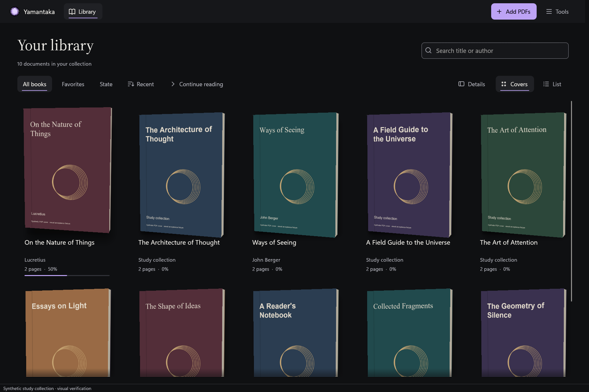

<p align="center">
  
</p>

# Yamantaka

**A private PDF library for reading and study on Windows.**

Yamantaka brings your documents into a personal library, keeps your reading context close, and stores your work locally. The native Rust rewrite pairs a gallery of physical 3D book covers with a focused PDF reader, warm paper environments, and a consistent desktop interface.

Choose **Reading options → Compare pages** to keep a reference beside your reading. Both panes provide navigation, bookmarks, search, text selection, and reading notes, with optional page, zoom, and position following. Workspaces retain the reference and view settings. See the [comparison guide](docs/user-guide/comparing-pdfs.md) for controls, export, and current limits.

Use **Details → Document connections** to connect companion readings, sources, attachments, and replacement editions. Incoming links show the original direction; removing a connection keeps both documents. Its **Revision groups** section collects editions and lets you choose the current member. The [connections guide](docs/user-guide/document-connections.md) describes the workflow and compatibility.

Use **Select** beside the library filters to choose several books, or Ctrl-click and Shift-click their covers or list rows. The menu can add or remove favorites, assign a tag, add or remove collection membership, archive the selected books, regenerate automatic covers, and remove books after confirmation. Regeneration can replace existing manual covers; later choices are preserved and the old image stays visible until its replacement is ready. Archive adds them to the existing or newly created **Archivado** collection. Selection stays within the current page of up to 80 books. In narrow windows, a checkbox icon opens the same actions. [Selection and bulk organization verification](docs/validation/rust-bulk-organization-2026-10-20.md) records organization behavior; [bulk cover verification](docs/validation/rust-bulk-cover-ui-2026-10-20.md) records confirmation and live cover replacement. **Remove from library** also appears in a book's context menu and through Delete. Removal deletes local notes, annotations, bookmarks, history and memberships without deleting the original PDFs. It cannot be undone. [Removal verification](docs/validation/rust-library-removal-ui-2026-10-20.md) records session saving, partial failure and reading recovery. Other readings remain accessible through **Tools → Open readings** and **Reopen last reading**.

Open **Tools → Reading queue** to reorder open readings, choose their review status, record a blocking reason or next action, and advance to the next pending reading. The queue survives restarting with the current reading context. [Reading queue checkpoint](docs/validation/rust-reading-queue-2026-10-22.md).

Open **Tools → Workspaces** to save the current readings under a name and recover them later. Each saved set retains its order, active reading, queue notes and reader context. The manager also supports renaming, duplication, updating from the current readings, setting the default flag and confirmed deletion. Existing Flutter workspace rows appear in the same manager. Updating or duplicating preserves their other stored settings, including split-pane references. [Saved workspace checkpoint](docs/validation/rust-workspaces-2026-10-22.md).

Saving a workspace now also records the current library filters, sort, grouping, cover size, list/cover choice and concentration mode. These apply after its reader opens successfully. While that workspace is open, changes to its reading queue, active document and concentration mode are saved automatically. Use **F8** or **Reading options → Focus mode** to hide the toolbar and navigator; F8 or the floating exit button restores them. The library sorting menu includes comfortable and compact cover sizes. [Workspace context checkpoint](docs/validation/rust-workspace-context-2026-10-22.md).

With **Restore last session** enabled, restarting also recovers the active workspace link when its saved revision and queue still match. Current reader positions are preserved. A first startup without a continuity file can open the default workspace; a deliberately empty saved session takes priority. If the workspace changed elsewhere, the current readings stay available without linking or overwriting it. **Undo deletion** in the workspace manager restores the last deleted workspace during the current session. Native reference settings are also saved with a workspace, including the PDF, page, position, zoom, divider and following options. While linked, comparison changes save after a short idle interval. Opening the workspace recovers its main reading before the reference; missing or cancelled reference openings preserve that reading. Enabled legacy Flutter split settings are adapted when no native comparison preference exists. Unsupported overlay settings remain preserved and are reported without blocking the main reading. Broader acceptance remains pending. [Legacy comparison checkpoint](docs/validation/rust-legacy-comparison-2026-10-22.md). [Saved comparison checkpoint](docs/validation/rust-workspace-comparison-2026-10-22.md). [Workspace recovery checkpoint](docs/validation/rust-workspace-recovery-2026-10-22.md).

Open **Tools → Tags** to rename tags, change their colors, merge them into another tag, or delete them. Merge and delete ask for confirmation. Books and notes are preserved, and selected library filters follow the saved changes. [Native tag-management verification](docs/validation/rust-tag-management-ui-2026-10-21.md) records the connected workflows and remaining acceptance.

Use **Group by** in the library's sorting menu to organize the current page by author, collection, tag or reading state. Fold individual groups in either cover or list view. Counts refer to the current page, and keyboard selection follows the visible books. The grouping choice is remembered. [Grouping verification](docs/validation/rust-library-grouping-2026-10-21.md) records the native behavior and remaining physical acceptance.

The native library renders PDF imagery on its 3D books and honors saved source-page choices, including manual selections copied from Flutter. Without a stored choice, it [scores the first six pages and saves an automatic selection](docs/validation/rust-automatic-cover-2026-10-13.md). Automatic choices are [rechecked against the detector version and catalogued source date](docs/validation/rust-cover-freshness-2026-10-15.md); manual choices retain priority. Open a document's details and choose **Choose cover** to preview another PDF page and save it as the cover. The original PDF stays unchanged. [Cover picker verification](docs/validation/rust-cover-picker-2026-10-13.md) records preview, saving, cancellation and recovery checks. A [bounded disk cache](docs/validation/rust-cover-cache-2026-10-13.md) reuses native cover pixels across worker restarts. Open **Settings → Storage** to calculate the disk space used by cover images and free that regeneratable cache. PDFs, metadata and chosen cover pages are preserved. [Cache maintenance verification](docs/validation/rust-cover-cache-maintenance-2026-10-19.md) covers native rendering during cache contention and the connected settings workflow. Live file-change invalidation of resident covers and small/large thumbnail parity remain pending.

The picker also includes **Restore automatic cover**, which recomputes a selection while keeping the saved choice until replacement succeeds. A newer choice or a failed write prevents replacement. [Restoration verification](docs/validation/rust-cover-restore-2026-10-13.md) records transaction, race, recovery and native presentation checks.

Cover loading shares the PDF worker with the reader. Verified cached pixels remain available while both reader slots are protected; native cover work can reclaim an unprotected warm slot. [Native admission verification](docs/validation/rust-cover-admission-2026-10-15.md) records those checks. The worker also [checks the requested path and source stamp before reusing a native handle](docs/validation/rust-cover-source-2026-10-15.md), preserving protected readers when a cover request targets a changed source.

Cover work preserves active background analysis handles. The coordinator retains waiting requests and retries them after confirmed releases, before admitting the next imported file. New manual choices retain priority, and waiting previews and restoration can be cancelled. [Capacity recovery verification](docs/validation/rust-cover-capacity-2026-10-16.md) and [coordination verification](docs/validation/rust-cover-coordination-2026-10-16.md) record native ownership, ordering, and recovery checks.

Cover requests now carry the displayed PDF source identity. Late results are rejected if the catalogue source or saved cover selection changed, and resident textures also check page count. [Source-check verification](docs/validation/rust-cover-source-2026-10-16.md) records native race and cancellation tests.

The reader uses a small first raster and retains it while refining after zoom or resize settles. Its navigator keeps the chosen width as content arrives, and background work no longer adds a processing row above the PDF. [Presentation verification](docs/validation/rust-reader-fluidity-2026-10-15.md) records native traces, tests and the remaining performance measurements.

New imports clean embedded title and author fields, then analyze text and layout on up to six opening pages in the background. Supported title blocks and explicit bylines can fill missing or rejected metadata. The detector joins aligned title lines and gives early cover evidence priority over later running headers. Conflicting accepted values remain saved proposals, with their source page and bounds. The original metadata stays available, and manual corrections retain priority. Each committed document becomes queryable before the batch finishes. [Title detection and reading refinements](docs/validation/rust-reading-refinement-2026-10-18.md) describes the current detector and validation scope.

New imports also save a full content reference, so later checks can detect changes anywhere in the PDF. Already registered paths reuse their document without repeating PDF analysis or replacing manual decisions. See [guarded import verification](docs/validation/rust-import-hash-2026-10-19.md).

Open a book's details and choose **Title and author** to review proposals or enter your own corrections. **Save changes** stores manual values that take priority over future extraction. You can dismiss suggestions or explicitly restore automatic values. The editor preserves the original PDF metadata and refuses to overwrite a newer review. [Metadata editor verification](docs/validation/rust-metadata-review-2026-10-16.md) includes native captures, transaction checks, and search updates.

**Analyze PDF again** refreshes the analysis in the background. It preserves accepted automatic values and manual corrections, presents conflicting text as proposals, and keeps the previous review if analysis fails. [Reanalysis verification](docs/validation/rust-metadata-reanalysis-2026-10-16.md) records native reader coexistence, source checks, rollback, and captures.

The editor now shows a real PDF reference beside your library values. **Compare page** reveals the evidence for a proposal. **Open page N in reader** checks the saved review and PDF source before opening that page, and **Back to metadata** returns to the editor. Unsaved drafts stay protected. Older evidence needs reanalysis before page links become available. [Metadata reference verification](docs/validation/rust-metadata-reference-2026-10-18.md) records source checks, navigation ownership, narrow layouts, and native captures.

If opening a reader interrupts background analysis, it resumes at the interrupted page after verifying the PDF source again. Changed files are rejected, and cancellation preserves the previous metadata review. [Resumption verification](docs/validation/rust-import-resumption-2026-10-18.md) records real reader-preemption, source-change, and cancellation tests.

No account is required. Documents and library data stay on your computer. The product is designed to operate without telemetry or network access during normal use.

> **Development status:** the Rust rewrite is in progress. It is not yet a replacement release. Flutter 0.15.0+16 remains the recoverable reference implementation. The [acceptance matrix](docs/architecture/rust-rewrite-parity.md) distinguishes verified behavior, partial implementations, and outstanding work.

<p align="center">
  
</p>

*Native Windows capture of an isolated synthetic study collection. The capture demonstrates the current gallery; it is not a photograph of a personal library or proof of complete feature parity.*

The library no longer reserves a full-width Continue reading strip. Resume sits beside the filters, or in the utility row on short windows. The reader uses a single quiet control row; zoom, fit and open readings remain in Reading options. See [the compact chrome checkpoint](docs/validation/rust-quiet-chrome-2026-10-18.md).

To import a folder, choose **Tools → Import folder…**. Yamantaka scans its subfolders in the background and feeds PDFs into the existing metadata and cover import flow. **Tools → Cancel import** stops remaining work. Already imported books stay saved. Folder links are excluded, and importing the same paths again preserves their document identities. See [folder import verification](docs/validation/rust-folder-import-2026-10-18.md).

Interrupted imports now appear under **Tools → Pending imports**. Choose **Resume** to continue or **Discard** to forget that job while keeping saved books. Recovery stores file selections or a folder root in a separate SQLite sidecar, with a checkpoint after each committed document. Startup leaves pending work paused. See [import recovery verification](docs/validation/rust-import-recovery-2026-10-18.md).

Open a book's details and choose **Check file** to inspect its current source in the background. The first successful check saves a full-content reference. Later checks can detect changes beyond the legacy partial fingerprint, mark a missing source and restore its availability when the same file returns. Manual metadata and reading data stay saved. See [file verification](docs/validation/rust-file-check-2026-10-19.md).

To check the whole library, choose **Tools → Check library files → Check now**. The background scan reports available, missing, changed, unverifiable and failed items. **Cancel check** keeps completed results. **Show missing** and **Show changed** filter the catalogue; **State → Modified files only** is also available later. The scan starts only when requested and adds no permanent progress bar. See [library file-check verification](docs/validation/rust-library-check-2026-10-19.md).

For a missing source, run **Details → Check file**, then **Locate PDF…**. Review the selected file and choose **Update location**. Saved full references require a complete SHA-256 match; older libraries with only a partial fingerprint show that limitation before confirmation. The existing document keeps its identity, reading data and manual choices. See [source relocation verification](docs/validation/rust-relocation-2026-10-19.md).

To check a possible duplicate, open a book's details and choose **Compare with another PDF**. Yamantaka compares the complete contents in the background using SHA-256. You can cancel the check; both originals remain unchanged. The result applies to that comparison and does not merge documents. [File comparison verification](docs/validation/rust-file-comparison-2026-10-18.md) describes the source guards and remaining duplicate-management work.

## The experience

- **An immersive library.** PDF-derived covers with connected boards, spines, page blocks and a damped response to the pointer. Six procedural cover families provide a fallback when an image is unavailable. Reduced motion retains a static volume.
- **A practical catalogue.** Cover and list views, title and author search, favorites, reading-state and missing-file filters, stable sorting, and pages of up to 80 documents. A document inspector preserves the width of the gallery.
- **A reader built around the document.** Native PDFium rendering, GPU presentation, page navigation, fit-to-page and fit-to-width, zoom, rotation, margins, page text, canonical history, and positions A/B. Single, facing and virtualized continuous layouts are connected through the canonical navigation model. Six reading environments are stored per document.
- **Protected reading.** Already catalogued password-protected PDFs have a masked, transient password prompt with retry and cancellation. Credentials are never saved; protected-file import is still pending.
- **Search inside a PDF.** Open **Navigator → Find** or press **Ctrl+F**. Contextual results, case and whole-word options, cancellation, rotated highlights and **F3/Shift+F3** navigation are connected. Empty results distinguish an absent phrase from a PDF without extractable text.
- **Local full-text search.** Explicit opt-in, resumable indexing, filters, ranked snippets and page navigation, with pause, stop, exclusion, rebuilding and erasing controls. Open it from **Tools → Global search** or **Ctrl+Shift+F**.
- **Page previews.** Open **Navigator → Pages** to browse rotated previews and return to a page. Visible previews share the reader's PDF worker and memory budget.
- **PDF contents.** Open **Navigator → Contents** to explore chapters, fold branches and jump to the page, position and view specified by the PDF.
- **Bookmarks for study.** Open the reader's **Navigator → Bookmarks** to save a page, edit its label, remove it or return to a passage. Existing named bookmarks keep their labels when a page is saved again. Label changes update the local search index when indexing is enabled.
- **A coherent desktop interface.** Dark graphite and warm ivory themes, functional violet accents, local Segoe UI Variable typography, custom controls, visible keyboard focus, Spanish and English surfaces, reduced motion, and text enlargement.
- **Independent storage.** A separate Rust library, versioned atomic preferences, and compatibility adapters for historical data. The Flutter installation remains a fallback during the transition.

These describe connected portions of the current implementation. Automatic and manual cover images, complete reader interaction acceptance, annotations, organization, continuity, broader search acceptance, and recovery flows still have outstanding acceptance work. See the matrix before relying on a capability.

## Platform

| Item | Target |
| --- | --- |
| Operating system | Windows 10 / 11 |
| Architecture | x64 |
| Presentation | Native Rust; egui/eframe, wgpu and AccessKit |
| PDF engine | PDFium 7881 through pdfium-render |
| Storage | SQLite with FTS5 through rusqlite |
| Interface languages | Spanish and English |
| Active product scope | Local PDF reading and study on Windows |

Android, iOS and web directories belong to the historical Flutter project. They are not targets of the active rewrite. Printing, OCR, encrypted backups and secondary reader windows are proposals or contracts, not completed Rust features.

## Run the development build

The following commands are for **development**, not for installing a finished release.

You need Windows x64, the Microsoft C++ build tools required by Rust's MSVC target, and Rust installed through rustup. The repository pins Rust 1.97.1 in `rust-toolchain.toml` and dependency versions in `Cargo.lock`.

```powershell
# From the repository root
cargo build -p yamantaka --locked
./tool/fetch_rust_pdfium.ps1
./target/debug/yamantaka-rust.exe
```

The PDFium fetch script downloads and verifies the pinned native dependency. Dependency setup may use the network; that is separate from normal application use.

To open a document from the command line:

```powershell
./target/debug/yamantaka-rust.exe "C:\Books\Example.pdf"
```

The default compositor uses DirectX 12. A separately checked OpenGL route is available:

```powershell
./target/debug/yamantaka-rust.exe --opengl
```

A finished Release bundle must include `pdfium.dll` beside the executable. Do not copy only the executable out of a bundle. The final bundle, hashes, SBOM, notices and installation instructions will be added after the parity and validation gates pass.

### Development storage

Frozen verification executables accumulate independently of the application and
its document caches. Inspect obsolete copies with:

```powershell
./tool/prune_rust_checkpoints.ps1
```

Add `-Apply` to remove the reviewed candidates. The tool retains the newest two
checkpoint executables and every running Yamantaka executable. It only considers
untracked `yamantaka-*.exe` files directly inside `build/verification`; source,
PDFs, databases, demo stores and compiler dependencies are outside its scope.
Run it on the Windows host so process paths can be inspected.
[Cleanup verification](docs/validation/rust-checkpoint-cleanup-2026-10-19.md)
records the executed cleanup and its limits.

### Isolated visual collection

Generate the synthetic PDF corpus with Python and the `reportlab`, `Pillow` and `pypdf` packages, then open the demo:

```powershell
python ./tool/create_rust_pdf_fixtures.py
python ./tool/create_rust_metadata_fixtures.py
./target/debug/yamantaka-rust.exe --demo
./target/debug/yamantaka-rust.exe --demo --light
./target/debug/yamantaka-rust.exe --demo --reader
./target/debug/yamantaka-rust.exe --demo --demo-window
```

`--demo-window` opens an independent synthetic preview while an existing demo remains open.

The demo uses synthetic documents and does not open the personal library. Interactive desktop previews and selected capture scenarios use isolated file-backed stores; other demo modes use an in-memory database. It currently depends on the repository's generated fixtures and is a development tool.

## Data and migration

Open **Settings → Storage → Export JSON backup** to save the current library data and settings as a v9 JSON file. Choose a destination outside the Rust data folder. Export runs in the background and can be cancelled; a failed or cancelled operation preserves an existing destination. PDFs are not included. The saved result offers **Show in folder**. See [backup export verification](docs/validation/rust-backup-ui-2026-10-21.md) for its checked behavior and limits.

To restore, choose **Settings → Storage → Restore JSON backup**, review the version and record counts, then choose **Restore and close**. Yamantaka prepares the data in the background, closes its readers, and installs the backup. It retains the previous library in a safety directory and shows that location on completion. Reopen Yamantaka to use the restored library. A changed backup requires another review. Manual rollback and recovery controls for ambiguous interrupted operations remain pending; see [restoration and recovery verification](docs/validation/rust-restore-ui-2026-10-22.md).

The rewrite must preserve identifiers, relationships, progress, annotations, manual corrections, cover decisions, workspaces, sessions and automation journals. Originals are never PDF editing targets.

| Data | Compatibility contract |
| --- | --- |
| Main database | Preserve SQLite schema v11; migrate historical schemas v1–v11 |
| JSON backups | Import versions v1–v9; retain version 9 export |
| Flutter preferences | Capture separately from SQLite, including unknown keys |
| Rust preferences | Versioned JSON, written atomically |
| Initial import | Independent, explicit, idempotent and fail-closed |
| SQLite capture | WAL-coherent backup; never just copy an open main database file |
| Exact duplicate detection | Full SHA-256 verification; inherited partial fingerprints alone are insufficient |

Compatibility tests cover populated historical schemas and backup contracts. The native import assistant now reviews and creates an independent copy, then lets you choose it for the next launch. Complete recovery and acceptance with real Flutter installations remain pending.

To import a Flutter library in the development build:

1. Open **Settings → Storage → Import from Flutter**.
2. Choose the Flutter SQLite database and its `shared_preferences.json` file. Portable Flutter databases live in `data`; their preferences still live in the Windows application-data location.
3. Close Flutter and select **Review source**. Check the book, note, bookmark, collection, tag, and setting counts.
4. Select **Create independent copy**. Wait for the checked-copy result, then select **Use next launch**.
5. Close and reopen Yamantaka. The current session keeps its existing library until restart.

Choose **Use original** before restarting to undo the pending selection. After restarting, **Settings → Storage → Use original Rust library next launch** returns to the original Rust store on the following launch. Both copies remain on disk. Imports preserve PDF locations rather than duplicating the PDFs. Review the [native import verification and remaining limits](docs/validation/rust-migration-ui-2026-10-21.md) before using personal data.

Rust uses independent installed and portable data locations. It does not synchronize changes back to Flutter. See [the acceptance matrix](docs/architecture/rust-rewrite-parity.md) for the precise implemented boundaries and [historical Flutter documentation](docs/architecture/flutter-readme-v015.md) for the incumbent workflows.

## Architecture

The workspace keeps presentation, persistence and native rendering separate:

| Crate | Responsibility |
| --- | --- |
| `yamantaka-domain` | Typed contracts, persisted semantics, canonical navigation, reader geometry and memory accounting |
| `yamantaka-application` | Commands, events, cancellation, actor runtime and incremental indexing coordination |
| `yamantaka-storage` | SQLite repositories, historical migrations, backups, preferences and FTS5 |
| `yamantaka-pdf` | Serialized PDFium worker, prioritized tickets, bounded caches and native rendering |
| `yamantaka-windows` | Paths, native activation, clipboard, Explorer and Windows integration |
| `yamantaka` | Desktop composition, custom controls, physical covers and GPU page presentation |

UI components dispatch commands and receive state. They do not execute SQL or call PDFium directly. Native PDF handles remain on one worker; GPU resources have explicit lifetimes. Initial global category limits are 72 MiB for pages, 24 MiB for tiles and 8 MiB for text. Complete live-resource coverage and device-loss recovery remain acceptance tasks.

## Validation

The current Rust suite contains 55 essential tests, following a reduction from 536 at the owner's request. It retains migration, backup, rollback, original-file, native cancellation, password, rendering, and metadata checks. Older checkpoint reports record the larger suites that existed on their dates. Removed tests remain recoverable in Git. Run the retained checks for the affected work; large capture matrices are not part of every edit.

Run the Rust checks from the repository root:

```powershell
cargo fmt --all --check
cargo clippy --workspace --all-targets --locked -- -D warnings
cargo test --workspace --locked
```

Generate the PDF fixtures and fetch PDFium first to run the native PDF suite. Tests exercise text, vectors, scanned pages, passwords, damage, intrinsic and requested rotation, mixed page sizes, tiles and documents of 5,000 pages. Storage tests cover historical schemas, populated relationships, backup formats, cancellation and rollback. Native Windows tests cover second-process activation and Unicode paths.

Current evidence is documented separately so dates and scopes remain explicit:

- [Acceptance matrix](docs/architecture/rust-rewrite-parity.md): the source of truth for completion.
- [Guarded shared-tag storage](docs/validation/rust-tag-management-storage-2026-10-21.md): rename, color, merge and deletion preserve identities and associations through guarded transactions, including cached search refresh and rollback. The [native tag manager](docs/validation/rust-tag-management-ui-2026-10-21.md) now connects editing, confirmation and filter reconciliation. Physical interaction and broader recovery acceptance remain pending.
- [Library removal storage](docs/validation/rust-library-removal-storage-2026-10-20.md): document-owned rows and cached FTS entries can now be removed in one rollback-safe transaction while original PDFs and shared organization data remain intact. The [actor coordinator](docs/validation/rust-library-removal-runtime-2026-10-20.md) closes readers before deletion, reports closures separately from removed records and rejects stale openings. The [native removal flow](docs/validation/rust-library-removal-ui-2026-10-20.md) now connects confirmation, session saving, presentation/continuity reconciliation, cancellation and partial outcomes. Physical interaction and broader concurrency acceptance remain pending.
- [Bulk cover runtime](docs/validation/rust-bulk-cover-runtime-2026-10-20.md): the actor now coordinates bounded automatic-cover regeneration with frozen decision revisions, protected-reader waits, cancellation and partial results. The [native selection-menu flow](docs/validation/rust-bulk-cover-ui-2026-10-20.md) now connects confirmation, progress/cancellation and retained-image refresh, including recovery after governed GPU capacity returns.
- [Bulk library organization](docs/validation/rust-bulk-organization-2026-10-20.md): assign shared tags, add/remove collection membership and archive a fixed page selection. Destination pickers search and paginate, keep cancellation visible, and preserve complete accessible names when long labels are shortened. Reviewed library removal and automatic cover regeneration are now connected separately.
- [Native Flutter import](docs/validation/rust-migration-ui-2026-10-21.md): source selection, reviewed independent copies, cancellable background work, next-launch activation, and return to the original store. Eight synthetic native captures and isolated production portable startups verify the connected flow; real-installation and recovery acceptance remain pending.
- [Reviewed Flutter migration storage](docs/validation/rust-migration-review-2026-10-21.md): frozen source summaries, guarded confirmation, cancellable WAL snapshots, and receipts that verify copied preferences and logical records.
- [Streaming backup export](docs/validation/rust-backup-streaming-2026-10-21.md): row-by-row v9 output, incremental category hashes, complete file-size limits, cancellation, and atomic replacement preserving existing backups on failure. The subsequent native export checkpoint connects export; restore and recovery controls remain pending.
- [Native backup export](docs/validation/rust-backup-ui-2026-10-21.md): Storage connects the native save dialog, read-only background export, cancellation, saved result, and folder reveal. The later restoration checkpoint connects restore separately.
- [Native backup restoration](docs/validation/rust-restore-ui-2026-10-22.md): reviewed JSON restoration, cancellable preparation, installation after reader shutdown, safety-copy preservation, and recovery of interrupted directory swaps. Manual rollback and ambiguous recovery controls remain pending.
- [Native collections](docs/validation/rust-collections-ui-2026-10-19.md): Tools → Collections supports creation, search, pinning, renaming and reviewed deletion. Its collection action menu also offers **Move earlier**, **Move later** and **Change icon**. Moves follow the full pinned or unpinned group, including collections outside the current search or page. Organize a book from its details, then use View books to filter the library. [Order and icon verification](docs/validation/rust-collection-order-2026-10-20.md) covers atomic movement, inherited rank ties, persistence and compact native controls; selected books can now be added or removed through the library selection menu.
- [Smart library views](docs/validation/rust-smart-views-2026-10-19.md): the State menu includes the eight Flutter views, including annotated/bookmarked PDFs and the last 14 days. Views combine with catalogue filters and keep bounded paging.
- [Library filter recovery](docs/validation/rust-library-filters-2026-10-19.md): empty filtered results show a reset action. Both reset controls clear every filter category and return to the first page while preserving sort order.
- [Native tags](docs/validation/rust-tags-ui-2026-10-19.md): Tools → Tags supports creation, search and multi-tag library filters. Organize tags from a book's details to assign/remove them or create and assign atomically. Annotation memberships are preserved; [rename, color, merge and reviewed deletion](docs/validation/rust-tag-management-ui-2026-10-21.md) now connect guarded actor writes, selected-filter reconciliation and view invalidation. The library selection menu also supports document tag assignment in bulk.
- [Front-matter metadata evidence](docs/validation/rust-front-matter-2026-10-15.md): bounded text and geometry analysis with real PDFium tests for titles, explicit authors, conflicts, logos, and rotations.
- [Background import analysis](docs/validation/rust-import-analysis-2026-10-16.md): native import persists evidence and proposals atomically, validates the source revision, and refreshes the catalogue after each commit. Reader requests take priority over analysis.
- [Native metadata review](docs/validation/rust-metadata-review-2026-10-16.md): review proposals, save manual title and author corrections, dismiss suggestions, or restore automatic values. Scoped replies, stale-review rejection, transactional search updates, and seven synthetic native captures verify this flow.
- [Native metadata reanalysis](docs/validation/rust-metadata-reanalysis-2026-10-16.md): rerun bounded analysis from the editor while preserving accepted values, manual corrections, and the previous result on failure. Native storage and actor tests plus five synthetic captures verify the connected flow.
- [Flutter baseline](docs/validation/flutter-baseline-2026-10-08.md): 330 tests and analysis executed on the reference implementation.
- [Native gallery and settings validation](docs/validation/rust-visual-stage2.md): captures, control bounds and the bounded visual review.
- [Protected reading validation](docs/validation/rust-password-opening-2026-10-09.md): ephemeral credential ownership, real PDFium retry tests and five native captures.
- [Bookmark persistence validation](docs/validation/rust-bookmark-repository-2026-10-09.md): legacy identity, transactional edits, pagination and responsive actor commands. The [connected bookmark panel validation](docs/validation/rust-bookmark-ui-2026-10-09.md) covers reader integration and current limits.
- [Bookmark search validation](docs/validation/rust-bookmark-search-2026-10-09.md): atomic updates, consent, exclusion and search results during native work.
- [Canonical reader anchor validation](docs/validation/rust-reader-anchors-2026-10-09.md): horizontal pan, rotation, history and A/B marks share a two-dimensional position. Interactive acceptance and persisted scroll contexts remain pending.
- [Native external-link dialog](docs/validation/rust-external-links-native-2026-10-09.md): four confirmation/rejection captures, fixed compact action layout and aggregate URI-budget recovery. Windows handler acceptance remains pending.
- [Modal keyboard isolation](docs/validation/rust-modal-shortcuts-2026-10-09.md): password and external-link dialogs block reader/search shortcuts, with three production egui input regressions. OS keyboard and accessibility acceptance remain pending.
- [Native text geometry](docs/validation/rust-text-geometry-2026-10-09.md): bounded Unicode character selection and normalized geometry on the PDFium worker, with six tests. Pointer selection is now connected in the checkpoint below; keyboard selection and annotation integration remain pending.
- [Connected page-text panel](docs/validation/rust-text-panel-2026-10-09.md): asynchronous actor routing, governed Text-tab results, cancellation/retry and four native captures. The pointer selection checkpoint below connects PDF-range interaction; annotation interaction and OS clipboard acceptance remain pending.
- [Cross-page selection semantics](docs/validation/rust-text-selection-2026-10-09.md): ordered Unicode passages, explicit geometry coverage and governed copies, checked with domain tests and real PDFium results. The pointer interaction checkpoint below now uses this contract; keyboard selection remains pending.
- [Reader pointer selection](docs/validation/rust-reader-selection-2026-10-09.md): native drag selection, rotated region display, shared asynchronous text snapshots and passage-copy output, with four UI tests and five native captures. Keyboard/grapheme selection, OS clipboard and annotation acceptance remain pending.
- [Keyboard selection](docs/validation/rust-selection-keyboard-2026-10-09.md): focused-page grapheme/word movement, extended ranges, page selection and copy/Escape routing, checked with three UI regressions and three native keyboard captures. Visual bidirectional/vertical and multi-page acceptance remain pending.
- [Selection annotation drafts](docs/validation/rust-annotation-drafts-2026-10-09.md): governed draft preparation, normalized glyph regions, explicit page-note fallback and Unicode context, checked with four domain regressions and real PDFium results. Editor and persistence integration remain pending.
- [Annotation repository](docs/validation/rust-annotation-repository-2026-10-09.md): paged governed snapshots, atomic edits/review/tags, exact restoration and consented FTS updates, checked with seven SQLite regressions including all eleven historical schemas. Actor, editor, painted marks and export integration remain pending.
- [Annotation actor](docs/validation/rust-annotation-actor-2026-10-09.md): owned commands and scoped replies through the application worker, checked with three SQLite integration regressions for held PDF work, cancellation, fallback confirmation, queue admission and memory release. Editor, painted marks, global review and exports remain pending.
- [Connected annotation editor](docs/validation/rust-annotation-editor-2026-10-09.md): single-page passage creation, explicit geometry fallback, note editing/review/removal and painting of loaded records, checked with three controller regressions and four native captures. Multi-page creation, full paint coverage, tag/global-review/export interfaces and broader interaction acceptance remain pending.
- [Atomic annotation batches](docs/validation/rust-annotation-batches-2026-10-09.md): governed per-page drafts and transactional creation through the actor, checked with three storage regressions and one application test. Multi-page editor integration and native interaction acceptance remain pending.
- [Multi-page annotation editor](docs/validation/rust-annotation-multi-editor-2026-10-09.md): complete selection snapshots, joined previews and atomic per-page creation, checked with two domain regressions, another SQLite-backed editor test and two native captures. Cross-page pointer/autoscroll and broader interaction acceptance remain pending.
- [Page notes without selection](docs/validation/rust-page-note-editor-2026-10-09.md): page-bound note creation without text extraction, checked with two domain regressions, actor and editor integration tests, and two native scanned-PDF captures. Full paint coverage, mutation history, tags, global review and exports remain pending.
- [Visible-page annotation geometry](docs/validation/rust-annotation-paint-2026-10-09.md): complete attached-page geometry independent of the 80-row Notes list, checked with SQLite, actor and cache regressions plus three native captures. Large annotation-page performance, intrinsic/directional placement and the remaining review/export interfaces still need acceptance.
- [Annotation tags in the editor](docs/validation/rust-annotation-tags-2026-10-09.md): create, preserve, replace and clear tags with atomic note/search updates, checked by SQLite, actor and editor regressions plus five native captures. Tag filters, bulk actions, global review and exports remain pending.
- [Incremental annotation export writer](docs/validation/rust-annotation-export-writer-2026-10-10.md): compatible JSON and Markdown formatting with UTC dates, borrowed records and failure handling, checked with five regressions including 181 SQLite records. Coherent traversal, actor routing, the save dialog and atomic file publication remain pending.
- [Coherent annotation export traversal](docs/validation/rust-annotation-export-snapshot-2026-10-10.md): one read transaction streams all records to the export writer, checked against concurrent WAL changes, callback failure, cancellation and historical schemas. Actor routing, native save and atomic publication remain pending.
- [Atomic creation of annotation export files](docs/validation/rust-annotation-export-publication-2026-10-10.md): staged, synchronized publication preserves occupied destinations and discards failed or cancelled output, checked by six storage/application regressions. Native save, actor routing and explicit replacement remain pending.
- [Independent annotation export worker](docs/validation/rust-annotation-export-worker-2026-10-10.md): scoped requests use a separate read-only SQLite connection and a cancellable worker, checked by five lifecycle/storage/runtime regressions. Native save, progress and export controls remain pending.
- [Reader annotation export controls](docs/validation/rust-annotation-export-controls-2026-10-10.md): Notes now routes Markdown/JSON through a native save selector and the export worker, with scoped completion, cancellation and recovery states. Four native captures and three hashed 181-record files verify the connected save path; actual dialog interaction, replacement and compact keyboard/scrolling acceptance remain pending.
- [Governed and cancellable export output](docs/validation/rust-annotation-export-output-2026-10-10.md): a globally accounted 64 KiB buffer groups formatter fragments and checks cancellation within large records. Seven output/file regressions verify exact Unicode bytes, partial-write handling, cleanup and memory-denial retry. A further SQLite-backed regression preserves legacy line boundaries in Markdown and original text in JSON; OS write latency and complete resource acceptance remain pending.
- [Reader annotation filters](docs/validation/rust-annotation-filters-2026-10-10.md): combine text, tag, mark kind and review state with cancellable reads and Reset. SQLite/controller regressions and five native captures verify 20 matching notes, all 181 visible marks and complete-document export. Global/bulk review and physical interaction acceptance remain pending.
- [Bulk annotation review](docs/validation/rust-annotation-bulk-review-2026-10-10.md): select notes on the current list page and atomically mark them pending, accepted or resolved. SQLite/controller regressions and five native captures verify scoped selection, rollback, filtered refresh and unchanged PDF marks. The Notes controls also use less vertical space; bulk tagging and cross-document review remain pending.
- [Bulk annotation tags](docs/validation/rust-annotation-bulk-tags-2026-10-10.md): add one tag to selected notes while preserving existing tags, with atomic rollback and Unicode character validation. Two SQLite-backed regressions and three native captures verify deduplication, recovery and tagged JSON export. Cross-document review and physical interaction acceptance remain pending.
- [Annotation transactions across documents](docs/validation/rust-global-annotation-batches-2026-10-10.md): typed targets support atomic global review/tag mutations, consented index refresh and governed results through the actor. Four SQLite regressions and a held-PDF runtime test verify rollback and cancellation. The global review screen remains pending.
- [Global library notes](docs/validation/rust-global-notes-screen-2026-10-10.md): review notes across documents in a list/detail screen, combine filters, page through results and open the source PDF. Three storage and three UI regressions plus seven native captures verify ordering, scoped actions, recovery and navigation. Compact keyboard/scrolling, physical accessibility and further visual refinement remain pending.
- [Global review export writer](docs/validation/rust-annotation-review-export-writer-2026-10-10.md): preserve the legacy 80-note review envelope and grouped Markdown through the existing governed formatter. Four regressions cover compatibility, invalid identities, cancellation and memory release. Storage, worker and global-screen integration remain pending.
- [Coherent review export snapshots](docs/validation/rust-annotation-review-snapshot-2026-10-10.md): capture the filtered notes and canonical catalogue metadata together, then export their immutable values with governed memory. Three SQLite regressions and a writer integration test verify paging, manual corrections, recovery and frozen output. Worker and global save controls remain pending.
- [Global review export worker](docs/validation/rust-annotation-review-worker-2026-10-10.md): route typed review requests through the independent worker and safe publication path. A held-PDF runtime test verifies filtered pages, both formats, metadata, request scope, cancellation and failure cleanup. Global save controls and native interaction evidence remain pending.
- [Global notes save controls](docs/validation/rust-global-notes-export-controls-2026-10-10.md): save the current filtered review page as Markdown or JSON through the native selector and shared cancellable export state. Four native captures verify 80-note global files and an unchanged 181-note complete reader export. Physical dialog and compact interaction acceptance remain pending.
- [Monotonic reading activity](docs/validation/rust-reading-activity-2026-10-10.md): count qualifying visible reading time without a periodic UI timer. Four domain regressions verify inactivity, hidden intervals, fractional time and the legacy duration limit. Session persistence, history and reader lifecycle integration remain pending.
- [Atomic reading session storage](docs/validation/rust-reading-session-storage-2026-10-10.md): preserve the legacy session table and context key, with retryable commands and one transaction for completion/context updates. Four SQLite regressions verify rollback, unknown fields, validation and all eleven historical schemas. Actor, reader lifecycle and history interfaces remain pending.
- [Reading session actor routing](docs/validation/rust-reading-session-actor-2026-10-10.md): bounded session commands return scoped success, cancellation and failure replies. A file-backed SQLite integration test verifies persistence while a native PDF open remains held. Reader recording, lifecycle completion and history interfaces remain pending.
- [Reading session lifecycle and persistence barrier](docs/validation/rust-reading-session-lifecycle-2026-10-10.md): retain closures across document switches and failed writes, freeze activity/context for retry, and persist recovery pairs independently of saturated UI events. Reader event wiring, recording preferences, exit integration and crash recovery remain pending.
- [Reader sessions and recording privacy](docs/validation/rust-reader-session-integration-2026-10-10.md): the native reader now records qualifying activity, live context and completed sessions through the actor, with a privacy control and close persistence barrier. Five native captures verify the revised privacy layout and enabled/disabled SQLite recording. History, crash recovery and broader physical acceptance remain pending.
- [Reading history retention](docs/validation/rust-reading-history-retention-2026-10-10.md): configure the completed-session limit in Privacy and atomically remove old rows with their context. Open readings and unknown metadata survive. SQLite regressions and a saturated-actor recovery test verify rollback and retention; history presentation and broader acceptance remain pending.
- [Governed reading history queries](docs/validation/rust-reading-history-query-2026-10-10.md): read completed sessions in immutable 80-row pages with canonical document metadata and preserved context objects. SQLite and actor regressions verify filtering, memory admission/release and scoped replies while PDF work is held. History presentation and restoration remain pending.
- [Native reading journal](docs/validation/rust-reading-history-ui-2026-10-10.md): Tools now exposes paginated completed sessions, selected-reading details and canonical opening at the saved page. Two state regressions and five native captures verify scoped reads, memory release, themes, paging and the compact layout. Full context restoration and physical interaction acceptance remain pending.
- [Reading context adapter](docs/validation/rust-reading-context-adapter-2026-10-10.md): decode historical context defaults and validated zoom/layout/mode/theme/scroll/panel values into a restoration plan without changing the original data or unrelated document preferences. Five regressions cover compatibility and invalid/future fields. Native plan application remains pending.
- [Connected reading restoration](docs/validation/rust-reading-restoration-ui-2026-10-10.md): restore a supported journal context through canonical opening, scoped preference loading and a one-shot viewport offset. Three state regressions and six native captures verify the connected path, invalid-context fallback and exact restored values. Broader physical/race/layout acceptance remains pending.
- [Individual session deletion](docs/validation/rust-reading-session-deletion-2026-10-10.md): remove a completed journal entry and its context atomically, preserving unfinished readings and unrelated metadata. Seven regressions and five native captures verify scope, retry/rollback and independent SQLite results. Broader physical/error/concurrency acceptance remains pending.
- [Native reading goals](docs/validation/rust-reading-goals-2026-10-11.md): edit optional page/minute targets from the book inspector, retain imported metadata and confirm writes through scoped actor replies. Ten regressions and native captures check persistence, rollback and the compact editor. Physical interaction and broader continuity acceptance remain pending.
- [Reader tab controller](docs/validation/rust-reader-tabs-core-2026-10-11.md): verified domain transitions for twelve tabs, independent reading context, pinned closures, reordering and a ten-entry reopen stack. Native selection, individual and bulk closure, and reopening are connected in the checkpoints below. Persistence remains pending.
- [Scoped native reader closure](docs/validation/rust-reader-close-2026-10-11.md): close replies retain their document/request identity and native outcome, reject late opening races and keep failed closures recoverable. Actor regressions and real PDFium closure verify the contract used by the individual and bulk tab controls below. Persisted-history integration remains pending.
- [Reader preservation during opening](docs/validation/rust-reader-opening-2026-10-11.md): failed or cancelled replacement retains the current reader; password retries and historical restoration use independent request scopes. Native captures and 387 workspace tests pass, with compact error-layout and persistence still pending.
- [Native reader tab selection](docs/validation/rust-reader-tabs-ui-2026-10-11.md): connected selection, duplicate context, pinning, reordering and keyboard cycling with scoped native admission. All 392 workspace tests and seven final-source native captures pass; persistence and physical interaction remain pending.
- [Native tab closure and reopening](docs/validation/rust-tab-closure-2026-10-11.md): scoped last/inactive closure, adjacent-reader handoff, full-context reopening and keyboard commands. Verified with 396 workspace tests, nine native captures and a completed synthetic reading session; persistence and physical acceptance remain pending.
- [Bulk reader tab closure](docs/validation/rust-bulk-tab-close-2026-10-11.md): Close others/Close to right preserve pinned readings and retire unused native documents through a bounded serial queue with scoped retry. Verified with 399 workspace tests and eight native captures; persistence, warm-resource policy and physical acceptance remain pending.
- [Reader continuity storage](docs/validation/rust-reader-continuity-storage-2026-10-11.md): The storage checkpoint verifies a separate versioned JSON adapter for complete open/closed tab contexts and non-destructive rejection of incompatible snapshots. Subsequent application integration is covered in the next checkpoint.
- [Library reading feature](docs/validation/rust-library-feature-2026-10-11.md): A larger physical reading feature and editorial library heading begin the next visual pass. Scoped continuity persistence and startup opening are now connected; real restart/recovery acceptance and legacy closure import remain pending.
- [External PDF link confirmation](docs/validation/rust-external-pdf-links-2026-10-09.md): bounded http/https/mailto destinations, redacted diagnostics and an explicit Windows opening dialog. Native modal and external-handler acceptance remain pending.
- [Bounded PDF URI reading](docs/validation/rust-bounded-pdf-uri-2026-10-09.md): verified local PDFium wrapper patch checks URI size before allocation. External link confirmation remains pending.
- [Native internal link presentation](docs/validation/rust-pdf-links-native-2026-10-09.md): five GPU captures of focus, rotation, compact text scaling and keyboard navigation from page 1 to page 2. Broader interaction and external links remain pending.
- [Native PDF link extraction](docs/validation/rust-pdf-links-extraction-2026-10-09.md): bounded asynchronous internal destinations and separate active regions, tested with real PDFium and nonblocking actor routing. Internal reader regions and visible-page cancellation are implemented; native interaction acceptance and external link confirmation remain pending.
- [Shared PDF contracts](docs/validation/rust-pdf-shared-contracts-2026-10-09.md): canonical destination interpretation, crop conversion and normalized rectangle rotation shared by contents and search. Clickable PDF links remain pending.
- [PDF search text availability](docs/validation/rust-find-text-presence-2026-10-09.md): distinct no-match and no-extractable-text states, complete-scan evidence and real textual/scanned/5,000-page tests.
- [Connected PDF search panel](docs/validation/rust-pdf-find-ui-2026-10-09.md): contextual result batches, canonical navigation, wrapping, rotated highlights and native dark/light/compact captures. Broader interaction and performance acceptance remain pending.
- [Document-wide PDF search coordination](docs/validation/rust-document-find-2026-10-09.md): bounded cross-page batches, exact continuation, coalesced progress and real 5,000-page traversal. The connected reader presentation has separate validation below.
- [Native PDF page-search foundation](docs/validation/rust-pdf-find-runtime-2026-10-09.md): bounded Unicode matches, normalized geometry, cancellation and actor responsiveness. The connected reader interface has separate validation above.
- [Reader thumbnail validation](docs/validation/rust-thumbnails-2026-10-09.md): prioritized previews, independent cancellation, native presentation and navigation to page 5,000.
- [Native contents-panel validation](docs/validation/rust-outline-ui-2026-10-09.md): chapter hierarchy, bounded presentation, destination jumps and PDFium binding reuse.
- [Shared page geometry validation](docs/validation/rust-page-geometry-2026-10-09.md): crop and rotation coordinates travel with each page size, with shared memory ownership and viewport-to-PDF conversion.
- [PDF destination resolution validation](docs/validation/rust-destination-resolution-2026-10-09.md): coordinates, zoom and fitting are resolved in the domain. The connected reader applies these results; broader interactive acceptance remains pending.
- [Native outline validation](docs/validation/rust-outline-runtime-2026-10-09.md): Unicode hierarchy, internal destinations, crop and rotation coordinates, cancellation and shared memory ownership. The outline tab remains pending.
- [Search-controller validation](docs/validation/rust-search-controller-2026-10-09.md): cancellation, durable resume, exclusions and nonblocking native boundaries.
- [Search actor validation](docs/validation/rust-search-runtime-2026-10-09.md): consent, native slot handoff, responsive catalogue queries and shutdown. See the [connected search interface validation](docs/validation/rust-search-ui-2026-10-09.md) for native captures and current scope.
- [Native page-resource validation](docs/validation/rust-native-page-resources.md): GPU readback, allocation, retirement and scoped rendering evidence.

Catalogue measurements cover synthetic libraries of 5,000, 25,000 and 100,000 documents. They do not establish a complete performance advantage over Flutter. Paired startup, UI/GPU, PDF, CPU, memory and closure measurements are still required.

Physical DPI certification at 100/125/150/175/200%, Narrator, multiple monitors, the complete offline application smoke and all critical-flow captures remain pending. Automated tests and synthetic screenshots do not replace those checks.

Before publishing a development checkpoint, review the staged files:

```powershell
python ./tool/check_public_checkpoint.py --staged
```

This guard checks exact Git blobs and synthetic capture metadata for recognized private paths, contacts, credentials and unexpected data files. It complements human review; it does not establish complete privacy certification.

## Project documentation

- [Product brief](PRODUCT.md)
- [Design system](DESIGN.md)
- [Visual contract](docs/architecture/rust-visual-contract.md)
- [Memory plan and implemented boundaries](docs/architecture/rust-live-memory-plan.md)
- [Contribution guide](CONTRIBUTING.md)

Third-party software and font notices remain with their respective components. The final Release bundle must include a complete license inventory and SBOM. No finished Rust release or distribution-signing status is claimed by this README.
