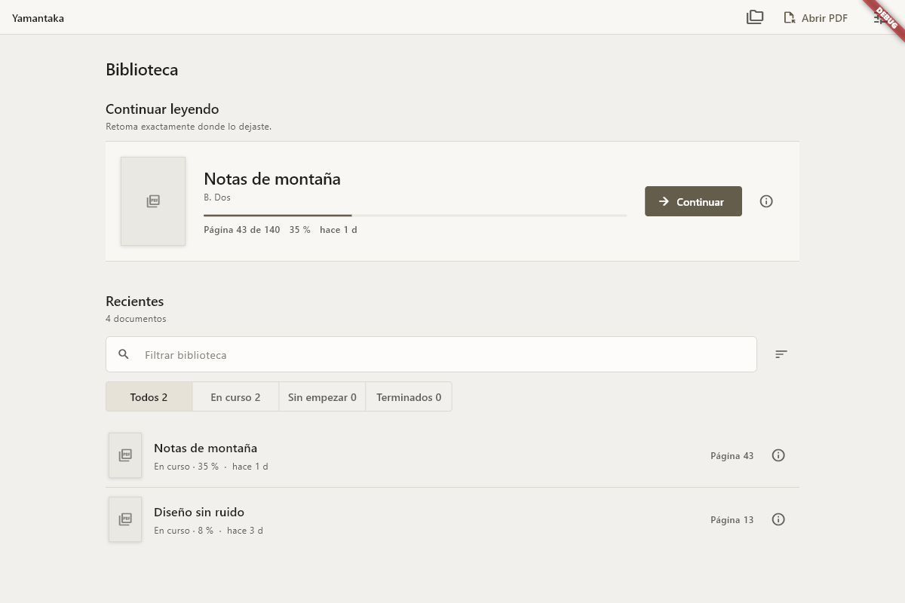
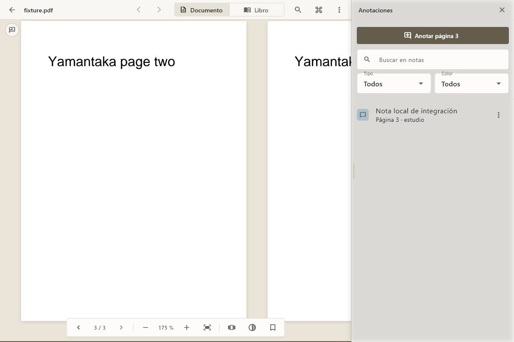
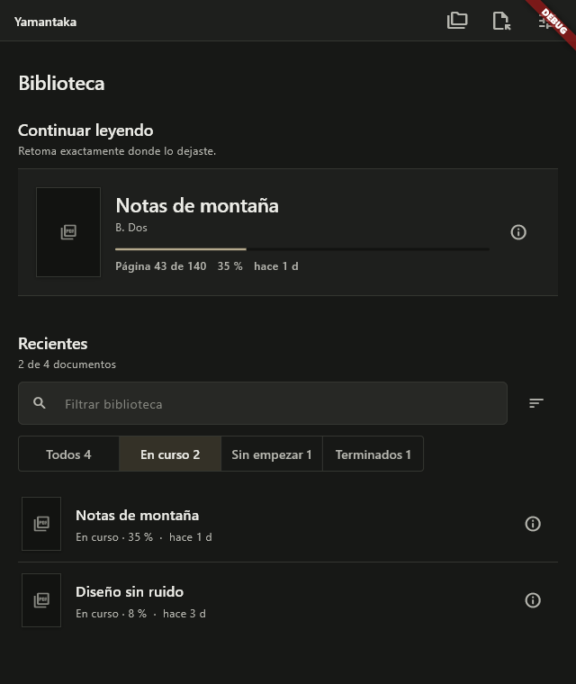

# Yamantaka

Yamantaka es un lector PDF local y ligero para documentos y sesiones largas de
lectura. No copia ni sube los PDF, no requiere cuenta y conserva biblioteca,
progreso, preferencias, sesiones y marcadores en el dispositivo.

El nombre visible está centralizado en `lib/app/app_config.dart`.

## Estado verificado

Base funcional Flutter 0.1.0 para Windows, Android e iOS, validada entre el 28
y el 29 de julio de 2026:

- `flutter analyze`: aprobado, sin incidencias.
- `flutter test`: 86 pruebas aprobadas.
- PDFium: apertura, bitmap nativo, extracción y búsqueda verificadas con un PDF
  legal generado durante la prueba.
- SQLite: esquema, migración inicial y repositorios verificados en memoria.
- Integración Windows: aprobada sobre el lector completo con `ui.Image`,
  lectura de píxeles, pintura nativa, chrome real, búsqueda, paleta, zoom,
  avance/retroceso, marcador, anotación de página, cierre y restauración.
- `flutter build windows --release`: aprobado; el ejecutable se abrió con un
  PDF real mediante argumento, mostró una ventana receptiva y no abrió
  conexiones TCP durante el smoke.
- Perfil Windows/Profile: cinco pasadas con 40 PDF, 100 páginas y carga
  vectorial pesada; cero frames fuera de presupuesto en el escenario medido.

El estado criterio por criterio está en [NEXT_TODOS.md](NEXT_TODOS.md).

## Funciones disponibles

- Selector nativo, arrastrar y soltar y apertura mediante argumento.
- Biblioteca con continuar leyendo, recientes, filtro local `Ctrl+F`, orden,
  estado (`Todos`, `En curso`, `Sin empezar`, `Terminados`), progreso, portadas
  diferidas y estados explícitos para ausente, cambiado y error de portada.
- Visor continuo, de página única o de páginas enfrentadas; portada individual,
  LTR/RTL, zoom, ajuste, rotación, pantalla completa y controles ocultables.
- Recuperación opt-in de documento, página, zoom, posición, disposición,
  márgenes, panel, sección, ancho y visibilidad del chrome, con guarda contra
  rutas ausentes/corruptas.
- Modo libro y seis fondos no destructivos: claro, marfil, sepia, gris, oscuro
  y negro.
- Búsqueda cancelable, índice, miniaturas y un único panel lateral perezoso,
  redimensionable entre 280 y 480 px con ratón o teclado.
- Marcadores locales con etiqueta opcional.
- Paleta `Ctrl+K` con comandos y hasta ocho documentos recientes; registro
  central y personalización segura de atajos importantes.
- Ficha local del documento desde biblioteca/lector con copiar/mostrar,
  localizar, continuar, reiniciar o retirar sin borrar el PDF.
- Historial local acotado y opcional; copia de seguridad JSON versionada con
  vista previa, validación, prebackup e importación transaccional, nunca PDF.
- Anotaciones locales por página con nota, tipos/colores acotados, etiquetas,
  filtros, undo, estado de revisión y exportación Markdown/JSON; nunca escribe
  el PDF.
- Pestañas acotadas con suspensión, reapertura, pin/reorder y espacios de
  trabajo locales transaccionales.
- Búsqueda global FTS5 opt-in sobre metadatos, páginas y anotaciones, cancelable
  y borrable, sin OCR ni consultas persistidas.
- Colecciones manuales, etiquetas y vistas inteligentes; importación de carpeta
  con preview y recuperación conservadora por huella.
- Historial de navegación atrás/adelante, scrubber para documentos largos, seis
  perfiles base, diagnóstico redaccionado y safe mode tras tres cierres no
  limpios.
- Ajustes de apariencia, lectura, barra, atajos, biblioteca, historial, copias y
  privacidad; perfil inicial para tinta electrónica y previsualización ligera.
- Sistema visual editorial de segunda generación con tokens semánticos,
  tipografía Segoe UI Variable, tema claro/oscuro y breakpoints únicos en
  680/1100 px.
- Densidad cómoda/compacta persistente, miniaturas limitadas por tamaño
  físico/DPR y movimiento reducido coherente, sin dependencias nuevas.
- Restauración del tamaño y posición de la ventana de escritorio.
- Confirmación antes de abrir enlaces externos y bloqueo de esquemas no seguros.

## Capturas







Son capturas reproducibles de la aplicación Release y de la integración
Windows con PDFium; no son mockups. Búsqueda, paleta, variante compacta y tema
claro están también en [`docs/screenshots`](docs/screenshots).

## Requisitos

- Windows 10/11 de 64 bits.
- Flutter estable 3.44.8 o compatible y Dart 3.12.
- Visual Studio 2022 con `Desktop development with C++` y sus componentes
  predeterminados.
- Modo de desarrollador de Windows activado para los enlaces simbólicos que
  necesitan los plugins.

Consulta la [configuración oficial de Flutter para
Windows](https://docs.flutter.dev/platform-integration/windows/setup).
El SDK `.flutter-sdk` usado durante esta iteración es local, está ignorado por
Git y no forma parte del producto.

## Instalación y ejecución

```powershell
flutter doctor -v
flutter pub get
flutter run -d windows
```

También se puede pasar un PDF al ejecutable:

```powershell
flutter run -d windows -- "C:\libros\ejemplo.pdf"
```

## Compilación y pruebas

```powershell
dart format --output=none --set-exit-if-changed `
  lib test integration_test tool test_driver
flutter analyze
flutter test
flutter test integration_test/reader_integration_test.dart -d windows
flutter build windows --release
```

El ejecutable Release se genera en
`build\windows\x64\runner\Release\yamantaka.exe`.
Para crear el PDF legal y reproducible usado en el smoke test:

```powershell
dart run tool/create_test_pdf.dart build/manual/yamantaka-smoke.pdf
```

Los fixtures y el perfil de interfaz se regeneran con:

```powershell
dart run tool/create_performance_fixtures.dart build/performance/fixtures
flutter drive --driver=test_driver/performance_driver.dart `
  --target=integration_test/performance_profile_test.dart `
  -d windows --profile
```

Las capturas de una ventana Release se pueden repetir con:

```powershell
powershell.exe -NoProfile -ExecutionPolicy Bypass `
  -File tool/capture_windows_window.ps1 `
  -TargetProcessId <PID> `
  -OutputPath docs/screenshots/windows-library-wide.png `
  -Width 1200 -Height 800
```

## Estructura

- `lib/app`: arranque, composición, tema, comandos y atajos.
- `lib/core`: errores, resultados, plataforma y logging privado.
- `lib/features`: biblioteca, lector, búsqueda, marcadores y ajustes.
- `lib/pdf_engine`: contrato del motor, modelos, visor adaptado y caché.
- `lib/storage`: SQLite, rutas, repositorios y copia de seguridad local.
- `test`: pruebas unitarias, de widgets, SQLite y PDFium.
- `integration_test`: flujo nativo con un PDF generado durante la prueba.
- `tool`: utilidades reproducibles de desarrollo y validación.
- `third_party/pdfrx`: parche local, aislado y licenciado de pdfrx 2.4.7.

## Limitaciones actuales

- El desplazamiento se restaura como fracción aproximada de la página, no como
  coordenada tipográfica exacta.
- El visor usa páginas completas virtualizadas; el contrato admite regiones,
  pero todavía no hay teselas.
- No hay OCR: un escaneo sin texto muestra el estado correspondiente.
- La selección geométrica nativa para highlight/subrayado/tachado está
  bloqueada por el adaptador actual; hoy se crean notas ligadas a página.
- Split/comparación tienen dominio y política serializables, pero no se anuncian
  como disponibles: falta ownership y perfil de dos visores reales.
- La UI avanzada de merge/reorder de etiquetas, perfiles personalizados, modo
  estudio de tres zonas y keep-awake de presentación sigue pendiente.
- Android/iOS están inicializados, pero sus toolchains y UX nativa no se han
  validado.
- Existe un perfil reproducible de 40 documentos, 100 páginas y carga vectorial
  en un equipo; aún faltan 1000 páginas, páginas raster extremas y otras GPU.
- Falta completar la matriz extensa de PDFs patológicos, DPI 100/150/200 %,
  tabulación completa y lector de pantalla descrita en `TESTING.md`; en esta
  iteración se verificó Windows a 125 %.
- pdfrx 2.4.7 lleva un parche local de ciclo de vida del codec; debe retirarse
  cuando una versión upstream corregida supere la misma captura nativa.
- El build de desarrollo no está firmado ni empaquetado para distribución.

No se incluyen edición/firma del PDF, anotación geométrica sin selección nativa,
nube, cuentas, telemetría,
IA, EPUB ni formatos distintos de PDF.

## Próximo paso

Resolver YAM-050 (selección/geométrica nativa), prototipar y medir YAM-062
(split con dos visores reales) y cerrar YAM-041 (Narrador y DPI nativo
100/150/200 %). El orden y los criterios completos permanecen en
[NEXT_TODOS.md](NEXT_TODOS.md).
