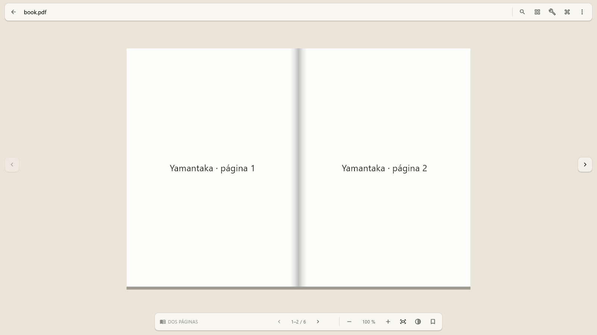
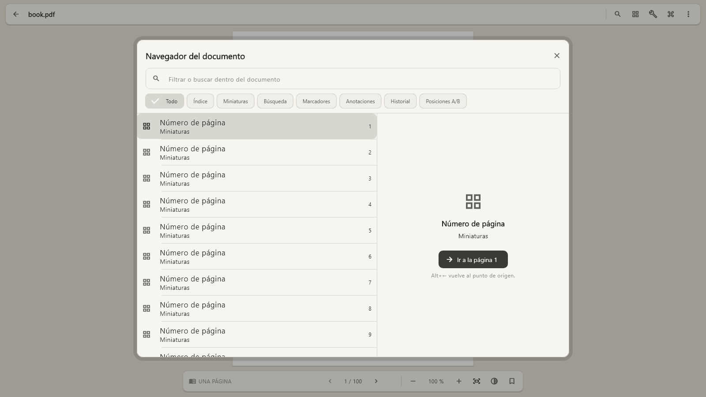

# Yamantaka

Yamantaka es un lector PDF local para Windows orientado a documentos y
sesiones largas de lectura. No requiere cuenta, no sube archivos y conserva
biblioteca, progreso, preferencias, sesiones, marcadores, anotaciones y
metadatos propios en el dispositivo.

## Estado verificado

Base Flutter 0.11.0+12 revisada el 28 de agosto de 2026:

- flutter analyze --no-pub: aprobado sin incidencias;
- flutter test --no-pub: 277 pruebas aprobadas;
- flutter build windows --release --no-pub: aprobado, incluido el runner C++;
- PDFium y SQLite conservan cobertura automatizada con fixtures sintéticos;
- el bundle Release local permanece receptivo durante un smoke de 8 s con un
  PDF sintético y no abre conexiones TCP/UDP; el harness lo cierra al terminar;
- sus nueve binarios nativos siguen sin firma, por lo que esta evidencia local
  no convierte el bundle en un artefacto apto para distribución.

El release local versionado se genera en `build/release/0.11.0+12/` e incluye el
ZIP completo, manifiesto con hash por archivo, `SHA256SUMS.txt` y el reporte del
smoke sin red. Debe extraerse entero antes de probarlo.

El bundle 0.11 se valida contra su manifiesto después del último cambio. El smoke
sintético comprueba conexiones TCP/UDP y el inventario separa explícitamente los
binarios sin firma; sigue siendo evidencia local, no un artefacto de distribución.

La hoja de ruta integral está en [NEXT_TODOS.md](NEXT_TODOS.md) y la estrategia
vigente de pruebas en [TESTING.md](TESTING.md).

## Lector

- `Ctrl+K` permite elegir Una página, Dos páginas y Continua desde la paleta de
  comandos, sin ocupar permanentemente la barra; conserva la página activa y
  la disposición por PDF.
- Dos páginas navega por pliegos completos y permite ajustar por documento si
  la portada queda sola y si la primera página comienza a izquierda o derecha;
  el emparejado respeta LTR/RTL, páginas pares/impares y la última sin pareja.
- Las páginas del pliego son contiguas y comparten un canal central ligado a
  sus bordes, por lo que el lomo acompaña zoom y paneo.
- Los tres modos comparten los seis entornos de lectura; el tema se aplica
  al canvas y al chrome sin alterar los píxeles del PDF.
- La barra superior mide 56 px (52 px en compacto), deja 8 px superiores y usa
  targets de 40 px con iconos de 18 px; título y herramientas comparten una sola
  superficie sin reservar una franja en el visor.
- En ventanas expandidas el panel lateral ocupa una columna propia y el visor
  se recentra en el ancho restante y usa navegación interna vertical; en
  compacto/medio es overlay con scrim y navegación superior.
- La dock mide 48 px activa y 38 px en reposo; clic, toque, foco o teclado revelan
  navegación y zoom sin alterar el centro del PDF.
- Los laterales ofrecen zonas claras de paso de página, con estado deshabilitado
  y soporte semántico.
- Flechas, Page Up/Down, Home/End, espacio, F11 y Escape comparten la misma
  navegación canónica.
- F11 usa una transición Win32 sin frame, conserva la geometría anterior y no
  guarda como normales las dimensiones fullscreen.
- Movimiento reducido, alto contraste y perfil de tinta electrónica tienen
  rutas específicas.

## Otras funciones

- Apertura mediante selector nativo, arrastrar y soltar uno o varios PDF, o
  argumentos múltiples; las rutas repetidas se descartan sin perder el orden.
- “Continuar leyendo” aparece solo cuando existe una lectura reciente sin
  terminar y resume con título, página, total, porcentaje y última apertura.
- `Ctrl+J` abre un navegador documental único para índice, miniaturas, búsqueda,
  marcadores, anotaciones, historial y posiciones A/B; `Ctrl+Mayús+J` mantiene
  el acceso directo al panel. Los saltos no reconstruyen el visor ni cambian el
  zoom y `Alt+←` vuelve al origen.
- Los documentos cerrados recientemente restauran página, zoom, layout, modo,
  tema, scroll y panel. Continuar, Releer y Terminado son acciones explícitas;
  una meta opcional por páginas o minutos permanece solo en el dispositivo. El
  menú del lector expone además `Cerrar sesión y conservar contexto`.
- `Ctrl+Tab` y `Ctrl+Shift+Tab` abren un conmutador compacto de documentos; dos
  documentos PDFium permanecen calientes como máximo y los demás se suspenden
  conservando página, zoom, layout, modo, scroll, tema y panel.
- Biblioteca local con portadas, filtros combinables por autor, tema, estado y
  favorito, agrupación plegable por autor, colección, etiqueta o estado,
  colecciones, etiquetas, vistas inteligentes,
  selección múltiple y operaciones por lote.
- La virtualización de Biblioteca eleva la prioridad de portadas visibles y
  cancela decodificaciones recreables al salir del viewport; el diagnóstico
  local expone intentos, cancelaciones y decodificaciones evitadas sin guardar
  rutas, títulos ni identificadores.
- La biblioteca alterna una cuadrícula con títulos y una lista densa para
  comparar documento, estado, progreso y última apertura. A 150 % de texto la
  lista reduce columnas y conserva estado, páginas y progreso en cada fila.
- El estado inicial muestra únicamente el símbolo de Yamantaka, el nombre, una
  frase breve y `Abrir PDF`. El símbolo conserva exactamente el dibujo original
  y sustituye el azul por el violeta `#B58AFF` mediante recoloración 1:1.
- Título, autor y hasta tres temas se proponen mediante metadatos y texto PDF
  procesados localmente; los resultados dudosos se revisan y las ediciones
  manuales prevalecen siempre.
- El menú de cada documento y el menú general permiten volver a analizar
  metadatos y temas sin perder ninguna corrección manual.
- El lector muestra una previsualización rápida y la sustituye por la región
  nítida al estabilizar zoom/desplazamiento; en Continua solo agenda páginas
  visibles o próximas, incluso en documentos de miles de páginas.
- Biblioteca siempre oscura y espacial, con una paleta monocromática,
  selección violeta, foco blanco independiente del color y controles
  superiores en cápsulas discretas.
- La selección abre un inspector contextual con estado icónico, progreso y
  `Abrir`, `Continuar`, `Releer` o `Localizar`; al filtrar conserva el documento
  o explica su exclusión.
- “Abrir PDF” es la acción primaria y los filtros activos ofrecen un
  restablecimiento visible sin volver a abrir el menú.
- Búsqueda PDF cancelable, índice, miniaturas y panel lateral redimensionable.
- Marcadores y anotaciones comparten filtro y orden por página; saltar a uno
  anuncia y enfoca temporalmente el destino. Se conservan notas por página,
  historial local opcional y navegación atrás/adelante.
- La selección real del texto permite resaltar, subrayar o tachar con geometría
  normalizada. Si el motor no entrega geometría fiable se crea y anuncia una
  nota de página, sin inventar coordenadas.
- Paleta de comandos con iconos específicos, metadatos, preview expandida,
  documentos recientes y atajos personalizables con detección de conflictos.
- Recuperación opt-in de documento, página, zoom, disposición, panel, chrome y
  geometría de ventana.
- Copia de seguridad JSON versionada, validada y transaccional; nunca incluye
  los PDF.
- Búsqueda global FTS5 opt-in y reanudable con filtros de documento, página, anotación,
  marcador, colección y etiqueta, relevancia con recencia solo como desempate,
  cancelación, diagnósticos redactados y safe mode conservador.
- La búsqueda global usa lista y preview en ancho expandido; selección,
  indexación y carga tienen texto de estado y no dependen de un spinner aislado.
- El editor de metadatos separa valores detectados de overrides locales,
  identifica cambios sin guardar y permite restaurar cada campo sin tocar el
  PDF original.
- Confirmación de enlaces externos y bloqueo de esquemas no seguros.
- Sistema visual monocromático con Segoe UI Variable, temas claro/oscuro,
  densidad cómoda/compacta y breakpoints en 680/1100 px.
- Ajustes usa master-detail agrupado, búsqueda de preferencias, reset por
  sección y una previsualización viva persistente del canvas, la página y el
  chrome, alternable entre reposo, activo, panel y e-ink.
- La ventana se abre maximizada y conserva su geometría normal para restaurarla.

## Referencia visual vigente

Esta imagen se genera desde widgets ejecutados a 1600×900 y se compara en la
suite. No es una captura nativa ni reutiliza estados de versiones anteriores.
Las 164 capturas de las matrices 0.11 cubren Biblioteca, Lector, navegador,
panel, Ajustes, paleta, búsqueda, menús, bienvenida e importación, con la base
0.10 conservada bajo
`build/visual-evidence/v0.10.0/` y la evidencia actual en
`build/visual-evidence/v0.11.0/`. La identidad del logo violeta se comprueba por
hash; no se regenera ni se altera su geometría.

## Requisitos

- Windows 10/11 de 64 bits.
- Flutter estable 3.44.8 o compatible y Dart 3.12.
- Visual Studio 2022 con Desktop development with C++.
- Modo de desarrollador de Windows para los enlaces simbólicos de plugins.

El SDK local .flutter-sdk está ignorado por Git y no forma parte del producto.

## Preparación y compilación local

    flutter doctor -v
    flutter pub get
    flutter build windows --release --no-pub

Este comando solo escribe artefactos bajo `build/`, que está ignorado por Git:
no publica Yamantaka en pub.dev, Microsoft Store ni ningún otro canal.

El ejecutable de Flutter no es autónomo: debe permanecer junto a `data/`,
`flutter_windows.dll` y las DLL de plugins. Si se usa el ZIP, hay que extraer el
bundle completo antes de abrirlo; copiar o ejecutar solo `yamantaka.exe` puede
fallar por dependencias ausentes.

Para iniciar la build local con preflight de estructura, ruta y
Mark-of-the-Web:

    powershell.exe -NoProfile -ExecutionPolicy Bypass -File tool/run_windows.ps1

También puede abrir un PDF directamente:

    powershell.exe -NoProfile -ExecutionPolicy Bypass -File tool/run_windows.ps1 -PdfPath "C:\libros\ejemplo.pdf"

Las builds Flutter de Windows no incluyen por defecto una firma Authenticode.
El launcher acepta una build local completa situada bajo `build/`, pero nunca la
presenta como artefacto firmado. Smart App Control puede bloquear binarios
descargados o desconocidos; no se recomienda desactivar protecciones de Windows
para evitarlo.

Cuando exista un certificado RSA de firma de código de un proveedor confiable,
se firma el bundle completo —ejecutable y DLL— así:

    powershell.exe -NoProfile -ExecutionPolicy Bypass -File tool/sign_windows_bundle.ps1 -BundlePath build/windows/x64/runner/Release -CertificateThumbprint <THUMBPRINT>

Una build firmada o la build local comprobada puede abrirse también como proceso
normal:

    & build/windows/x64/runner/Release/yamantaka.exe "C:\libros\ejemplo.pdf"

Firmar no publica la aplicación. El certificado y su clave se administran fuera
del repositorio. No se recomienda desactivar Smart App Control como solución de
desarrollo.

## Compilación y pruebas

    dart format --output=none --set-exit-if-changed lib test integration_test tool test_driver
    flutter analyze --no-pub
    flutter test --no-pub
    flutter build windows --release --no-pub

Gate reproducible:

    powershell.exe -NoProfile -ExecutionPolicy Bypass -File tool/verify_windows.ps1

Los informes quedan bajo build/verification. El gate local puede ejecutar el
bundle que acaba de compilar cuando está completo, permanece bajo `build/` y no
tiene Mark-of-the-Web. La firma sigue siendo obligatoria para un gate de
distribución; con un certificado disponible:

    powershell.exe -NoProfile -ExecutionPolicy Bypass -File tool/verify_windows.ps1 -CertificateThumbprint <THUMBPRINT> -RequireSignature

Sin certificado, `-RequireSignature` omite las fases que abrirían el bundle y
explica qué binarios carecen de firma. No desactiva ni modifica Smart App
Control.

PDF sintético para smoke:

    dart run tool/create_test_pdf.dart build/verification/corpus/normal.pdf

Matriz visual nativa sobre una escala real del host; use `-RequireSignature`
para evidencia de distribución:

    powershell.exe -NoProfile -ExecutionPolicy Bypass -File tool/run_visual_matrix.ps1 -HostScalePercent 125 -ScaleConfirmed

Captura de una ventana ya abierta, conservando sus bounds y enviando F11:

    powershell.exe -NoProfile -ExecutionPolicy Bypass -File tool/capture_windows_window.ps1 -TargetProcessId <PID> -OutputPath build/verification/book-fullscreen.png -PreserveWindowBounds -SendKeys "{F11}"

## Estructura

- lib/app: arranque, composición, tema, comandos y atajos.
- lib/core: errores, plataforma y logging privado.
- lib/features: biblioteca, lector, búsqueda, marcadores y ajustes.
- lib/pdf_engine: contrato del motor, modelos, visor y caché.
- lib/storage: SQLite, rutas, repositorios y backup local.
- test: dominio, widgets, SQLite, PDFium y referencia visual.
- integration_test: flujos nativos con PDF generado.
- tool: utilidades reproducibles de desarrollo y validación.
- third_party/pdfrx: parche local, aislado y licenciado de pdfrx 2.4.7.

## Limitaciones

- No hay OCR, IA, clasificación remota ni edición o firma del PDF. Los PDF
  escaneados sin capa de texto conservan el nombre de archivo hasta una edición
  manual.
- Highlight, subrayado y tachado usan la geometría normalizada que entrega el
  adaptador nativo. Selecciones multipágina o sin geometría fiable degradan de
  forma anunciada a nota de página.
- Split/comparación conservan modelos internos, pero no se anuncian sin dos
  visores reales y medidos.
- Android e iOS están inicializados, pero esta iteración solo valida Windows.
- El build local actual no está firmado. Puede usarse para desarrollo desde el
  bundle completo bajo `build/`, pero distribuirlo sin advertencias requiere un
  certificado RSA confiable o un canal que firme el artefacto.
- La validación manual de Narrador, varios monitores y cada DPI físico no se
  sustituye por pruebas de widget.

No se incluyen nube, cuentas, telemetría, IA, EPUB ni formatos distintos de
PDF.
