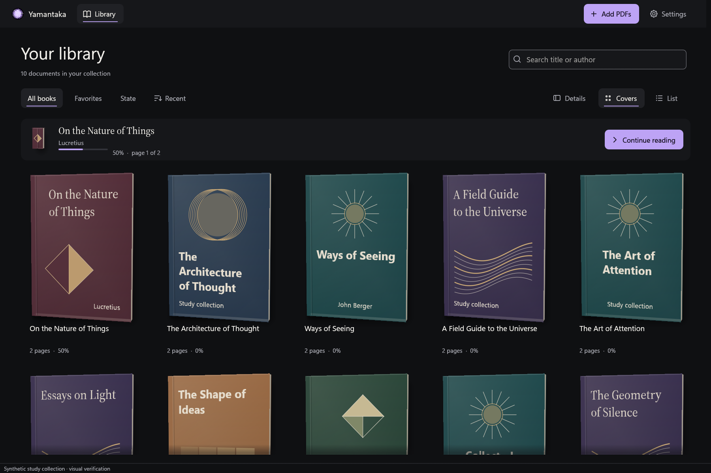

<p align="center">
  
</p>

# Yamantaka

**A private PDF library for reading and study on Windows.**

Yamantaka brings your documents into a personal library, keeps your reading context close, and stores your work locally. The native Rust rewrite pairs a gallery of physical 3D book covers with a focused PDF reader, warm paper environments, and a consistent desktop interface.

No account is required. Documents and library data stay on your computer. The product is designed to operate without telemetry or network access during normal use.

> **Development status:** the Rust rewrite is in progress. It is not yet a replacement release. Flutter 0.15.0+16 remains the recoverable reference implementation. The [acceptance matrix](docs/architecture/rust-rewrite-parity.md) distinguishes verified behavior, partial implementations, and outstanding work.

<p align="center">
  
</p>

*Native Windows capture of an isolated synthetic study collection. The capture demonstrates the current gallery; it is not a photograph of a personal library or proof of complete feature parity.*

## The experience

- **An immersive library.** Large book covers with connected boards, spines, page blocks, six procedural cover families, and a damped response to the pointer. Reduced motion retains a static volume.
- **A practical catalogue.** Cover and list views, title and author search, favorites, reading-state and missing-file filters, stable sorting, and pages of up to 80 documents. A document inspector preserves the width of the gallery.
- **A reader built around the document.** Native PDFium rendering, GPU presentation, page navigation, fit-to-page and fit-to-width, zoom, rotation, margins, page text, canonical history, and positions A/B. Single, facing and virtualized continuous layouts are connected through the canonical navigation model. Six reading environments are stored per document.
- **Protected reading.** Already catalogued password-protected PDFs have a masked, transient password prompt with retry and cancellation. Credentials are never saved; protected-file import is still pending.
- **Search inside a PDF.** Open **Navigator → Find** or press **Ctrl+F**. Contextual results, case and whole-word options, cancellation, rotated highlights and **F3/Shift+F3** navigation are connected. Empty results distinguish an absent phrase from a PDF without extractable text.
- **Local full-text search.** Explicit opt-in, resumable indexing, filters, ranked snippets and page navigation, with pause, stop, exclusion, rebuilding and erasing controls. Open it from **Tools → Global search** or **Ctrl+Shift+F**.
- **Page previews.** Open **Navigator → Pages** to browse rotated previews and return to a page. Visible previews share the reader's PDF worker and memory budget.
- **PDF contents.** Open **Navigator → Contents** to explore chapters, fold branches and jump to the page, position and view specified by the PDF.
- **Bookmarks for study.** Open the reader's **Navigator → Bookmarks** to save a page, edit its label, remove it or return to a passage. Existing named bookmarks keep their labels when a page is saved again. Label changes update the local search index when indexing is enabled.
- **A coherent desktop interface.** Dark graphite and warm ivory themes, functional violet accents, local Segoe UI Variable typography, custom controls, visible keyboard focus, Spanish and English surfaces, reduced motion, and text enlargement.
- **Independent storage.** A separate Rust library, versioned atomic preferences, and compatibility adapters for historical data. The Flutter installation remains a fallback during the transition.

These describe connected portions of the current implementation. Automatic and manual cover images, complete reader interaction acceptance, annotations, organization, continuity, broader search acceptance, and recovery flows still have outstanding acceptance work. See the matrix before relying on a capability.

## Platform

| Item | Target |
| --- | --- |
| Operating system | Windows 10 / 11 |
| Architecture | x64 |
| Presentation | Native Rust; egui/eframe, wgpu and AccessKit |
| PDF engine | PDFium 7881 through pdfium-render |
| Storage | SQLite with FTS5 through rusqlite |
| Interface languages | Spanish and English |
| Active product scope | Local PDF reading and study on Windows |

Android, iOS and web directories belong to the historical Flutter project. They are not targets of the active rewrite. Printing, OCR, encrypted backups and secondary reader windows are proposals or contracts, not completed Rust features.

## Run the development build

The following commands are for **development**, not for installing a finished release.

You need Windows x64, the Microsoft C++ build tools required by Rust's MSVC target, and Rust installed through rustup. The repository pins Rust 1.97.1 in `rust-toolchain.toml` and dependency versions in `Cargo.lock`.

```powershell
# From the repository root
cargo build -p yamantaka --locked
./tool/fetch_rust_pdfium.ps1
./target/debug/yamantaka-rust.exe
```

The PDFium fetch script downloads and verifies the pinned native dependency. Dependency setup may use the network; that is separate from normal application use.

To open a document from the command line:

```powershell
./target/debug/yamantaka-rust.exe "C:\Books\Example.pdf"
```

The default compositor uses DirectX 12. A separately checked OpenGL route is available:

```powershell
./target/debug/yamantaka-rust.exe --opengl
```

A finished Release bundle must include `pdfium.dll` beside the executable. Do not copy only the executable out of a bundle. The final bundle, hashes, SBOM, notices and installation instructions will be added after the parity and validation gates pass.

### Isolated visual collection

Generate the synthetic PDF corpus with Python and the `reportlab`, `Pillow` and `pypdf` packages, then open the demo:

```powershell
python ./tool/create_rust_pdf_fixtures.py
./target/debug/yamantaka-rust.exe --demo
./target/debug/yamantaka-rust.exe --demo --light
./target/debug/yamantaka-rust.exe --demo --reader
./target/debug/yamantaka-rust.exe --demo --demo-window
```

`--demo-window` opens an independent synthetic preview while an existing demo remains open.

The demo uses an in-memory database and synthetic documents. It does not open the personal library. It currently depends on the repository's generated fixtures and is a development tool.

## Data and migration

The rewrite must preserve identifiers, relationships, progress, annotations, manual corrections, cover decisions, workspaces, sessions and automation journals. Originals are never PDF editing targets.

| Data | Compatibility contract |
| --- | --- |
| Main database | Preserve SQLite schema v11; migrate historical schemas v1–v11 |
| JSON backups | Import versions v1–v9; retain version 9 export |
| Flutter preferences | Capture separately from SQLite, including unknown keys |
| Rust preferences | Versioned JSON, written atomically |
| Initial import | Independent, explicit, idempotent and fail-closed |
| SQLite capture | WAL-coherent backup; never just copy an open main database file |
| Exact duplicate detection | Full SHA-256 verification; inherited partial fingerprints alone are insufficient |

Compatibility tests cover populated historical schemas and backup contracts. The complete migration preview, confirmation and recovery interface remains pending. **The current executable does not provide a complete one-click migration flow.**

Rust uses independent installed and portable data locations. It does not synchronize changes back to Flutter. See [the acceptance matrix](docs/architecture/rust-rewrite-parity.md) for the precise implemented boundaries and [historical Flutter documentation](docs/architecture/flutter-readme-v015.md) for the incumbent workflows.

## Architecture

The workspace keeps presentation, persistence and native rendering separate:

| Crate | Responsibility |
| --- | --- |
| `yamantaka-domain` | Typed contracts, persisted semantics, canonical navigation, reader geometry and memory accounting |
| `yamantaka-application` | Commands, events, cancellation, actor runtime and incremental indexing coordination |
| `yamantaka-storage` | SQLite repositories, historical migrations, backups, preferences and FTS5 |
| `yamantaka-pdf` | Serialized PDFium worker, prioritized tickets, bounded caches and native rendering |
| `yamantaka-windows` | Paths, native activation, clipboard, Explorer and Windows integration |
| `yamantaka` | Desktop composition, custom controls, physical covers and GPU page presentation |

UI components dispatch commands and receive state. They do not execute SQL or call PDFium directly. Native PDF handles remain on one worker; GPU resources have explicit lifetimes. Initial global category limits are 72 MiB for pages, 24 MiB for tiles and 8 MiB for text. Complete live-resource coverage and device-loss recovery remain acceptance tasks.

## Validation

Run the Rust checks from the repository root:

```powershell
cargo fmt --all --check
cargo clippy --workspace --all-targets --locked -- -D warnings
cargo test --workspace --locked
```

Generate the PDF fixtures and fetch PDFium first to run the native PDF suite. Tests exercise text, vectors, scanned pages, passwords, damage, intrinsic and requested rotation, mixed page sizes, tiles and documents of 5,000 pages. Storage tests cover historical schemas, populated relationships, backup formats, cancellation and rollback. Native Windows tests cover second-process activation and Unicode paths.

Current evidence is documented separately so dates and scopes remain explicit:

- [Acceptance matrix](docs/architecture/rust-rewrite-parity.md): the source of truth for completion.
- [Flutter baseline](docs/validation/flutter-baseline-2026-10-08.md): 330 tests and analysis executed on the reference implementation.
- [Native gallery and settings validation](docs/validation/rust-visual-stage2.md): captures, control bounds and the bounded visual review.
- [Protected reading validation](docs/validation/rust-password-opening-2026-10-09.md): ephemeral credential ownership, real PDFium retry tests and five native captures.
- [Bookmark persistence validation](docs/validation/rust-bookmark-repository-2026-10-09.md): legacy identity, transactional edits, pagination and responsive actor commands. The [connected bookmark panel validation](docs/validation/rust-bookmark-ui-2026-10-09.md) covers reader integration and current limits.
- [Bookmark search validation](docs/validation/rust-bookmark-search-2026-10-09.md): atomic updates, consent, exclusion and search results during native work.
- [Canonical reader anchor validation](docs/validation/rust-reader-anchors-2026-10-09.md): horizontal pan, rotation, history and A/B marks share a two-dimensional position. Interactive acceptance and persisted scroll contexts remain pending.
- [Native external-link dialog](docs/validation/rust-external-links-native-2026-10-09.md): four confirmation/rejection captures, fixed compact action layout and aggregate URI-budget recovery. Windows handler acceptance remains pending.
- [Modal keyboard isolation](docs/validation/rust-modal-shortcuts-2026-10-09.md): password and external-link dialogs block reader/search shortcuts, with three production egui input regressions. OS keyboard and accessibility acceptance remain pending.
- [Native text geometry](docs/validation/rust-text-geometry-2026-10-09.md): bounded Unicode character selection and normalized geometry on the PDFium worker, with six tests. Pointer selection is now connected in the checkpoint below; keyboard selection and annotation integration remain pending.
- [Connected page-text panel](docs/validation/rust-text-panel-2026-10-09.md): asynchronous actor routing, governed Text-tab results, cancellation/retry and four native captures. The pointer selection checkpoint below connects PDF-range interaction; annotation interaction and OS clipboard acceptance remain pending.
- [Cross-page selection semantics](docs/validation/rust-text-selection-2026-10-09.md): ordered Unicode passages, explicit geometry coverage and governed copies, checked with domain tests and real PDFium results. The pointer interaction checkpoint below now uses this contract; keyboard selection remains pending.
- [Reader pointer selection](docs/validation/rust-reader-selection-2026-10-09.md): native drag selection, rotated region display, shared asynchronous text snapshots and passage-copy output, with four UI tests and five native captures. Keyboard/grapheme selection, OS clipboard and annotation acceptance remain pending.
- [Keyboard selection](docs/validation/rust-selection-keyboard-2026-10-09.md): focused-page grapheme/word movement, extended ranges, page selection and copy/Escape routing, checked with three UI regressions and three native keyboard captures. Visual bidirectional/vertical and multi-page acceptance remain pending.
- [Selection annotation drafts](docs/validation/rust-annotation-drafts-2026-10-09.md): governed draft preparation, normalized glyph regions, explicit page-note fallback and Unicode context, checked with four domain regressions and real PDFium results. Editor and persistence integration remain pending.
- [Annotation repository](docs/validation/rust-annotation-repository-2026-10-09.md): paged governed snapshots, atomic edits/review/tags, exact restoration and consented FTS updates, checked with seven SQLite regressions including all eleven historical schemas. Actor, editor, painted marks and export integration remain pending.
- [Annotation actor](docs/validation/rust-annotation-actor-2026-10-09.md): owned commands and scoped replies through the application worker, checked with three SQLite integration regressions for held PDF work, cancellation, fallback confirmation, queue admission and memory release. Editor, painted marks, global review and exports remain pending.
- [Connected annotation editor](docs/validation/rust-annotation-editor-2026-10-09.md): single-page passage creation, explicit geometry fallback, note editing/review/removal and painting of loaded records, checked with three controller regressions and four native captures. Multi-page creation, full paint coverage, tag/global-review/export interfaces and broader interaction acceptance remain pending.
- [Atomic annotation batches](docs/validation/rust-annotation-batches-2026-10-09.md): governed per-page drafts and transactional creation through the actor, checked with three storage regressions and one application test. Multi-page editor integration and native interaction acceptance remain pending.
- [Multi-page annotation editor](docs/validation/rust-annotation-multi-editor-2026-10-09.md): complete selection snapshots, joined previews and atomic per-page creation, checked with two domain regressions, another SQLite-backed editor test and two native captures. Cross-page pointer/autoscroll and broader interaction acceptance remain pending.
- [Page notes without selection](docs/validation/rust-page-note-editor-2026-10-09.md): page-bound note creation without text extraction, checked with two domain regressions, actor and editor integration tests, and two native scanned-PDF captures. Full paint coverage, mutation history, tags, global review and exports remain pending.
- [Visible-page annotation geometry](docs/validation/rust-annotation-paint-2026-10-09.md): complete attached-page geometry independent of the 80-row Notes list, checked with SQLite, actor and cache regressions plus three native captures. Large annotation-page performance, intrinsic/directional placement and the remaining review/export interfaces still need acceptance.
- [Annotation tags in the editor](docs/validation/rust-annotation-tags-2026-10-09.md): create, preserve, replace and clear tags with atomic note/search updates, checked by SQLite, actor and editor regressions plus five native captures. Tag filters, bulk actions, global review and exports remain pending.
- [Incremental annotation export writer](docs/validation/rust-annotation-export-writer-2026-10-10.md): compatible JSON and Markdown formatting with UTC dates, borrowed records and failure handling, checked with five regressions including 181 SQLite records. Coherent traversal, actor routing, the save dialog and atomic file publication remain pending.
- [Coherent annotation export traversal](docs/validation/rust-annotation-export-snapshot-2026-10-10.md): one read transaction streams all records to the export writer, checked against concurrent WAL changes, callback failure, cancellation and historical schemas. Actor routing, native save and atomic publication remain pending.
- [Atomic creation of annotation export files](docs/validation/rust-annotation-export-publication-2026-10-10.md): staged, synchronized publication preserves occupied destinations and discards failed or cancelled output, checked by six storage/application regressions. Native save, actor routing and explicit replacement remain pending.
- [Independent annotation export worker](docs/validation/rust-annotation-export-worker-2026-10-10.md): scoped requests use a separate read-only SQLite connection and a cancellable worker, checked by five lifecycle/storage/runtime regressions. Native save, progress and export controls remain pending.
- [External PDF link confirmation](docs/validation/rust-external-pdf-links-2026-10-09.md): bounded http/https/mailto destinations, redacted diagnostics and an explicit Windows opening dialog. Native modal and external-handler acceptance remain pending.
- [Bounded PDF URI reading](docs/validation/rust-bounded-pdf-uri-2026-10-09.md): verified local PDFium wrapper patch checks URI size before allocation. External link confirmation remains pending.
- [Native internal link presentation](docs/validation/rust-pdf-links-native-2026-10-09.md): five GPU captures of focus, rotation, compact text scaling and keyboard navigation from page 1 to page 2. Broader interaction and external links remain pending.
- [Native PDF link extraction](docs/validation/rust-pdf-links-extraction-2026-10-09.md): bounded asynchronous internal destinations and separate active regions, tested with real PDFium and nonblocking actor routing. Internal reader regions and visible-page cancellation are implemented; native interaction acceptance and external link confirmation remain pending.
- [Shared PDF contracts](docs/validation/rust-pdf-shared-contracts-2026-10-09.md): canonical destination interpretation, crop conversion and normalized rectangle rotation shared by contents and search. Clickable PDF links remain pending.
- [PDF search text availability](docs/validation/rust-find-text-presence-2026-10-09.md): distinct no-match and no-extractable-text states, complete-scan evidence and real textual/scanned/5,000-page tests.
- [Connected PDF search panel](docs/validation/rust-pdf-find-ui-2026-10-09.md): contextual result batches, canonical navigation, wrapping, rotated highlights and native dark/light/compact captures. Broader interaction and performance acceptance remain pending.
- [Document-wide PDF search coordination](docs/validation/rust-document-find-2026-10-09.md): bounded cross-page batches, exact continuation, coalesced progress and real 5,000-page traversal. The connected reader presentation has separate validation below.
- [Native PDF page-search foundation](docs/validation/rust-pdf-find-runtime-2026-10-09.md): bounded Unicode matches, normalized geometry, cancellation and actor responsiveness. The connected reader interface has separate validation above.
- [Reader thumbnail validation](docs/validation/rust-thumbnails-2026-10-09.md): prioritized previews, independent cancellation, native presentation and navigation to page 5,000.
- [Native contents-panel validation](docs/validation/rust-outline-ui-2026-10-09.md): chapter hierarchy, bounded presentation, destination jumps and PDFium binding reuse.
- [Shared page geometry validation](docs/validation/rust-page-geometry-2026-10-09.md): crop and rotation coordinates travel with each page size, with shared memory ownership and viewport-to-PDF conversion.
- [PDF destination resolution validation](docs/validation/rust-destination-resolution-2026-10-09.md): coordinates, zoom and fitting are resolved in the domain. The connected reader applies these results; broader interactive acceptance remains pending.
- [Native outline validation](docs/validation/rust-outline-runtime-2026-10-09.md): Unicode hierarchy, internal destinations, crop and rotation coordinates, cancellation and shared memory ownership. The outline tab remains pending.
- [Search-controller validation](docs/validation/rust-search-controller-2026-10-09.md): cancellation, durable resume, exclusions and nonblocking native boundaries.
- [Search actor validation](docs/validation/rust-search-runtime-2026-10-09.md): consent, native slot handoff, responsive catalogue queries and shutdown. See the [connected search interface validation](docs/validation/rust-search-ui-2026-10-09.md) for native captures and current scope.
- [Native page-resource validation](docs/validation/rust-native-page-resources.md): GPU readback, allocation, retirement and scoped rendering evidence.

Catalogue measurements cover synthetic libraries of 5,000, 25,000 and 100,000 documents. They do not establish a complete performance advantage over Flutter. Paired startup, UI/GPU, PDF, CPU, memory and closure measurements are still required.

Physical DPI certification at 100/125/150/175/200%, Narrator, multiple monitors, the complete offline application smoke and all critical-flow captures remain pending. Automated tests and synthetic screenshots do not replace those checks.

Before publishing a development checkpoint, review the staged files:

```powershell
python ./tool/check_public_checkpoint.py --staged
```

This guard checks exact Git blobs and synthetic capture metadata for recognized private paths, contacts, credentials and unexpected data files. It complements human review; it does not establish complete privacy certification.

## Project documentation

- [Product brief](PRODUCT.md)
- [Design system](DESIGN.md)
- [Visual contract](docs/architecture/rust-visual-contract.md)
- [Memory plan and implemented boundaries](docs/architecture/rust-live-memory-plan.md)
- [Contribution guide](CONTRIBUTING.md)

Third-party software and font notices remain with their respective components. The final Release bundle must include a complete license inventory and SBOM. No finished Rust release or distribution-signing status is claimed by this README.
