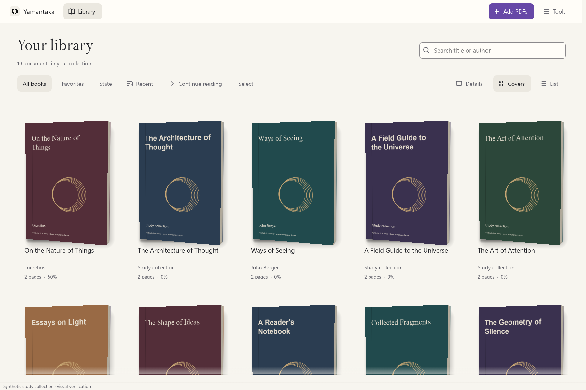

# Yamantaka

**A local PDF library for reading and study on Windows.**

Yamantaka combines a library of physical 3D book covers with a document-focused reader. Organize your collection, compare passages, keep reading notes and return to your saved context. Your library runs locally, without an account or a cloud backend.

**Project status:** the native Rust rewrite is under active development. Review builds are not a finished replacement for the Flutter application. Complete parity, physical accessibility and comparative performance acceptance remain open in the [acceptance matrix](docs/architecture/rust-rewrite-parity.md).

<picture>
  <source media="(prefers-color-scheme: dark)" srcset="docs/screenshots/rust-readme-2026-11-03/readme-library-dark.png" />
  
</picture>

*Native application screenshots using generated PDF covers in a synthetic study collection.*

## Read, organize and study

| Area | Available for review |
| --- | --- |
| Library | PDF-derived or manually selected covers, spring-based 3D movement, cover and list views, search, filters, favorites and bulk actions |
| Reading | Document and Book modes, single-page, facing and virtualized continuous layouts, zoom, rotation, margins and LTR/RTL reading |
| Reading controls | Compact controls that hide without moving the PDF, six document environments and an optional electronic-ink profile |
| Navigation | Contents, page previews, bookmarks, in-document search, navigation history and positions A/B |
| Study | Text selection and copying, highlights, underlines, strikeouts, page and passage notes, and annotation export |
| Continuity | Reading tabs, saved progress, sessions, workspaces, a reading queue and comparison with optional page, position and zoom following |
| Organization | Collections, tags, smart views, document connections, revision groups and reviewed local rules |
| Search | Opt-in local FTS5 indexing, ranked results, filters, snippets, exclusions and resumable indexing |
| Metadata | Local title/author extraction, reviewable proposals, reanalysis and persistent manual corrections |
| Desktop | Dark and light themes, Spanish and English, configurable shortcuts, visible keyboard focus, enlarged text and reduced motion |

These are connected application features, with acceptance boundaries recorded in the matrix. Printing, OCR, encrypted backups and secondary reader windows are not completed Rust features. Android, iOS and web are outside the active rewrite.

Metadata extraction uses PDF metadata and readable front matter. Image-only pages can need manual title or author corrections. Protected PDFs use temporary password prompts; passwords are not saved. If you enable full-text indexing, extracted text is stored in the local index. See [protected PDF search](docs/user-guide/protected-search.md).

## Start a Windows review build

The target is **Windows 10/11 x64**. A native review bundle includes the executable, PDFium, licenses and user instructions. Flutter, Dart and Rust are not needed to run that bundle.

Download the [portable prerelease](https://github.com/Hakaelll/Yamantaka/releases/download/v0.16.0-alpha.1-review.10/yamantaka-0.16.0-alpha.1-windows-x64-portable.zip), or open its [release page](https://github.com/Hakaelll/Yamantaka/releases/tag/v0.16.0-alpha.1-review.10) for checksums, the manifest and SBOM.

1. Extract the complete ZIP into a writable folder.
2. Start `yamantaka/yamantaka.exe`. Keep `pdfium.dll` beside it.
3. Select **Add PDFs**, drop documents into the window, or pass a PDF path on the command line.
4. Open a book to read. Use **Navigator** for contents, pages, bookmarks and search, or **Reading options → Compare pages** for a reference pane.

The default compositor uses DirectX 12 through wgpu. If initialization fails, the application attempts the alternate OpenGL compositor once in a fresh process. You can also start with `--opengl`; see [graphics recovery](docs/user-guide/graphics-recovery.md).

The [review 10 notes](docs/release/rust-0.16-review-10.md) describe the published prerelease, user-reported functional acceptance and remaining limits. Application checks recorded for [review 09](docs/release/rust-0.16-review-09.md) apply to that earlier revision; no new automated runtime suite was run for review 10.

The [review 11 candidate](docs/release/rust-0.16-review-11.md) packages later protected-cover and metadata scheduling changes. Its build and packaging are complete; runtime acceptance remains pending.

Portable builds include `.yamantaka-rust-portable` and keep independent `rust-data` and `rust-cache` folders beside the executable. Extract a review build separately from your Flutter installation.

## Keep your library independent

The rewrite imports a separate copy of a Flutter library. It does not synchronize changes back to Flutter or duplicate the original PDFs. PDF locations remain references, and source documents are not editing targets.

To import existing data:

1. Open **Settings → Storage → Import from Flutter**.
2. Choose the SQLite database and its `shared_preferences.json` file.
3. Close Flutter, select **Review source**, and check the record counts.
4. Select **Create independent copy**, then **Use next launch**.
5. Restart Yamantaka to use the imported copy. The current session keeps its existing library until then.

**Use original** cancels a pending selection. Storage settings also let you return to the original Rust library on a later launch. Both libraries remain on disk. [Migration verification](docs/validation/rust-migration-ui-2026-10-21.md) records the workflow and remaining limits.

| Data | Compatibility contract |
| --- | --- |
| SQLite | Schema v11, with migration from historical schemas v1–v11 and WAL-coherent capture |
| JSON backups | Import v1–v9 and export v9; PDFs are not included |
| Preferences | Flutter preferences captured separately; Rust preferences written as versioned, atomic JSON |
| Manual decisions | Preserve metadata corrections, cover-page choices and other stored library state |
| Exact duplicates | Require complete SHA-256 verification before confirming identical files |

Use **Settings → Storage** to export or review a backup before restoring it. Restore retains a safety copy of the previous library. [Previous library](docs/user-guide/previous-library.md) explains how to return to that copy; [identical copies](docs/user-guide/identical-copies.md) explains reviewed record consolidation.

## Build from source

You need Windows x64, Rust through rustup, and Microsoft C++ build tools with a Windows SDK for the MSVC target. `rust-toolchain.toml` pins the toolchain; `Cargo.lock` pins Rust dependencies.

From the repository root:

```powershell
./tool/fetch_rust_pdfium.ps1
cargo build --locked -p yamantaka
./target/debug/yamantaka-rust.exe
```

The fetch script verifies the pinned PDFium archive and DLL hashes. Initial toolchain and dependency setup can use the network.

To open a PDF directly:

```powershell
./target/debug/yamantaka-rust.exe "C:\Books\Example.pdf"
```

To build an optimized portable review bundle, use Python 3.11 or newer with Pillow, restore Cargo dependencies first, then run:

```powershell
python ./tool/fetch_rust_licenses.py
./tool/package_rust_windows.ps1 -Portable -OutputDirectory build/release/native-review
```

Choose a fresh output folder. Packaging uses locked, offline Cargo resolution, static Microsoft C runtime linkage and remapped build paths. It produces a ZIP, SHA-256 sums, a per-file manifest, license notices and a CycloneDX 1.5 SBOM. It does not publish a GitHub Release. See [bundle instructions](docs/release/RUST-WINDOWS-BUNDLE.txt).

## Development and validation

The workspace separates application concerns into six crates:

| Crate | Responsibility |
| --- | --- |
| `yamantaka-domain` | Contracts, persisted semantics, navigation, geometry and memory accounting |
| `yamantaka-application` | Commands, events, cancellation and actor coordination |
| `yamantaka-storage` | SQLite, migrations, backups, preferences and FTS5 |
| `yamantaka-pdf` | Serialized PDFium worker, priorities, native ownership and bounded caches |
| `yamantaka-windows` | Paths, activation, clipboard, Explorer and Windows integration |
| `yamantaka` | egui/eframe interface, 3D covers and GPU page presentation |

The retained suite contains **56 tests**, covering native rendering, migration, backup, ownership, cancellation and other core behavior. The [complete workspace checkpoint](docs/validation/artifacts/workspace-checkpoint-2026-11-03.json) records the last full run and its source scope. This is not full rewrite acceptance. [Contributing](CONTRIBUTING.md) explains fixture setup, isolated previews, targeted checks and the complete workspace commands.

## Documentation

| Topic | Guide |
| --- | --- |
| Library layout and smaller windows | [Library layout](docs/user-guide/library-layout.md) |
| Session-only folder notifications, after review 11 | [Authorized folders](docs/user-guide/authorized-folders.md) |
| Passage selection and edge scrolling, after review 11 | [Text selection](docs/user-guide/text-selection.md) |
| Visible-page PDF search highlights, after review 11 | [Document search](docs/user-guide/document-search.md) |
| Controls, page previews and source changes | [Reader responsiveness](docs/user-guide/reader-responsiveness.md) |
| Electronic-ink presentation | [Reader profiles](docs/user-guide/reader-profiles.md) |
| Tabs, sessions, workspaces and comparison | [Reading continuity](docs/user-guide/reading-continuity.md) |
| Passwords and cached covers | [Protected imports](docs/user-guide/protected-imports.md) · [Cover recovery](docs/user-guide/cover-recovery.md) |
| Search exclusions | [Search exclusions](docs/user-guide/search-exclusions.md) |
| Product and visual direction | [Product brief](PRODUCT.md) · [Design system](DESIGN.md) |
| Technical evidence and remaining work | [Acceptance matrix](docs/architecture/rust-rewrite-parity.md) · [Memory boundaries](docs/architecture/rust-live-memory-plan.md) |

## License

Yamantaka project code is licensed under the [MIT License](LICENSE). Third-party software and fonts retain their own licenses and notices, included in the native review bundle. The [historical Flutter documentation](docs/architecture/flutter-readme-v015.md) remains available during the transition.
