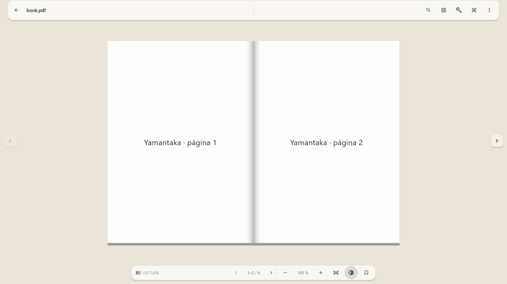

# Yamantaka

Yamantaka es un lector PDF local para Windows orientado a documentos y
sesiones largas de lectura. No requiere cuenta, no sube archivos y conserva
biblioteca, progreso, preferencias, sesiones, marcadores, anotaciones y
metadatos propios en el dispositivo.

## Estado verificado

Base Flutter 0.7.0+8 revisada el 25 de agosto de 2026:

- flutter analyze --no-pub: aprobado sin incidencias;
- flutter test --no-pub: 247 pruebas aprobadas;
- flutter build windows --release --no-pub: aprobado, incluido el runner C++;
- PDFium y SQLite conservan cobertura automatizada con fixtures sintéticos;
- el bundle Release local permanece receptivo durante un smoke de 8 s con un
  PDF sintético y no abre conexiones TCP/UDP; el harness lo cierra al terminar;
- sus nueve binarios nativos siguen sin firma, por lo que esta evidencia local
  no convierte el bundle en un artefacto apto para distribución.

El release local versionado se genera en `build/release/0.7.0+8/` e incluye el
ZIP completo, manifiesto con hash por archivo, `SHA256SUMS.txt` y el reporte del
smoke sin red. Debe extraerse entero antes de probarlo.

El bundle 0.7 contiene 21 archivos (43.138.872 bytes) y el ZIP ocupa
18.705.581 bytes. El smoke sintético de 8 s terminó sin conexiones TCP/UDP. Los
nueve binarios nativos continúan sin firma; no es un artefacto de distribución.

La hoja de ruta integral está en [NEXT_TODOS.md](NEXT_TODOS.md) y la estrategia
vigente de pruebas en [TESTING.md](TESTING.md).

## Lector

- `Ctrl+K` permite elegir Una página, Dos páginas y Continua desde la paleta de
  comandos, sin ocupar permanentemente la barra; conserva la página activa y
  la disposición por PDF.
- Dos páginas navega por pliegos completos y permite ajustar por documento si
  la portada queda sola y si la primera página comienza a izquierda o derecha;
  el emparejado respeta LTR/RTL, páginas pares/impares y la última sin pareja.
- Las páginas del pliego son contiguas y comparten un canal central ligado a
  sus bordes, por lo que el lomo acompaña zoom y paneo.
- Los tres modos comparten los seis entornos de lectura; el tema se aplica
  al canvas y al chrome sin alterar los píxeles del PDF.
- La barra superior usa una sola superficie editorial con región documental,
  divisor y herramientas contextuales, sin reservar una franja en el visor.
- En ventanas expandidas el panel lateral ocupa una columna propia y el visor
  se recentra en el ancho restante y usa navegación interna vertical; en
  compacto/medio es overlay con scrim y navegación superior.
- En reposo la navegación inferior se reduce a posición y progreso; clic, toque,
  foco o teclado revelan navegación y zoom sin alterar el centro del PDF.
- Los laterales ofrecen zonas claras de paso de página, con estado deshabilitado
  y soporte semántico.
- Flechas, Page Up/Down, Home/End, espacio, F11 y Escape comparten la misma
  navegación canónica.
- F11 usa una transición Win32 sin frame, conserva la geometría anterior y no
  guarda como normales las dimensiones fullscreen.
- Movimiento reducido, alto contraste y perfil de tinta electrónica tienen
  rutas específicas.

## Otras funciones

- Apertura mediante selector nativo, arrastrar y soltar o argumento.
- Biblioteca local con portadas, filtros combinables por autor, tema, estado y
  favorito, agrupación por autor, colecciones, etiquetas, vistas inteligentes,
  selección múltiple y operaciones por lote.
- Título, autor y hasta tres temas se proponen mediante metadatos y texto PDF
  procesados localmente; los resultados dudosos se revisan y las ediciones
  manuales prevalecen siempre.
- El menú de cada documento y el menú general permiten volver a analizar
  metadatos y temas sin perder ninguna corrección manual.
- El lector muestra una previsualización rápida y la sustituye por la región
  nítida al estabilizar zoom/desplazamiento; en Continua solo agenda páginas
  visibles o próximas, incluso en documentos de miles de páginas.
- Biblioteca siempre oscura y espacial, con una paleta monocromática,
  selección violeta, foco blanco independiente del color y controles
  superiores en cápsulas discretas.
- La selección abre un inspector contextual con estado icónico, progreso y
  `Abrir`, `Continuar`, `Releer` o `Localizar`; al filtrar conserva el documento
  o explica su exclusión.
- “Abrir PDF” es la acción primaria y los filtros activos ofrecen un
  restablecimiento visible sin volver a abrir el menú.
- Búsqueda PDF cancelable, índice, miniaturas y panel lateral redimensionable.
- Marcadores, notas por página, historial local opcional y navegación
  atrás/adelante.
- Paleta de comandos con iconos específicos, metadatos, preview expandida,
  documentos recientes y atajos personalizables con detección de conflictos.
- Recuperación opt-in de documento, página, zoom, disposición, panel, chrome y
  geometría de ventana.
- Copia de seguridad JSON versionada, validada y transaccional; nunca incluye
  los PDF.
- Búsqueda global FTS5 opt-in, diagnósticos redactados y safe mode conservador.
- Confirmación de enlaces externos y bloqueo de esquemas no seguros.
- Sistema visual monocromático con Segoe UI Variable, temas claro/oscuro,
  densidad cómoda/compacta y breakpoints en 680/1100 px.
- Ajustes usa master-detail agrupado y una previsualización viva persistente del
  canvas, la página y el chrome, alternable entre reposo, activo, panel y e-ink.
- La ventana se abre maximizada y conserva su geometría normal para restaurarla.

## Referencia visual vigente

Esta imagen se genera desde widgets ejecutados a 1600×900 y se compara en la
suite. No es una captura nativa ni reutiliza estados de versiones anteriores.
Las matrices 0.7 y diez comparaciones 0.6/0.7 reproducibles permanecen bajo
`build/visual-evidence/v0.7.0/`.

## Requisitos

- Windows 10/11 de 64 bits.
- Flutter estable 3.44.8 o compatible y Dart 3.12.
- Visual Studio 2022 con Desktop development with C++.
- Modo de desarrollador de Windows para los enlaces simbólicos de plugins.

El SDK local .flutter-sdk está ignorado por Git y no forma parte del producto.

## Preparación y compilación local

    flutter doctor -v
    flutter pub get
    flutter build windows --release --no-pub

Este comando solo escribe artefactos bajo `build/`, que está ignorado por Git:
no publica Yamantaka en pub.dev, Microsoft Store ni ningún otro canal.

El ejecutable de Flutter no es autónomo: debe permanecer junto a `data/`,
`flutter_windows.dll` y las DLL de plugins. Si se usa el ZIP, hay que extraer el
bundle completo antes de abrirlo; copiar o ejecutar solo `yamantaka.exe` puede
fallar por dependencias ausentes.

Para iniciar la build local con preflight de estructura, ruta y
Mark-of-the-Web:

    powershell.exe -NoProfile -ExecutionPolicy Bypass -File tool/run_windows.ps1

También puede abrir un PDF directamente:

    powershell.exe -NoProfile -ExecutionPolicy Bypass -File tool/run_windows.ps1 -PdfPath "C:\libros\ejemplo.pdf"

Las builds Flutter de Windows no incluyen por defecto una firma Authenticode.
El launcher acepta una build local completa situada bajo `build/`, pero nunca la
presenta como artefacto firmado. Smart App Control puede bloquear binarios
descargados o desconocidos; no se recomienda desactivar protecciones de Windows
para evitarlo.

Cuando exista un certificado RSA de firma de código de un proveedor confiable,
se firma el bundle completo —ejecutable y DLL— así:

    powershell.exe -NoProfile -ExecutionPolicy Bypass -File tool/sign_windows_bundle.ps1 -BundlePath build/windows/x64/runner/Release -CertificateThumbprint <THUMBPRINT>

Una build firmada o la build local comprobada puede abrirse también como proceso
normal:

    & build/windows/x64/runner/Release/yamantaka.exe "C:\libros\ejemplo.pdf"

Firmar no publica la aplicación. El certificado y su clave se administran fuera
del repositorio. No se recomienda desactivar Smart App Control como solución de
desarrollo.

## Compilación y pruebas

    dart format --output=none --set-exit-if-changed lib test integration_test tool test_driver
    flutter analyze --no-pub
    flutter test --no-pub
    flutter build windows --release --no-pub

Gate reproducible:

    powershell.exe -NoProfile -ExecutionPolicy Bypass -File tool/verify_windows.ps1

Los informes quedan bajo build/verification. El gate local puede ejecutar el
bundle que acaba de compilar cuando está completo, permanece bajo `build/` y no
tiene Mark-of-the-Web. La firma sigue siendo obligatoria para un gate de
distribución; con un certificado disponible:

    powershell.exe -NoProfile -ExecutionPolicy Bypass -File tool/verify_windows.ps1 -CertificateThumbprint <THUMBPRINT> -RequireSignature

Sin certificado, `-RequireSignature` omite las fases que abrirían el bundle y
explica qué binarios carecen de firma. No desactiva ni modifica Smart App
Control.

PDF sintético para smoke:

    dart run tool/create_test_pdf.dart build/verification/corpus/normal.pdf

Matriz visual nativa sobre una escala real del host; use `-RequireSignature`
para evidencia de distribución:

    powershell.exe -NoProfile -ExecutionPolicy Bypass -File tool/run_visual_matrix.ps1 -HostScalePercent 125 -ScaleConfirmed

Captura de una ventana ya abierta, conservando sus bounds y enviando F11:

    powershell.exe -NoProfile -ExecutionPolicy Bypass -File tool/capture_windows_window.ps1 -TargetProcessId <PID> -OutputPath build/verification/book-fullscreen.png -PreserveWindowBounds -SendKeys "{F11}"

## Estructura

- lib/app: arranque, composición, tema, comandos y atajos.
- lib/core: errores, plataforma y logging privado.
- lib/features: biblioteca, lector, búsqueda, marcadores y ajustes.
- lib/pdf_engine: contrato del motor, modelos, visor y caché.
- lib/storage: SQLite, rutas, repositorios y backup local.
- test: dominio, widgets, SQLite, PDFium y referencia visual.
- integration_test: flujos nativos con PDF generado.
- tool: utilidades reproducibles de desarrollo y validación.
- third_party/pdfrx: parche local, aislado y licenciado de pdfrx 2.4.7.

## Limitaciones

- No hay OCR, IA, clasificación remota ni edición o firma del PDF. Los PDF
  escaneados sin capa de texto conservan el nombre de archivo hasta una edición
  manual.
- La selección geométrica para highlight, subrayado y tachado depende aún del
  adaptador nativo; hoy las notas se ligan a página.
- Split/comparación conservan modelos internos, pero no se anuncian sin dos
  visores reales y medidos.
- Android e iOS están inicializados, pero esta iteración solo valida Windows.
- El build local actual no está firmado. Puede usarse para desarrollo desde el
  bundle completo bajo `build/`, pero distribuirlo sin advertencias requiere un
  certificado RSA confiable o un canal que firme el artefacto.
- La validación manual de Narrador, varios monitores y cada DPI físico no se
  sustituye por pruebas de widget.

No se incluyen nube, cuentas, telemetría, IA, EPUB ni formatos distintos de
PDF.
