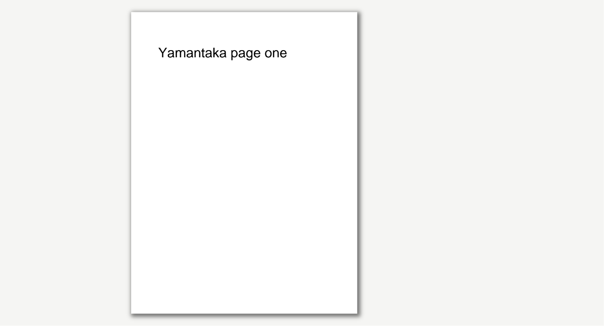

# Yamantaka

Yamantaka es un lector PDF local y ligero para documentos y sesiones largas de
lectura. No copia ni sube los PDF, no requiere cuenta y conserva biblioteca,
progreso, preferencias, sesiones y marcadores en el dispositivo.

El nombre visible está centralizado en `lib/app/app_config.dart`.

## Estado verificado

Base funcional Flutter 0.1.0 para Windows, Android e iOS, validada entre el 28
y el 29 de julio de 2026:

- `flutter analyze`: aprobado, sin incidencias.
- `flutter test`: 34 pruebas aprobadas.
- PDFium: apertura, bitmap nativo, extracción y búsqueda verificadas con un PDF
  legal generado durante la prueba.
- SQLite: esquema, migración inicial y repositorios verificados en memoria.
- Integración Windows: aprobada con `ui.Image`, lectura de píxeles, pintura
  nativa, zoom, avance/retroceso, búsqueda, marcador, cierre y restauración.
- `flutter build windows --release`: aprobado; el ejecutable se abrió con un
  PDF real mediante argumento, mostró una ventana receptiva y no abrió
  conexiones TCP durante el smoke.

El estado criterio por criterio está en [NEXT_TODOS.md](NEXT_TODOS.md).

## Funciones disponibles

- Selector nativo, arrastrar y soltar y apertura mediante argumento.
- Biblioteca con continuar leyendo, recientes, progreso, portadas diferidas,
  detección de ausentes y relocalización por huella parcial.
- Visor continuo, de página única o de páginas enfrentadas; portada individual,
  LTR/RTL, zoom, ajuste, rotación, pantalla completa y controles ocultables.
- Restauración con debounce de página, zoom, posición aproximada, tema,
  disposición y márgenes.
- Modo libro y seis fondos no destructivos: claro, marfil, sepia, gris, oscuro
  y negro.
- Búsqueda cancelable, índice, miniaturas y un único panel lateral.
- Marcadores locales con etiqueta opcional.
- Paleta extensible `Ctrl+K` y registro central de atajos.
- Ajustes de apariencia, lectura, biblioteca, caché y privacidad; perfil inicial
  para tinta electrónica.
- Restauración del tamaño y posición de la ventana de escritorio.
- Confirmación antes de abrir enlaces externos y bloqueo de esquemas no seguros.

## Capturas



Captura real de la superficie Flutter durante la integración Windows. Verifica
la portada individual de la vista enfrentada; no es un mockup.

## Requisitos

- Windows 10/11 de 64 bits.
- Flutter estable 3.44.8 o compatible y Dart 3.12.
- Visual Studio 2022 con `Desktop development with C++` y sus componentes
  predeterminados.
- Modo de desarrollador de Windows activado para los enlaces simbólicos que
  necesitan los plugins.

Consulta la [configuración oficial de Flutter para
Windows](https://docs.flutter.dev/platform-integration/windows/setup).
El SDK `.flutter-sdk` usado durante esta iteración es local, está ignorado por
Git y no forma parte del producto.

## Instalación y ejecución

```powershell
flutter doctor -v
flutter pub get
flutter run -d windows
```

También se puede pasar un PDF al ejecutable:

```powershell
flutter run -d windows -- "C:\libros\ejemplo.pdf"
```

## Compilación y pruebas

```powershell
dart format --output=none --set-exit-if-changed lib test integration_test tool
flutter analyze
flutter test
flutter test integration_test -d windows
flutter build windows --release
```

El ejecutable Release se genera en
`build\windows\x64\runner\Release\yamantaka.exe`.
Para crear el PDF legal y reproducible usado en el smoke test:

```powershell
dart run tool/create_test_pdf.dart build/manual/yamantaka-smoke.pdf
```

## Estructura

- `lib/app`: arranque, composición, tema, comandos y atajos.
- `lib/core`: errores, resultados, plataforma y logging privado.
- `lib/features`: biblioteca, lector, búsqueda, marcadores y ajustes.
- `lib/pdf_engine`: contrato del motor, modelos, visor adaptado y caché.
- `lib/storage`: SQLite, rutas, migración y repositorios.
- `test`: pruebas unitarias, de widgets, SQLite y PDFium.
- `integration_test`: flujo nativo con un PDF generado durante la prueba.
- `tool`: utilidades reproducibles de desarrollo y validación.
- `third_party/pdfrx`: parche local, aislado y licenciado de pdfrx 2.4.7.

## Limitaciones actuales

- El desplazamiento se restaura como fracción aproximada de la página, no como
  coordenada tipográfica exacta.
- El visor usa páginas completas virtualizadas; el contrato admite regiones,
  pero todavía no hay teselas.
- No hay OCR: un escaneo sin texto muestra el estado correspondiente.
- Android/iOS están inicializados, pero sus toolchains y UX nativa no se han
  validado.
- Existe una línea base Release de arranque y memoria para el fixture pequeño;
  la matriz con documentos largos, mediana/p95 y fluidez sigue pendiente.
- Falta completar la matriz extensa de PDFs patológicos, DPI, teclado y lector
  de pantalla descrita en `TESTING.md`.
- pdfrx 2.4.7 lleva un parche local de ciclo de vida del codec; debe retirarse
  cuando una versión upstream corregida supere la misma captura nativa.
- El build de desarrollo no está firmado ni empaquetado para distribución.

No se incluyen edición, firma, anotación compleja, nube, cuentas, telemetría,
IA, EPUB ni formatos distintos de PDF.

## Próximo paso

Completar la matriz manual ampliada y las mediciones reproducibles de
[TESTING.md](TESTING.md) y [PERFORMANCE.md](PERFORMANCE.md); después validar
Android y, en macOS, iOS.
