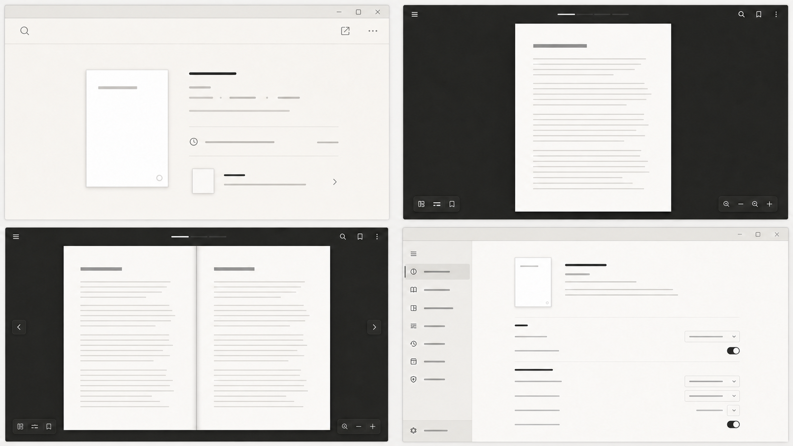

# Especificación integral del rediseño de interfaz de Yamantaka

> Estado: especificación de producto, diseño e implementación futura.  
> Plataforma prioritaria: Windows 10/11 de escritorio.  
> Implementación realizada en esta fase: ninguna.  
> Archivo normativo: este documento.  
> Fecha de auditoría del repositorio y de las capturas: 2026-08-02.

## Convenciones normativas

Este plan está escrito para que otro agente pueda implementarlo sin reinterpretar la intención visual.

- **DEBE / NO DEBE**: requisito obligatorio y criterio de aceptación.
- **DEBERÍA**: comportamiento recomendado; cualquier desviación requiere justificarla y probarla.
- **PUEDE**: opción compatible, no necesaria para completar la fase.
- **Actual**: comportamiento comprobado en el repositorio o en las capturas adjuntas.
- **Propuesto**: comportamiento futuro; no existe todavía salvo que se indique lo contrario.
- Las rutas y clases citadas como actuales existen en el repositorio. Las rutas marcadas como **propuestas** no existen todavía y solo describen una posible organización futura.
- Cuando este documento contradiga una descripción histórica de `DESIGN.md`, `ARCHITECTURE.md` o `NEXT_TODOS.md`, la implementación actual observada tiene prioridad para el diagnóstico y esta especificación tiene prioridad para el rediseño futuro.

---

## 1. Resumen ejecutivo

Yamantaka ya posee una base sólida: arquitectura por funciones, controladores `ChangeNotifier`, un límite explícito alrededor de `pdfrx`, tokens semánticos, persistencia local, navegación por unidad de lectura, geometría probada para página y pliego, biblioteca virtualizada y una política clara de privacidad. El problema no es la ausencia de estructura, sino que la composición visible aún transmite patrones de aplicación Material de propósito general: barras completas, sucesiones de iconos pequeños, superficies rectangulares, switches y dropdowns repetidos, y un lector donde el chrome continúa siendo perceptualmente más estructural de lo deseable.

El rediseño debe convertir Yamantaka en una **mesa de lectura digital monocromática**. El PDF pasa a ser el único objeto de alto contraste y la interfaz se convierte en una capa temporal: aparece por intención o proximidad, nunca cambia el viewport al mostrarse, y desaparece sin dejar barras, huecos ni bordes residuales. La identidad no se apoyará en color de marca, tarjetas, cristal o efectos; se construirá con proporción editorial, tipografía de Windows, espaciado, profundidad ambiental mínima, estados de interacción precisos y movimiento funcional de 80–200 ms.

Las decisiones principales son:

1. Sustituir la barra superior estructural por una **capa superior contextual sin fondo rectangular permanente**, con identidad del documento a la izquierda, selector editorial de modo en el centro cuando haya espacio y un único acceso a herramientas de documento a la derecha.
2. Sustituir la toolbar inferior monolítica por **dos grupos flotantes coordinados**: navegación/página en el centro y zoom/ajuste en el extremo derecho; el progreso queda separado como una línea de 1–2 px.
3. Separar tres estados que hoy están mezclados: chrome visible/autooculto, modo inmersivo deliberado y pantalla completa del sistema.
4. Rehacer el modo Libro como una geometría de pliego: páginas casi contiguas, canal central visual independiente del espacio físico, escala conjunta, paridad configurable y navegación por pliegos.
5. Convertir la biblioteca en una composición editorial adaptada a la cantidad: tratamiento hero para un documento, campo editorial para 2–8 y cuadrícula virtualizada para colecciones grandes.
6. Reorganizar Ajustes en ocho categorías visuales, añadir búsqueda contextual y una previsualización útil, y eliminar la sucesión de filas idénticas y separadores.
7. Ampliar los tokens actuales para distinguir superficies de biblioteca, ajustes, lector, chrome contextual, canal del libro y estados interactivos.
8. Mantener las fortalezas existentes: ninguna dependencia visual nueva por defecto, ninguna escritura en el PDF, visor cacheado, cancelación, privacidad local, alto contraste del sistema y pruebas de geometría.

El resultado buscado no es “más moderno” en abstracto. Debe ser objetivamente verificable: ninguna barra debe reducir permanentemente el área de lectura; mostrar u ocultar chrome no cambia centro, zoom ni rectángulo de página; el pliego completo siempre se centra; la biblioteca con un documento tiene una composición intencional; y las operaciones principales se completan con teclado, foco visible y contraste AA.

## 2. Alcance de esta especificación

Este documento define:

- dirección artística y principios de producto;
- una lámina conceptual no normativa, autorizada posteriormente por el usuario, para aclarar composición y atmósfera;
- tokens de color, tipografía, espaciado, geometría, elevación y movimiento;
- arquitectura del lector, barra superior, controles inferiores, paneles, modo Documento, modo Libro, modo inmersivo y pantalla completa;
- biblioteca, ajustes y componentes reutilizables;
- estados vacíos, carga, error y cancelación;
- interacción de ratón, rueda y teclado;
- comportamiento adaptable, accesibilidad y rendimiento;
- correspondencia con archivos, clases y widgets existentes;
- fases futuras, riesgos, pruebas y criterios de aceptación;
- una lista de tareas preparada para trasladarse manualmente a `NEXT_TODOS.md` en otra fase.

Queda fuera de esta especificación:

- edición o firma de PDF;
- EPUB u otros formatos;
- nube, cuentas, telemetría o sincronización;
- OCR;
- rediseño móvil específico;
- implementación de split o multi-window;
- una tipografía propia o un paquete de iconos nuevo como requisito;
- cambios de marca, emblema o icono de aplicación;
- efectos fotorrealistas de libro, estantería o paso de página 3D.

## 3. Restricciones de la fase

Esta fase es exclusivamente documental.

- No se modifica código fuente, temas, recursos, dependencias, pruebas ni configuración.
- No se implementa ningún componente descrito.
- No se corrigen los problemas encontrados.
- No se modifica `NEXT_TODOS.md`; la lista transferible vive en la sección 37.
- Excepción autorizada posteriormente por el usuario: una única lámina raster no funcional puede acompañar al documento como referencia artística. No es un prototipo ni sustituye medidas, estados o criterios del Markdown.
- No se crean otros prototipos, assets ni archivos auxiliares.
- No se ejecutan generadores, formateadores, migraciones, builds ni pruebas que puedan alterar el repositorio.
- No se realizan commits, staging, cambios de rama ni reversiones.
- Las observaciones técnicas son diagnóstico y propuesta; no implican que el rediseño ya exista.

## 4. Diagnóstico de la interfaz actual

### 4.1 Hallazgos de las capturas adjuntas

**Biblioteca.** La captura con un único PDF muestra dos bandas superiores, una gran superficie negra y una portada centrada de forma casi accidental. El objeto tiene buena presencia, pero el contador, las acciones y los metadatos se encuentran alejados entre sí. El resultado es “un archivo dentro de una cuadrícula vacía”, no una colección privada con una pieza principal. El título y el estado aparecen en una franja inferior, desconectados de la portada.

**Lector Documento.** La página está bien centrada, pero el fondo gris claro ocupa una masa visual dominante y hace que la hoja parezca colocada sobre un rectángulo de aplicación. La barra superior forma un límite duro de 46 px y reúne historial, selector Documento/Libro, búsqueda, cuatro accesos a panel, paleta y menú. La barra inferior reúne navegación, página, zoom, ajuste, layout, tema y marcador dentro de una única superficie de hasta 680 px. Las dos barras compiten con el PDF aunque se oculten después.

**Lector Libro.** Las dos páginas se renderizan completas, pero se perciben como dos hojas separadas: el hueco central es un espacio de canvas, no un canal de encuadernación; no existe una sombra interior diferenciada; el pliego no se lee como un único objeto; y el conjunto puede sentirse demasiado ancho o desplazado. La geometría actual sí posee una base correcta para emparejar y centrar, pero la composición visual no la expresa.

**Ajustes.** La navegación lateral tiene nueve categorías con iconos y selección rectangular. El contenido se organiza como una columna de filas separadas por líneas, con controles a la derecha. La repetición de `Switch`, dropdown y separador produce una apariencia administrativa. “Reducir animaciones” y “Desactivar animaciones” son dos booleanos que pueden crear combinaciones redundantes. La vista previa es demasiado pequeña para explicar el efecto real de tema, canvas, densidad y movimiento.

### 4.2 Causas verificadas en la implementación

- `lib/app/theme/app_theme.dart` construye `ThemeData` con `useMaterial3: true` y tematiza globalmente `AppBar`, `IconButton`, `Switch`, `SegmentedButton`, `PopupMenu`, `NavigationRail`, `Card` y otros controles. Los tokens son propios, pero la anatomía visible continúa siendo Material.
- `ReaderTopBar` en `lib/features/reader/presentation/reader_top_bar.dart` es una superficie de ancho completo, 46 px de altura y borde inferior. En ancho expandido muestra búsqueda más cuatro botones de panel, paleta y menú, además de navegación histórica y selector de modo.
- `_ReaderModeSelector` es personalizado, pero sigue siendo un contenedor segmentado con dos rectángulos y subrayado, muy cercano al patrón de un segmented control genérico.
- `ReaderBottomControls` en `lib/features/reader/presentation/reader_bottom_controls.dart` crea una única superficie de 44 px, borde, sombra y ancho máximo 520/680 px. La jerarquía entre página, zoom, layout, tema y marcador es casi plana.
- `ReaderScreen` en `lib/features/reader/presentation/reader_screen.dart` define `immersive = controller.isFullScreen`; por tanto, no existe estado de dominio separado para inmersión.
- `_revealControls()` programa el autoocultado solo cuando `_isBookMode` es verdadero. La preferencia global existe, pero Documento no recibe el mismo comportamiento.
- `ReaderScreen` reserva `bottomControlHeight + 16` como `viewportMargin` fuera de pantalla completa. Esto evita solapamiento, pero conserva la sensación de un layout condicionado por la barra inferior.
- El panel lateral se superpone en compacto/medio, pero en expandido se acopla y resta su ancho del visor. Abrirlo cambia el espacio útil y el centro perceptual del documento.
- `ReaderViewportMetrics.facingPageLayout()` crea un `spineGap` físico de 10–16 px. No separa ese espacio geométrico del tratamiento visual del canal.
- `ReaderLayoutPolicy.shouldUseFacing()` existe en `lib/app/theme/app_tokens.dart` y tiene pruebas, pero no se usa en `ReaderScreen`; el modo Libro solicita `PdfViewFlow.facing` incluso en 640 px.
- `ReaderTheme` en `lib/features/reader/domain/reader_models.dart` incrusta seis colores directos en el enum; esos canvas quedan fuera de `AppColorTokens`.
- `LibraryArtifactLayout.metricsFor()` centra un único documento con ancho máximo 210 px. `_ArtifactCanvas` centra todo el bloque de 1–6 documentos; no hay una plantilla editorial especial para 1 o 2.
- `SettingsScreen` construye filas con `_SwitchSetting`, `_DropdownSetting`, `_SliderSetting`, `_ShortcutSetting` y `_ActionSetting`, y `_SettingsSectionContent` añade un `Divider` entre casi todos los elementos.
- `AppSettings` guarda `reduceMotion` y `disableAnimations` por separado en `SharedPreferences`, en lugar de un único nivel de movimiento.

### 4.3 Fortalezas que deben conservarse

- `ReaderViewportMetrics`, `FacingPageSpread` y `ReadingUnitNavigation` ya centralizan geometría y navegación; deben evolucionar, no duplicarse.
- `ReaderScreen` cachea el widget del adaptador y evita reconstruirlo por panel, chrome, progreso o marcadores.
- `PdfrxViewerAdapter` normaliza el centro, limita el paneo y vuelve a centrar al cambiar el tamaño.
- El panel monta una sola sección, es redimensionable 280–480 px, guarda con debounce y restaura foco.
- La biblioteca usa `SliverGrid.builder` desde siete documentos y decodifica portadas según tamaño físico/DPR.
- El tema ya detecta alto contraste del sistema y utiliza `Segoe UI Variable` con fallback.
- El registro de comandos centraliza etiquetas, atajos y conflictos.
- Las pruebas existentes cubren portada, pliegos, RTL, indicadores, teclado, foco, breakpoints, contraste y geometría.

### 4.4 Inventario técnico auditado

| Responsabilidad | Evidencia actual | Implicación para el rediseño |
|---|---|---|
| Framework/lenguaje | Flutter con Dart 3.12; `pubspec.yaml` usa Material icons | diseñar desktop con Flutter sin añadir toolkit visual por defecto |
| Arquitectura | features por dominio/presentación/aplicación, `AppServices` como composición | mantener ownership por feature y primitivas compartidas sin repositorios |
| Estado | controladores pequeños `ChangeNotifier`; estado local en widgets | separar `ReaderUiState` efímero de `ReaderController` documental |
| Motor PDF | interfaz `PdfDocumentEngine`, `PdfViewerAdapter` y fork local `third_party/pdfrx` | cambios visuales detrás del adapter; no acoplar UI a pdfrx |
| Persistencia | SQLite para documentos/datos por documento; `SharedPreferencesAsync` mediante `AppSettingsRepository` | migraciones retrocompatibles; no mover datos por razones visuales |
| Navegación | `_AppPage` Library/Reader/Settings en `lib/app/app.dart`, historial propio del Reader | transiciones conservan foco/scroll; no introducir router nuevo sin necesidad |
| Temas | `AppTheme`, `AppColorTokens`, `AppDensityTokens`, `AppInterfaceDensity`, Material 3 y high contrast | ampliar tokens semánticos; Material queda como infraestructura |
| Atajos | `AppCommandRegistry` en `lib/app/shortcuts/app_commands.dart`, defaults y overrides | añadir comandos por registry y respetar scopes/conflictos |
| Componentes reutilizables | `AppSectionHeader`, `AppStatusView`, `AppShortcutHint`, `AppStatusLabel` | evolucionar/reutilizar antes de crear duplicados `Yama*` |
| Dependencias UI | Flutter SDK, `window_manager`, `file_selector`, `desktop_drop`, `pdfrx` local | no añadir blur/icon/font packages para el rediseño inicial |
| Windows | fullscreen/maximize workaround, DPI/metrics y foco de diálogos | probar estado real de ventana, snap y monitores mixtos |
| Render/caché | adapter cacheado, página completa y presupuesto aproximado de 112 MiB | chrome no recrea viewer; medir spreads/transiciones |

Fuentes inspeccionadas: `README.md`, `ARCHITECTURE.md`, `DESIGN.md`, `DECISIONS.md`, `NEXT_TODOS.md`, documentos bajo `docs/architecture/`, `PERFORMANCE.md`, `TESTING.md`, `pubspec.yaml`, implementación de `lib/`, tests de `test/` e `integration_test/`, y capturas adjuntas/del repositorio. `NEXT_TODOS.md` se consultó solo en lectura.

## 5. Problemas detectados por pantalla

| Pantalla | Problema actual | Consecuencia | Decisión de rediseño | Componente actual afectado | Comprobación futura |
| --- | --- | --- | --- | --- | --- |
| Biblioteca vacía | Estado centrado correcto pero genérico | Se percibe como pantalla de utilidad | Mantener una sola acción, sumar jerarquía editorial y ayuda de drop sin ilustración | `EmptyLibraryState`, `AppStatusView` | Una acción primaria, foco inicial, sin tarjeta ni imagen genérica |
| Biblioteca con 1 documento | Portada aislada en el centro y metadatos lejos | Sensación de producto incompleto | Plantilla hero asimétrica con portada y bloque tipográfico relacionado | `_ArtifactCanvas`, `LibraryArtifactLayout`, `DocumentInfoOverlay` | El documento ocupa una composición deliberada en 16:9, 16:10 y compacto |
| Biblioteca 2–8 | Wrap centrado casi uniforme | Falta ritmo editorial | Plantillas deterministas por cantidad, con un documento reciente dominante | `_ArtifactCanvas`, `ArtifactDocument` | Sin solapamiento; orden visual y de foco coinciden |
| Biblioteca grande | Grid funciona pero conserva doble chrome | Densidad de controles innecesaria | Unificar contador, búsqueda y filtro en una sola capa superior | `_LibraryCommandBar`, `LibraryScreen` | Buscar/filtrar a una interacción, cuadrícula virtualizada |
| Lector Documento | Barra completa arriba y toolbar completa abajo | El PDF parece contenido dentro de una app | Chrome contextual en overlay; dos grupos inferiores; canvas de borde a borde | `ReaderScreen`, `ReaderTopBar`, `ReaderBottomControls` | Mostrar/ocultar no modifica `PdfViewController.zoom`, página ni centro |
| Lector Libro | Dos hojas separadas por hueco | No se percibe un libro abierto | Gap geométrico mínimo + canal visual + escala conjunta + paridad configurable | `ReaderViewportMetrics`, `PdfrxViewerAdapter`, `FacingPageSpread` | Pliego centrado, canal 12–16 px visual y separación física 0–2 px |
| Panel lateral | Acoplado resta ancho en expandido | El PDF cambia de centro al abrir | Overlay por defecto; anclaje explícito opcional | `ReaderSidePanel`, `ReaderScreen` | Apertura estándar no cambia zoom/centro; foco vuelve al invocador |
| Ajustes | Nueve categorías y filas repetidas | Apariencia Android/administrativa | Ocho categorías visuales, búsqueda contextual, grupos sin separadores por fila y preview útil | `SettingsScreen` y widgets privados de ajuste | Opción localizable por texto; teclado completo; sin muros de filas |
| Diálogos/menús | Primitivas Material con variaciones locales | Experiencia fragmentada | Contrato compartido de overlays y foco | `AppTheme`, `CommandPalette`, diálogos actuales | Escape cierra solo la capa superior y restaura foco |

## 6. Principios de diseño de Yamantaka

### 6.1 El contenido domina

El PDF es el único objeto que puede ocupar la mayor superficie, usar blanco cercano al papel y proyectar sombra perceptible. En biblioteca domina la portada; en ajustes domina la opción o preview activa, no la navegación. Ningún título de aplicación, marca o barra permanente debe tener más contraste que la página.

### 6.2 La interfaz aparece por intención

Los controles se revelan por movimiento significativo, proximidad a un borde, clic sobre canvas, tecla relevante o foco. No se muestran por ruido mínimo del ratón. Búsqueda, índice, miniaturas, marcadores y anotaciones viven en una única superficie lateral contextual. Las acciones infrecuentes viven en menú o paleta.

### 6.3 Continuidad espacial

Mostrar u ocultar chrome no cambia el rectángulo de layout del PDF. El mismo centro, zoom y unidad de lectura se conservan. Un panel estándar se superpone. Un panel anclado solo cambia el espacio útil después de una acción explícita y conserva el centro dentro del espacio restante. Cambiar Documento/Libro normaliza la unidad una vez y anima únicamente una transición corta entre geometrías.

### 6.4 Precisión de escritorio

Los iconos visuales miden 16–18 px, los objetivos 40×40 px, las filas 56–68 px según contenido y los menús 32–36 px por opción. Hover, foco, menú contextual, rueda, arrastre y atajos son comportamientos de primera clase. No se sobredimensionan controles para imitar táctil.

### 6.5 Identidad monocromática editorial

La personalidad nace de los fondos cálidos, el contraste medido, el ritmo de 4 px, la tipografía Segoe, los indicadores lineales, el canal del libro y la composición asimétrica controlada. Los colores saturados se reservan a error, advertencia y éxito. La selección usa simultáneamente tono, borde y forma.

### 6.6 Movimiento funcional

Cada animación responde a una pregunta: qué apareció, de dónde vino o qué unidad cambió. No hay rebote, rotación, parallax continuo, escalas grandes ni blur animado. Las acciones repetidas interrumpen o coalescen la animación; nunca forman una cola lenta.

### 6.7 Lectura sin ruido

Después de la inactividad, el lector conserva como máximo una línea de progreso de 1 px o un indicador breve solicitado por el usuario. En modo inmersivo incluso esa línea puede ocultarse. El cursor desaparece cuando no aporta información. Las páginas no compiten con marcas, sombras fuertes o gradientes visibles.

### 6.8 Honestidad técnica

Los efectos deben encajar con Flutter, PDFium, el fork local de `pdfrx` y el presupuesto de memoria existente. Si un efecto exige reconstruir el visor, renderizar páginas extra, añadir blur grande o extraer color por frame, se rechaza o se sustituye por una versión estática y cacheada.

## 7. Dirección artística

### 7.1 Concepto: “mesa de lectura nocturna”

Yamantaka debe sentirse como un espacio privado y silencioso alrededor de un objeto editorial. La aplicación no dibuja una mesa literal; toma de esa idea cuatro propiedades:

- el documento es el objeto iluminado;
- el fondo absorbe atención en lugar de emitirla;
- las herramientas están al alcance, pero fuera del centro;
- la profundidad indica jerarquía, no decoración.

### 7.2 Rasgos obligatorios

- Fondos no puros: grafito/negro verdoso en oscuro y papel mineral en claro.
- Superficies planas; elevación solo en página, popover, panel temporal y grupos de control.
- Radios pequeños: 4–8 px en la mayoría de controles.
- Una única línea o borde para selección/foco; no doble contorno.
- Tipografía de Windows, sin fuente empaquetada.
- Iconografía de una única familia visual, 18 px por defecto.
- Espacio negativo con función: centrar el pliego, separar grupos, crear una lectura editorial de biblioteca.
- Top chrome sin banda opaca permanente en el lector.
- Gradientes únicamente como velos ambientales estáticos y de baja opacidad.

### 7.3 Antipatrones prohibidos

- barras rectangulares de ancho completo como estructura permanente del lector;
- tarjetas para cada documento, ajuste o grupo;
- pills/cápsulas repetidas para todo;
- glassmorphism, blur de fondo o acrylic como lenguaje principal;
- sombras mayores que la página;
- acentos azules, morados o saturados como identidad;
- selector Documento/Libro dentro de un rectángulo segmentado genérico;
- cuatro o más iconos de panel consecutivos;
- imitación de un libro 3D, curvatura visible o giro de hoja;
- derivar un color saturado de la portada;
- animar permanentemente fondos, luces, progreso o portadas.

### 7.4 Lámina conceptual no normativa



La lámina muestra, en orden de lectura, Biblioteca con una obra, Reader Documento, Reader Libro y Ajustes. Sirve para transmitir proporción general, fondos cálidos, protagonismo de la hoja, separación de controles y densidad desktop.

Reglas de interpretación:

- El Markdown es normativo; si la imagen difiere en número de controles, medidas, iconos, texto o estados, prevalecen las secciones técnicas.
- Los trazos grises son placeholders, no labels ni datos propuestos.
- La lámina no prescribe una title bar custom, posiciones físicas inmutables, contenido PDF, nuevos comandos ni funciones.
- Biblioteca debe seguir la composición “Mesa editorial” sin sidebar permanente, como aparece en el cuadrante superior izquierdo final.
- Los rectángulos negros inferiores del Reader representan grupos flotantes, no una barra reservada.
- Libro debe usar la geometría exacta de la sección 17; la imagen solo comunica la percepción de un pliego unido.
- Ajustes conserva navegación lateral únicamente en ancho desktop y debe adaptarse según la sección 21.
- No extraer colores, iconos o dimensiones directamente de los píxeles de esta imagen; usar los tokens de las secciones 8–11.

## 8. Sistema de color

### 8.1 Paleta semántica propuesta

Los valores son sRGB. En sombras se indica color más opacidad para evitar ambigüedad entre formatos ARGB y RGBA.

| Token propuesto | Claro | Oscuro | Uso normativo |
| --- | --- | --- | --- |
| `appBackground` | `#ECEAE4` | `#111310` | Base general fuera del lector |
| `readerBackground` | `#E7E4DC` | `#141613` | Entorno de lectura por defecto cuando no se elige preset |
| `libraryBackground` | `#EDEBE5` | `#10120F` | Campo editorial de biblioteca |
| `settingsBackground` | `#F1EFE9` | `#151714` | Fondo de ajustes |
| `surfaceElevated` | `#F7F5EF` | `#1C1F1B` | Panel, diálogo y preview |
| `surfaceFloating` | `#FBF9F3` | `#232620` | Menú y grupos flotantes |
| `surfaceActive` | `#DCDAD3` | `#30342D` | Selección persistente |
| `surfaceHover` | `#E4E2DB` | `#242720` | Hover de objetivo |
| `surfacePressed` | `#D3D1CA` | `#34382F` | Pressed |
| `textPrimary` | `#1C1E1A` | `#F0F1EB` | Texto principal |
| `textSecondary` | `#5D6159` | `#B7BBB1` | Descripción y metadatos útiles |
| `textTertiary` | `#777B72` | `#8F948A` | Contexto de baja prioridad |
| `textDisabled` | `#9B9E97` | `#666B62` | Texto desactivado |
| `iconNormal` | `#62665E` | `#A9ADA4` | Icono en reposo |
| `iconActive` | `#20221E` | `#F3F4EE` | Icono activo |
| `iconDisabled` | `#A4A79F` | `#5E635A` | Icono desactivado |
| `borderSubtle` | `#D5D2CA` | `#2B2F29` | Borde excepcional de superficie |
| `separatorExceptional` | `#BBB8AF` | `#3B4038` | Separación entre grupos, no filas |
| `ambientShadow` | `#000000` @ 12 % | `#000000` @ 40 % | Panel/popover |
| `pageShadow` | `#000000` @ 18 % | `#000000` @ 52 % | Hoja sobre canvas claro/grafito; se reduce en carbón |
| `paperWhite` | `#F8F7F2` | `#F8F7F2` | Referencia de papel; no fondo de app |
| `ivory` | `#EDE7D8` | `#EDE7D8` | Preset de lectura cálido |
| `nightBackground` | `#0B0D0B` | `#0B0D0B` | Preset carbón; no negro absoluto |
| `bookSpineChannel` | `#BDB8AD` | `#080A08` | Núcleo del gradiente central, con opacidad contextual |
| `selection` | `#D8D7CF` | `#30342D` | Selección; siempre acompañada de borde o indicador |
| `focus` | `#50594E` | `#D8DED3` | Anillo de foco 2 px |
| `error` | `#9C4943` | `#D9847C` | Error funcional |
| `warning` | `#85652F` | `#D0AD70` | Advertencia funcional |
| `success` | `#4E7058` | `#8EB397` | Éxito funcional |

### 8.2 Combinaciones permitidas

- `textPrimary` sobre cualquiera de los cuatro fondos principales y superficies.
- `textSecondary` sobre fondos principales y `surfaceElevated`.
- `textTertiary` solo para metadatos no esenciales; no para instrucciones, botones o estado.
- `surfaceFloating` sobre el canvas con borde sutil o sombra, pero no ambos con alta intensidad.
- `focus` debe alcanzar contraste no textual mínimo 3:1 con la superficie adyacente.
- Error/advertencia/éxito siempre con icono, título o borde; nunca como único indicador.

### 8.3 Combinaciones prohibidas

- `textTertiary` o `textDisabled` como texto principal.
- `surfaceActive` ocupando grandes fondos de pantalla.
- `paperWhite` como fondo completo de Ajustes o Biblioteca.
- `nightBackground` debajo de texto secundario sin verificar contraste.
- sombras negras densas sobre cada fila o portada.
- color de portada sin desaturar aplicado a chrome, botones o texto.

### 8.4 Contraste y coherencia entre temas

- Verificar WCAG AA: 4,5:1 para texto normal, 3:1 para texto de 18 pt/14 pt semibold y 3:1 para foco/controles.
- Modo oscuro usa tres niveles cercanos (`#0B0D0B`, `#111310`, `#1C1F1B`) para profundidad; no llena todo con `#000000`.
- Modo claro usa papel mineral y marfil; el blanco de la página mantiene el máximo contraste sin que toda la app sea clínica.
- Los nombres semánticos y relaciones de luminosidad son iguales en ambos temas. Cambia el valor, no el significado.
- Alto contraste del sistema continúa sustituyendo tokens mediante `AppTheme`; los gradientes, transparencias y sombras se eliminan.

### 8.5 Presets de fondo del lector

**Incluir como presets principales:**

| Nombre | Valor | Propósito |
| --- | --- | --- |
| Papel | `#F8F7F2` | Lectura diurna; evita blanco puro |
| Marfil | `#EDE7D8` | Lectura larga cálida; predeterminado recomendado |
| Papel cálido | `#E2D5BE` | Alternativa a sepia, menos amarilla que la actual |
| Gris neutro | `#B8BAB5` | Reduce contraste de una página blanca en entornos luminosos |
| Grafito | `#242722` | Oscuro moderado con página visible |
| Carbón | `#0B0D0B` | Inmersión nocturna sin negro absoluto |

**No incluir como presets normales:** blanco puro y negro puro. Pueden permanecer como override del perfil `electronicInk`, donde la ausencia de sombra, transparencia y animación es intencional. El PDF nunca se recolorea ni filtra; cambia únicamente el canvas.

## 9. Sistema tipográfico

### 9.1 Familia y disponibilidad

- Familia principal: `Segoe UI Variable`, ya configurada en `AppTheme` y disponible en Windows 11.
- Fallback: `Segoe UI`, después la fuente sans-serif del sistema.
- No se empaqueta ninguna fuente. Esto evita dependencia, licencia adicional y divergencia de render.
- Pesos permitidos: 400, 500 y 600. El 700 queda reservado a mensajes críticos excepcionales; no se usa en chrome.
- Números de página, porcentaje, recuentos y atajos usan cifras tabulares.

### 9.2 Escala propuesta

| Rol | Tamaño/altura | Peso | Tracking | Uso |
| --- | --- | --- | --- | --- |
| `screenTitle` | 24/30 px | 600 | -0,2 px | Biblioteca, Ajustes |
| `sectionTitle` | 18/24 px | 600 | -0,1 px | Grupos principales |
| `dialogTitle` | 18/24 px | 600 | -0,1 px | Diálogos |
| `documentTitle` | 13/18 px | 500 | 0 | Nombre en chrome del lector |
| `libraryHeroTitle` | 20/26 px | 600 | -0,1 px | Documento principal |
| `body` | 14/20 px | 400 | 0 | Texto y descripción |
| `bodyCompact` | 13/18 px | 400 | 0 | Menús y panel |
| `controlLabel` | 12/16 px | 500 | +0,1 px | Toolbar, botones, selector de modo |
| `metadata` | 12/16 px | 400 | +0,05 px | Fecha, páginas, autor |
| `indicator` | 12/16 px | 500 | +0,1 px | Página, rango, zoom |
| `tooltip` | 12/16 px | 400 | 0 | Tooltip con atajo |
| `micro` | 11/15 px | 500 | +0,1 px | Estado terciario; mínimo absoluto |
| `emptyTitle` | 20/26 px | 600 | -0,1 px | Estado vacío/error |
| `emptyBody` | 14/20 px | 400 | 0 | Explicación de estado |

### 9.3 Reglas por superficie

- El nombre del documento permanece presente cuando el chrome aparece, pero con `documentTitle`, tono secundario y ancho flexible. Tooltip y semántica contienen el nombre completo.
- Los controles no usan mayúsculas completas.
- La jerarquía se crea por posición, tamaño y espacio antes de aumentar peso.
- Menús, tooltips y paneles no bajan de 12 px; `micro` se limita a metadatos no esenciales.
- Ajustes usa título de sección de 18 px, subtítulo de 13–14 px y etiquetas de 14 px; los controles no deben competir con el label.
- Mensajes de error usan el mismo tamaño que otros estados; la gravedad se expresa con icono, texto y acción, no con bold excesivo.
- A escalado de texto 200 %, los labels pueden envolver a dos líneas; controles pasan debajo, nunca se recortan.

## 10. Iconografía

### 10.1 Auditoría actual

- `Icons.tune_rounded` se usa para Ajustes en la barra de biblioteca y para Filtrar/ordenar en la segunda barra; dos acciones diferentes comparten símbolo muy próximo.
- Las flechas pequeñas de historial en `ReaderTopBar` pueden confundirse con anterior/siguiente página, que viven abajo.
- `grid_view_outlined` para miniaturas, `format_list_bulleted_rounded` para índice, `bookmarks_outlined` y `rate_review_outlined` forman cuatro símbolos consecutivos de igual peso y baja diferenciación jerárquica.
- `view_carousel_outlined` en los controles inferiores representa disposición de páginas, pero puede interpretarse como carrusel.
- `tonality_outlined` para tema de lectura no comunica inequívocamente “fondo del lector”.
- `keyboard_command_key_rounded` es reconocible por usuarios avanzados, pero no por todos; debe acompañarse de tooltip “Paleta de comandos”.

### 10.2 Sistema recomendado

- Mantener inicialmente la familia `Icons` incluida por Flutter para no añadir dependencia ni asset. Curar una lista única de variantes `outlined`/`rounded`; relleno solo expresa selección (por ejemplo, marcador activo).
- Tamaño visual: 18 px por defecto; 16 px en menús densos; 20 px solo en acción primaria o estado vacío.
- Caja óptica: 20×20 px centrada dentro de objetivo 40×40 px.
- No afirmar un grosor de trazo exacto mientras se utilicen glyphs de `Icons`, porque Flutter no expone un parámetro uniforme de stroke. El objetivo visual es 1,5–1,75 px; si una auditoría futura demuestra variación inaceptable, evaluar un set vectorial first-party como fase separada.
- Estado activo: icono relleno o indicador lineal + tono activo. Estado inactivo: `iconNormal`. Disabled: `iconDisabled`, sin opacidad adicional sobre toda la fila.
- Hover/foco revela superficie 40×40 con radio 6; en reposo el botón puede ser completamente transparente.

### 10.3 Visibilidad por acción

| Acción | Tratamiento recomendado |
| --- | --- |
| Volver a biblioteca | Icono aislado, siempre visible cuando hay chrome |
| Buscar | Icono + etiqueta “Buscar” en ancho expandido; icono en medio/compacto |
| Documento/Libro | Dos etiquetas de texto con indicador inferior; icono opcional, sin caja segmentada |
| Herramientas de documento | Un botón combinado “Herramientas” con chevron; abre selector de panel |
| Marcador | Visible en grupo de navegación solo si se confirma como acción frecuente; estado filled/outline |
| Página anterior/siguiente | Iconos visibles en grupo inferior y teclas |
| Zoom +/- | Iconos visibles en grupo de zoom; porcentaje editable |
| Ajustar página/ancho/100 % | Menú de zoom y atajos `Ctrl+0/2/1` |
| Rotar, márgenes, información, ajustes | Menú secundario o paleta |
| Historial de ubicación | Atajos `Alt+←/→` y menú; no dos flechas junto a navegación de página |

## 11. Espaciado y geometría

### 11.1 Escala base

La unidad base es 4 px. Se admiten 2 y 6 px para alineación óptica. Escala: `2, 4, 6, 8, 12, 16, 20, 24, 32, 40, 48, 64`.

### 11.2 Tokens geométricos propuestos

| Token | Valor | Regla |
| --- | ---: | --- |
| `desktopTarget` | 40 px | Objetivo mínimo interactivo |
| `compactMenuRow` | 34 px | Menú de escritorio; puede crecer por texto |
| `topRevealZone` | 24 px | Proximidad al borde superior |
| `topChromeHeight` | 48 px | Caja de alineación, no barra opaca |
| `topVeilDepth` | 72 px | Gradiente ambiental estático |
| `bottomControlHeight` | 40 px | Grupos inferiores |
| `controlGap` | 4–6 px | Dentro de grupo |
| `controlGroupGap` | 16 px | Entre grupos |
| `readerOuterMarginMin` | 16 px | Ventana baja/estrecha |
| `readerOuterMarginDefault` | 28 px | Documento |
| `readerOuterMarginWide` | 40–56 px | Pantalla grande |
| `continuousPageGap` | 24 px | 16 compacto, 32 expandido |
| `bookPhysicalPageGap` | 0–2 px | Espacio real entre rectángulos |
| `bookSpineVisualWidth` | 12–16 px | Gradiente superpuesto, no hueco |
| `readerPanelMin` | 288 px | Panel lateral |
| `readerPanelDefault` | 336 px | Panel lateral |
| `readerPanelMax` | 480 px | Panel lateral |
| `settingsNavWidth` | 220 px | 200 px en medio; desaparece en compacto |
| `settingsContentMax` | 760 px | Evita líneas demasiado largas |
| `settingsRowMin` | 56 px | Sin descripción; crece, no altura fija |
| `settingsRowWithDescription` | 64–72 px | Según wrap/escalado |
| `libraryHeroCoverWidth` | 220–300 px | `clamp(220, 18vw, 300)` |
| `librarySmallCoverWidth` | 164–196 px | Campo de 2–8 |
| `libraryGridCoverWidth` | 144–184 px | Colecciones grandes |
| `radiusIndicator` | 2 px | Línea/progreso |
| `radiusControl` | 6 px | Botones/campos |
| `radiusFloating` | 8 px | Grupo flotante/panel |
| `radiusDialog` | 10 px | Diálogo; no tarjetas repetidas |
| `borderHairline` | 1 px | Bordes sutiles |
| `focusBorder` | 2 px | Foco visible |

### 11.3 Sombras

| Nivel | Sombra | Uso |
| --- | --- | --- |
| 0 | ninguna | Filas, barras, navegación |
| Página | `0 2 10`, 12–18 % | Hoja en canvas claro/grafito |
| Flotante | `0 4 14`, 14–20 % | Grupos inferiores y panel temporal |
| Popover | `0 8 24`, 20–28 % | Menú/diálogo |

No usar elevación Material como única definición. La implementación futura debe centralizar offset, blur y alpha, no solo un número de `elevation`.

## 12. Arquitectura general del lector

### 12.1 Capas, de fondo a frente

1. **Canvas de lectura**: cubre todo el `ReaderScreen`.
2. **Viewport PDF**: ocupa todo el espacio de ventana; chrome no lo recorta.
3. **Tratamiento de página/pliego**: sombra exterior y canal central.
4. **Indicadores mínimos**: progreso de 1–2 px y estado temporal.
5. **Chrome contextual**: capa superior y grupos inferiores.
6. **Panel lateral**: overlay por defecto; anclado solo por acción explícita.
7. **Menús/diálogos/paleta**: capa modal superior.

### 12.2 Estado de presentación propuesto

La implementación futura debe separar conceptualmente:

- `chromeVisibility`: `visible`, `temporarilyHidden`;
- `immersionMode`: `normal`, `immersive`;
- `windowMode`: `windowed`, `fullScreen`;
- `panelPresentation`: `closed`, `overlay`, `pinned`;
- `cursorVisibility`: derivado de actividad y modo, no preferencia independiente.

Estos nombres son una propuesta de modelo, no clases existentes. `ReaderController.isFullScreen` actual no es suficiente para representar la matriz.

### 12.3 Invariantes

- Cambiar `chromeVisibility` NO DEBE modificar constraints, zoom, página ni centro del visor.
- Abrir panel overlay NO DEBE reconstruir el visor ni cambiar su configuración.
- Entrar en inmersivo NO DEBE activar automáticamente pantalla completa.
- Entrar en pantalla completa NO DEBE implicar inmersivo; conserva el modo previo.
- Si ambos están activos, se pueden desactivar de forma independiente.
- Un cambio de canvas no modifica los píxeles del PDF.
- El título de ventana y la accesibilidad siguen disponibles aunque el chrome visual esté oculto.

### 12.4 Efectos al servicio del documento

Cada efecto es opcional y debe justificarse por una función. La intensidad se expresa como límite máximo; si la prueba visual funciona con menos, se reduce.

| Efecto | Problema que resuelve y prescripción | Intensidad | Cuándo se desactiva | Coste y medición | Alternativa simple |
|---|---|---|---|---|---|
| Oscurecimiento periférico | Reduce la presencia de bordes en canvas oscuro sin encerrar la página | vignette estática en 48 px, caída máxima 6 % | claro, high contrast, e-ink, ventana pequeña | overdraw; medir raster p95 | fondo plano un tono más oscuro |
| Gradiente ambiental de chrome | Hace legibles controles superpuestos sin una barra | 72 px, 14–18 % junto al borde y 0 % al interior | chrome oculto, high contrast, e-ink | fill simple; prohibido blur/saveLayer | scrim plano bajo cada grupo |
| Atenuación del fondo | Separa panel/modal del documento y mantiene contexto | 8 % claro / 12 % oscuro | panel pinned, high contrast, e-ink | una capa de color; medir hit/raster | borde/sombra del panel sin scrim |
| Sombra natural de página | Distingue hoja blanca de canvas claro y conserva su forma | `0 2 10`, negro 12–18 %; menor en oscuro | high contrast, e-ink, memoria/raster bajo presión | raster/overdraw; comparar con baseline | borde de 1 px de contraste medio |
| Iluminación ambiental | Evita que el pliego parezca dos rectángulos sin vínculo | solo canal del Libro; variación ≤2 % fuera de 4–6 px interiores | Documento, high contrast, e-ink, GPU lenta | gradiente estático; medir raster | canal plano de 1–2 px |
| Color medio de portada/página | Podría relacionar Biblioteca y documento, pero introduce coste y ruido cromático | **no recomendado por defecto**; si se investiga, desaturación ≥90 % y alpha ≤4 % | siempre en high contrast/e-ink o si no hay caché | decodificación/extracción y cache invalidation | usar `libraryBackground` fijo |
| Modo de enfoque | Delibera una sesión sin chrome permanente | estado inmersivo explícito; no modifica el PDF | no se activa automáticamente | coste nulo salvo overlays; medir estado/foco | ocultación manual `Ctrl+H` |
| Ocultación de cursor | Elimina un objeto brillante inmóvil sobre la página | tras 2 s sin movimiento en inmersivo | foco en control, tecnología asistiva, drag, menú | timer/eventos; probar churn y recuperación | mover cursor a borde sin ocultarlo |
| Controles por proximidad | Recupera orientación sin barras permanentes | 24 px arriba, 10 px abajo; activación por entrada real | touch/AT cuando cause activaciones accidentales | hit testing; medir eventos y links | clic sobre fondo para revelar todo |
| Progreso en borde inferior | Mantiene posición con chrome oculto | 1 px, 22 % de contraste, actualización 120 ms | preferencia off, inmersivo estricto, high contrast si no alcanza 3:1 | repaint pequeño; no animación continua | texto temporal al navegar |
| Transición Biblioteca→Reader | Mantiene continuidad del objeto seleccionado | crossfade de 160 ms; sin hero de portada hasta probar geometría | movimiento reducido/off, apertura lenta | dos composiciones breves; medir primera página | sustitución inmediata con placeholder estable |

No se propone blur de fondo, extracción cromática continua, parallax, iluminación animada ni transformación 3D. Si un efecto no mejora orientación, legibilidad o continuidad en una prueba comparativa, se elimina.

## 13. Rediseño de la barra superior

### 13.1 Composición propuesta

No existe una banda opaca permanente. Cuando se revela, un velo vertical de 72 px pasa de 14–18 % de opacidad del canvas a transparente. Sobre él aparecen tres zonas:

- **Izquierda**: Volver (40×40), título del documento y estado no persistente si existe.
- **Centro**: selector editorial `Documento  Libro` solo en ancho medio/expandido. El activo usa texto primario y una línea de 2 px; el inactivo usa texto secundario. No hay contenedor exterior.
- **Derecha**: Buscar, botón combinado Herramientas y Más. En expandido Buscar/Herramientas pueden llevar etiqueta; en medio son iconos; en compacto el selector y Herramientas pasan a Más.

Altura de alineación: 48 px. Padding lateral: 12 px compacto, 20 px medio, 24 px expandido. Los controles no se pegan al borde nativo de ventana.

### 13.2 Jerarquía de acciones

| Acción actual | Nueva ubicación | Visibilidad |
| --- | --- | --- |
| Volver a biblioteca | Zona izquierda | Siempre que se revele chrome |
| Nombre del documento | Zona izquierda | Siempre; tono secundario y elipsis |
| Página anterior/siguiente | Grupo inferior + teclado | No en barra superior |
| Documento/Libro | Centro editorial | Medio/expandido; menú/paleta en compacto |
| Buscar | Zona derecha | Primera capa |
| Miniaturas/Índice/Marcadores/Anotaciones | Selector Herramientas | Una sola entrada, muestra sección activa |
| Paleta | `Ctrl+K` y Más | No icono permanente salvo preferencia avanzada futura |
| Historial atrás/adelante | `Alt+←/→`, menú/paleta | No flechas permanentes |
| Rotar/Márgenes/Información/Ajustes/Abrir otro | Más | Secundario |

### 13.3 Aparición y desaparición

- Revelar por movimiento mayor de 2 px, tecla relevante, clic sobre canvas o entrada en los 24 px superiores.
- No reiniciar el temporizador por `MouseRegion.onHover` si la posición no cambia de forma significativa.
- Autoocultar después de 2,4 s en modo normal si la preferencia está activa; 1,8 s en inmersivo.
- Mantener visible mientras un control tiene foco, un menú está abierto, el cursor está dentro del chrome o hay un panel abierto por teclado.
- Animación: opacidad 0→1 y desplazamiento vertical -4→0, 120 ms, `easeOutCubic`; ocultación 100 ms, `easeInCubic`.
- Con movimiento reducido: opacidad en 0 ms; sin desplazamiento.

### 13.4 Estados

- Reposo: sin superficie, `iconNormal`.
- Hover: `surfaceHover`, radio 6.
- Pressed: `surfacePressed` durante 80 ms.
- Focus: borde exterior 2 px `focus`, no depender de hover.
- Selected: `surfaceActive` + icono activo o línea inferior.
- Disabled: icono/texto disabled, tooltip explica por qué cuando sea útil.

## 14. Rediseño de los controles inferiores

### 14.1 Alternativa A: una cápsula simplificada

**Composición:** anterior, página editable, siguiente, zoom, +/- y menú de ajuste dentro de una superficie centrada de 40 px y máximo 440 px.

**Ventajas:** una única zona de foco visual; fácil de descubrir; buena en ventanas estrechas.

**Inconvenientes:** continúa pareciendo una toolbar flotante; mezcla navegación y escala; crece al añadir marcador o progreso; el centro del documento queda visualmente ocupado.

**Comportamiento:** se oculta como bloque. En compacto, porcentaje y labels pasan al menú. Accesible, pero el orden de tabulación es largo dentro de una sola pieza.

### 14.2 Alternativa B: dos grupos coordinados

**Composición:**

- Grupo central: anterior, indicador/página editable, siguiente. Máximo 196 px.
- Grupo derecho: reducir, zoom editable, aumentar, menú de ajuste. Máximo 232 px.
- Progreso: línea independiente de 1–2 px en el borde inferior.
- Marcador: en Herramientas o como botón final del grupo central solo si los datos de uso justifican primera capa.

**Ventajas:** jerarquía clara, menos sensación de barra, navegación centrada y zoom fuera del eje del documento. Cada grupo puede colapsar de forma independiente.

**Inconvenientes:** exige reglas responsive; puede fragmentarse si se añaden más grupos.

**Comportamiento:** ambos aparecen coordinados. En ventana menor de 760 px, el grupo de zoom se reduce a `– 125 % +` y el ajuste vive en el porcentaje. Menor de 640 px, ambos se fusionan temporalmente en la alternativa A compacta.

### 14.3 Recomendación

Adoptar **Alternativa B**, limitada estrictamente a dos grupos. No añadir un tercer grupo. La variante A se usa solo como fallback compacto, no como composición principal.

### 14.4 Campos editables

- Indicador de página: clic o `Ctrl+G` transforma `12–13 / 286` en campo. Acepta una página; en Libro normaliza al pliego correspondiente. Enter confirma, Escape cancela y restaura el valor.
- Zoom: clic en `125 %` abre campo numérico 10–800 %. Enter confirma y mantiene el punto focal; Escape cancela.
- `Ctrl+0`: ajustar página/pliego.
- `Ctrl+1`: tamaño real 100 %.
- `Ctrl+2`: ajustar ancho.
- Tooltip muestra label y atajo resuelto.

### 14.5 Progreso en reposo

Con chrome oculto puede permanecer una línea de 1 px al 22 % de contraste y longitud proporcional. Desaparece en inmersivo si “progreso mínimo” está desactivado. No se anima continuamente; solo interpola al cambiar de unidad durante 120 ms, o salta con movimiento reducido.

## 15. Paneles secundarios

### 15.1 Secciones

Una única superficie aloja `thumbnails`, `outline`, `bookmarks`, `annotations` y `search`, manteniendo la enumeración actual `ReaderPanelSection`. Información del documento permanece como diálogo o panel inspector separado, porque no comparte navegación de página.

### 15.2 Presentación por defecto

- Overlay desde el borde derecho, 336 px, límites 288–480 px.
- En compacto: `min(viewportWidth - 24, 360)` y máximo 88 % del ancho.
- Scrim 12 % en oscuro / 8 % en claro; clic fuera cierra.
- El PDF no cambia centro ni zoom.
- Encabezado 48 px, título, selector de sección compacto y cerrar.
- Resize mantiene el handle actual, objetivo 10 px y ajuste de 16 px por flecha.

### 15.3 Modo anclado explícito

Puede existir una acción “Anclar panel” solo en ancho expandido. Al anclar:

- el usuario acepta que el área restante cambie;
- el documento se centra dentro del espacio restante sin alterar el zoom personalizado;
- un fit activo se recalcula una vez usando el nuevo viewport;
- al desanclar se restaura el centro/fit anterior;
- el estado anclado puede persistirse por ventana, no por documento, solo si la arquitectura futura lo admite.

### 15.4 Transición y foco

- Entrada: 180 ms, translate X 12 px + opacity; salida 140 ms.
- Repetir una acción durante transición invierte desde el valor actual.
- Escape cierra la sección superior y devuelve foco al botón que la abrió, conservando la lógica `_focusBeforePanel` actual.
- Cambiar sección cancela trabajo de la anterior y mantiene ancho.
- Con movimiento reducido: aparición inmediata.

## 16. Modo Documento

### 16.1 Disposiciones

- `single`: una página por unidad, centrada horizontal y verticalmente si cabe.
- `continuous`: scroll vertical, páginas centradas, gap 16/24/32 px según ventana.
- `facing` deja de ser una disposición independiente dentro de Documento; pertenece a `ReaderMode.book`. El menú no debe ofrecer combinaciones contradictorias.

### 16.2 Geometría

- Canvas de borde a borde.
- Margen mínimo 16 px, normal 28 px, amplio 40–56 px.
- Con zoom inferior al fit, `normalizeCenter` mantiene el centro de la página; ningún offset residual la pega a una esquina.
- Con zoom superior, paneo limitado permite alcanzar todos los bordes sin perder la página.
- Ajustar ancho alinea arriba si la página desborda en vertical, preservando el comportamiento ya probado.
- Resize recalcula fit solo si el modo de zoom es fit; en zoom custom conserva zoom y punto focal normalizado.

### 16.3 Navegación

- Izquierda/Derecha: anterior/siguiente unidad cuando el canvas posee foco.
- Arriba/Abajo: desplaza 48 px; si la página cabe, no cambia de página por sorpresa.
- Page Down / Espacio: siguiente unidad; Page Up / Shift+Espacio: anterior.
- Home/End: primera/última unidad.
- En continuo, Page Up/Down desplaza 85 % del viewport y actualiza la página activa; Home/End van a inicio/final.
- Ninguna tecla de lectura se procesa dentro de `EditableText`, menú, diálogo o control enfocado.

### 16.4 Casos especiales

- Páginas de tamaños distintos: cada rectángulo conserva proporción; el slot usa el máximo necesario sin estirar.
- Apaisadas: fit page por ambos ejes; no recortar por asumir retrato.
- Escaneadas: mismo layout; si no hay texto, búsqueda muestra estado específico, no error genérico.
- Márgenes blancos grandes: no recortar automáticamente el contenido. Un futuro “recorte visual” requeriría función separada y no forma parte de esta fase.
- Cambio desde Libro: mantener la primera página visible del pliego como página activa y aplicar el zoom equivalente más cercano sin salto lateral.

### 16.5 Continuidad de posición y ventana

- Persistir página activa, modo de zoom y posición normalizada mediante los repositorios actuales; no almacenar offsets físicos dependientes de DPI como única fuente.
- Al entrar/salir de fullscreen, capturar `ViewportAnchor`, esperar métricas de ventana y restaurar el mismo punto semántico. Un fit se recalcula; custom conserva escala.
- En single por páginas, margen superior/inferior mínimo 16 px; en continuous, el gap sustituye ese margen entre hojas y se conservan 24–40 px en extremos.
- Si una página ampliada tiene paneo activo, resize mantiene el punto bajo el centro del viewport siempre que siga dentro del rectángulo; después aplica clamp suave, sin animación.
- Al reabrir un PDF escaneado o de página blanca se restaura igual que cualquier otro; no inferir contenido/recorte a partir de píxeles.

## 17. Modo Libro

### 17.1 Modelo de pliego

El pliego es la unidad geométrica y de navegación. `ReaderViewportMetrics` debe calcular un `spreadRect` que englobe ambas páginas; fit, centro, sombra y transición operan sobre ese rectángulo, no sobre cada hoja por separado.

### 17.2 Emparejamiento y paridad

Añadir en una fase futura preferencias explícitas:

- política de portada: `firstPageIsCover` predeterminada, `noCover` y, si se justifica, `auto`;
- lado inicial: derecha para LTR, izquierda para RTL por defecto; opción inversa;
- dirección LTR/RTL ya existente.

Reglas deterministas:

1. Documento de una página: página única centrada.
2. Con portada: página 1 sola y centrada; después 2–3, 4–5, etc.
3. Sin portada y comienzo a la derecha en LTR: primera unidad conserva hueco izquierdo lógico y página 1 a la derecha; después 2–3.
4. Sin portada y comienzo a la izquierda: 1–2, 3–4, etc.
5. La página final sin pareja ocupa el lado físicamente correcto dentro de un frame de pliego estable; la portada es la única página individual centrada por excepción.
6. RTL invierte lado y orden, pero los números e indicador se mantienen en orden de lectura.
7. Flechas y Page Up/Down avanzan un pliego completo.
8. El indicador muestra `12–13 / 286`; una unidad individual muestra `1 / 286`.

### 17.3 Composición visual

- Separación física entre rectángulos: 0–2 px.
- Canal visual: gradiente superpuesto de 12 px en ventana media y 16 px en expandida; centro máximo 8–10 % de oscuridad en claro y 18–22 % en oscuro.
- Sombra interior: gradiente de 6 px por página, diferente de la sombra exterior.
- Sombra exterior: `0 3 14` al 14–18 %, alrededor del pliego completo.
- Bordes superiores alineados. Si las alturas difieren, mantener top alignment y dejar la diferencia visible abajo.
- Márgenes exteriores simétricos respecto al `spreadRect`: 24 px mínimo, 40 px normal, 56 px amplio.
- No dibujar curvatura salvo una variación de luminancia menor al 2 % en los 4 px interiores. Recomendación inicial: **sin curvatura**, solo canal y sombra.
- No añadir fondo debajo del pliego distinto del canvas.

### 17.4 Ajuste al viewport

Estrategia predeterminada: **reducir automáticamente el fit para conservar el pliego completo**. No recortar ni cambiar silenciosamente a una página.

- En `fitPage`, recalcular escala conjunta para ancho y alto del pliego.
- En zoom custom, conservar zoom y permitir paneo limitado; ofrecer acción “Ajustar pliego” si una hoja queda fuera.
- En ventana extremadamente estrecha, seguir mostrando ambas páginas a escala reducida. Puede aparecer un aviso no modal “El pliego se ha ajustado para mostrar ambas páginas”, una sola vez por sesión.
- No activar automáticamente `ReaderLayoutPolicy.shouldUseFacing()` para salir de Libro. Esa política puede reutilizarse para recomendar, no para cambiar el modo sin consentimiento.

| Condición | Regla de composición y ajuste |
|---|---|
| Ventana muy ancha / 1440p | limitar margen exterior visual a 56 px y centrar spread; no agrandar por encima del fit salvo preferencia |
| Ventana estrecha / pantalla pequeña | mantener dos hojas completas reduciendo fit; recomendar Documento si ancho legible por hoja <280 px, sin cambiarlo |
| Ventana muy baja | fit por altura con margen mínimo 16 px; chrome overlay no resta altura |
| 4K / DPR alto | mismas medidas lógicas, bitmaps al DPR actual y redondeo físico conjunto |
| PDF vertical | fit conjunto normal y tops alineados |
| PDF apaisado | fit por ambos ejes; puede resultar escala menor, nunca recorte automático |
| Páginas de distinto tamaño/orientación | `spreadRect` engloba ambas; top alignment y márgenes exteriores simétricos del conjunto |
| Zoom superior al viewport | conservar zoom, permitir paneo hasta ambos bordes y ofrecer Ajustar pliego |
| Entrada/salida fullscreen | recalcular fit o restaurar custom mediante anchor después de estabilizar bounds |
| Cambio desde Documento | usar página activa para elegir spread; mantener punto equivalente y no saltar a la pareja anterior incorrecta |
| Portada / última impar | unidad single con slot lógico estable; portada centrada, última en lado según paridad/dirección |

### 17.5 Transición de pliego

Elegir **desplazamiento horizontal corto + fundido direccional**:

- duración 140 ms;
- translate 8 px desde la dirección de avance y opacidad 0,92→1;
- curva `easeOutCubic`;
- no escala, no rotación, no giro 3D;
- navegación rápida coalesce al último destino y conserva como máximo una transición activa;
- con movimiento reducido o desactivado, sustitución inmediata sin fundido;
- mantener el bitmap anterior hasta que el nuevo esté listo, aprovechando el comportamiento actual de `pdfrx`.

### 17.6 Alternativas de transición evaluadas

| Alternativa | Ventaja | Problema | Decisión |
|---|---|---|---|
| Desplazamiento horizontal corto | comunica dirección con poco coste | solo puede parecer slide de documento | **Usar**, limitado a 8 px y combinado con fade |
| Fundido direccional | suaviza sustitución y oculta render tardío | sin translate pierde orientación | **Usar** junto al desplazamiento, 0,92→1 |
| Microcompresión del pliego | podría sugerir objeto físico | altera geometría y parece efecto 3D | Rechazar |
| Sustitución inmediata suavizada | rápida y robusta | menor orientación espacial | Fallback para reduce/off y presión de memoria |
| Cambio breve de iluminación | refuerza lomo | decorativo, shader/overdraw y parpadeo | Rechazar |

## 18. Modo inmersivo

### 18.1 Diferencia respecto a autoocultado

Autoocultado es un estado temporal del chrome dentro del modo normal. Modo inmersivo es una decisión de lectura que cambia las reglas de revelado, cursor, progreso y panel, pero no el tamaño de ventana.

### 18.2 Entrada y salida

- Acción en menú/paleta y atajo propuesto `Ctrl+Shift+I`.
- Escape sale de inmersivo después de cerrar menú/diálogo/panel superior.
- No persistir inmersivo entre reinicios por defecto; restaurar solo si una futura preferencia explícita lo autoriza.
- Entrada 160 ms: chrome se desvanece, velos reducen intensidad y el cursor inicia temporizador. No cambiar zoom ni centro.
- Salida 140 ms: se revela chrome contextual sin mover el PDF.

### 18.3 Reglas visuales

- Sin barra estructural, borde ni hueco reservado.
- Progreso mínimo opcional de 1 px; oculto por defecto en inmersivo.
- Cursor oculto tras 2 s sin movimiento si no está sobre un control; reaparece con movimiento >2 px, clic o tecla.
- Proximidad superior/inferior revela solo la capa correspondiente.
- Panel abierto al entrar: se cierra y se recuerda para restauración opcional al salir; no queda interactivo invisible.
- Fondo puede añadir vignette estática de hasta 6 % en los 48 px exteriores, solo grafito/carbón. Se desactiva en alto contraste y e-ink.

## 19. Pantalla completa

Pantalla completa y modo inmersivo deben ser estados ortogonales. Pantalla completa controla la ventana; inmersivo controla la interfaz. Las cuatro combinaciones son válidas: ventana normal con chrome, ventana normal inmersiva, pantalla completa con chrome y pantalla completa inmersiva.

### 19.1 Comportamiento de ventana

- Mantener `F11` como alternancia de pantalla completa mediante `DesktopWindowService` y `window_manager`.
- Conservar el workaround actual de maximización de Windows hasta verificar que la versión de `window_manager` lo hace innecesario.
- Capturar antes de entrar: monitor, bounds restaurables, estado maximizado y centro lógico del documento.
- Al salir, devolver la ventana al monitor y estado previos sin alterar página, spread, zoom, rotación ni panel.
- `Escape` sigue una pila de prioridad: cerrar menú o diálogo; cerrar panel overlay; salir de inmersivo; salir de pantalla completa. Nunca ejecutar dos niveles con una sola pulsación.
- Si Windows interrumpe fullscreen por cambio de monitor, suspensión o pérdida del dispositivo gráfico, reconciliar el estado del controlador con el estado real de la ventana.

### 19.2 Chrome en pantalla completa

La entrada a pantalla completa no activa inmersivo automáticamente. Se conserva la preferencia actual de visibilidad del chrome y se muestra durante 1,2 s una confirmación discreta: “Pantalla completa · F11 para salir”. En el primer uso puede incluir “Ctrl+Shift+I: lectura inmersiva”.

- Revelado superior: zona de proximidad de 8 px, ampliada a 16 px para puntero táctil.
- Revelado inferior: zona de 10 px; no debe interceptar la rueda ni los gestos de página fuera de la franja.
- Los controles revelados se superponen al viewport; jamás reducen el área de ajuste.
- El autoocultado usa 2,5 s en fullscreen y 3 s en ventana normal, salvo preferencia del usuario.
- No ocultar mientras un control tenga foco, un menú esté abierto, haya drag de slider o el puntero permanezca sobre chrome/panel.

### 19.3 Transición, fallo y aceptación

- Transición de ventana: la controla el sistema operativo; Yamantaka solo funde el chrome 120 ms después de estabilizar métricas.
- Evitar animar simultáneamente el PDF durante el cambio de bounds.
- Si fullscreen falla, mantener estado de ventana normal, anunciar “No se pudo activar pantalla completa” y registrar diagnóstico sin bloquear lectura.
- Criterio de aceptación: 20 ciclos `F11` en cada estado maximizado/restaurado y en monitor 100/125/150/200 % sin deriva visible del documento ni pérdida de foco de teclado.

## 20. Rediseño de la Biblioteca

La Biblioteca deja de parecer un lienzo vacío con un archivo aislado y pasa a ser un escritorio documental sereno. El artefacto sigue siendo protagonista, pero búsqueda, filtros y acciones adquieren jerarquía predecible.

### 20.1 Composición A: “Mesa editorial”

- Encabezado compacto de 56 px con marca/título a la izquierda, búsqueda central de hasta 420 px y acciones a la derecha.
- Subbarra de 36 px con recuento, filtros activos y orden.
- Documentos distribuidos como objetos sobre un campo cálido, usando el `Wrap` actual entre 1 y 6 y grid virtualizado a partir de 7.
- Para 1 documento, no dejarlo perdido en el centro exacto: colocarlo en una zona de trabajo centrada verticalmente con un bloque de bienvenida/acciones de ancho compartido.
- Metadatos aparecen en una tarjeta flotante al hover/foco o en selección; nunca pisan permanentemente la portada.

Ventajas: conserva la identidad actual de “artefactos”, escala desde bibliotecas pequeñas y requiere menos ruptura de arquitectura. Riesgo: el jitter debe ser mucho más sutil para no parecer desalineación accidental.

### 20.2 Composición B: “Estantería silenciosa”

- Encabezado igual de compacto.
- Filas horizontales por estado: “Leyendo”, “Recientes”, “Terminados” y “Sin empezar”.
- Portadas alineadas sobre una base común, metadatos bajo cada portada y scroll vertical por secciones.
- Con una sola sección o pocos documentos, cada fila se convierte en una banda de gran anchura.

Ventajas: gran claridad para colecciones medianas. Riesgos: introduce categorización dominante, duplica documentos entre secciones o exige reglas complejas, y reduce el carácter libre de la biblioteca.

### 20.3 Dirección elegida

Elegir **Composición A, Mesa editorial**. Es consistente con `ArtifactLibraryView`, `ArtifactDocument` y `LibraryArtifactLayout`; permite mejorar la jerarquía sin reescribir el modelo de consulta. La composición B queda como investigación futura para vistas guardadas, no como base de este rediseño.

### 20.4 Estructura de la pantalla elegida

1. Encabezado global: título “Biblioteca”, búsqueda, `Abrir PDF`, menú de aplicación y acceso a Ajustes.
2. Barra contextual: recuento total/cargado, selección, filtros, orden y limpiar filtros.
3. Campo de artefactos: `CustomScrollView` único; evita scrolls anidados.
4. Estado contextual inferior opcional: importación, indexación o errores no bloqueantes.

El botón primario `Abrir PDF` usa relleno de acento solo cuando la biblioteca está vacía. Con contenido, se convierte en botón tonal/outline para no competir con las portadas.

### 20.5 Documento, portada y metadatos

- Portada objetivo: 160×224 px cómoda, 136×190 px compacta; respetar relación real si existe.
- Radio 4 px, sombra corta y fría; no tarjetas Material alrededor de cada documento.
- Jitter propuesto: X ±1,5 px, Y ±2 px, rotación ±0,25°, escala ±0,25 %, determinista por id. Desactivarlo en alto contraste y movimiento reducido; no aplicarlo a selección múltiple.
- Hover: elevación +2 px y translate Y −2 px en 100 ms. Foco: sin desplazamiento; anillo de 2 px exterior. Selección: escala máxima 1,025 y marca visible, no 1,055.
- Progreso: regla de 2 px bajo la portada, con pista visible; texto de porcentaje solo en overlay o vista accesible.
- Favorito: insignia superior derecha fuera de la imagen útil, con tooltip y estado semántico.
- Título: máximo dos líneas, alineación izquierda, elipsis; autor una línea secundaria.
- Overlay de información: anclado a la portada, 240–320 px, abre por hover sostenido 300 ms, foco o menú contextual. Debe mantenerse dentro del viewport.

### 20.6 Búsqueda, filtros, orden y selección

- Búsqueda incremental con debounce 180 ms; `Ctrl+F` la enfoca en Biblioteca. `Escape` limpia si tiene texto y después devuelve foco al canvas.
- Filtros como chips compactos: estado de lectura, favoritos, formato y fecha. Mostrar solo activos en ventanas estrechas; el resto en popover.
- Orden: actividad reciente, título, autor, fecha añadida y progreso. Indicar ascendente/descendente.
- Selección simple con clic; aditiva con `Ctrl`; rango con `Shift`; `Ctrl+A` selecciona resultados cargados y lo anuncia explícitamente.
- Doble clic/Enter abre. Barra espaciadora muestra vista rápida solo si se implementa una vista rápida real; mientras tanto no secuestrarla.
- Menú contextual: Abrir, Abrir en modo Documento/Libro, Favorito, Mostrar información, Quitar de Biblioteca. “Quitar” exige confirmación que aclare que no borra el PDF.
- Mantener paginación actual (`limit` 80, máximo 200 por consulta) y `loadNextPage`; la barra debe distinguir “80 cargados de 2.413”.

### 20.7 Estados y adaptación

- Biblioteca vacía: ilustración abstracta no necesaria; usar un marco de portada, mensaje, botón Abrir PDF y soporte de arrastrar y soltar.
- Sin resultados: conservar consulta/filtros visibles y ofrecer “Limpiar filtros”.
- Importando: insertar skeletons con proporción de portada, sin reorganizar artefactos ya visibles.
- Error de archivo individual: portada tenue con icono y acción “Localizar archivo”; no convertir toda la pantalla en error.
- Anchos <680 px: búsqueda ocupa segunda fila, filtros en popover, grid mínimo de una columna.
- 680–1099 px: dos zonas en encabezado y grid de 2–4 columnas.
- ≥1100 px: composición completa, hasta 6–8 columnas según tamaño real; no estirar portadas.

### 20.8 Casos de colección y continuidad

| Caso | Composición/estado elegido |
|---|---|
| Cero documentos | estado vacío centrado de máximo 440 px, drop target y `Abrir PDF` primario |
| Un documento | zona editorial portada + metadatos + Continuar; no centro aislado sin contexto |
| Dos a ocho | `Wrap`/grid de 2–4 columnas según ancho; selección principal puede ocupar 1,08× sin romper alineación |
| Colección grande | `SliverGrid` virtualizado, carga 80 y continuación; recuento cargado/total |
| Sin portada | placeholder de papel con inicial/título; no icono genérico de archivo gigante |
| Primera página blanca | tratarla como portada válida con borde/sombra y metadata fuera; no marcar fallo |
| Portada apaisada | `contain` dentro de slot y fondo paper; no crop forzado |
| Nombre muy largo | dos líneas + elipsis; tooltip/semántica con nombre completo |
| Archivo inexistente | artifact local de error con Localizar/Quitar |
| Archivo dañado | artifact de error; conserva entrada y permite detalles/reintento |
| Portada pendiente | skeleton de proporción estable; documento sigue abrible |

La transición al Reader usa crossfade de 160 ms y restaura al volver el mismo scroll/foco. Un hero geométrico de portada se pospone: el destino es la página/spread real y su relación puede no coincidir con la thumbnail. Tampoco se deriva el fondo de la portada en la primera implementación; la extracción cromática añade coste, variación y riesgo de romper la identidad monocromática. Como investigación futura, solo sería aceptable un tinte desaturado ≥90 %, alpha ≤4 %, cacheado y desactivado en high contrast/e-ink.

## 21. Rediseño de Ajustes

Objetivo: convertir una lista administrativa en un espacio de configuración editorial, claro y auditable. Se mantiene la arquitectura por categorías y `SettingsController`, pero se mejora agrupación, lenguaje y densidad.

### 21.1 Estructura

- Ventana ≥840 px: navegación lateral fija de 220 px, encabezado de contenido y columna de ajustes de máximo 760 px.
- Ventana <840 px: lista raíz de categorías; al entrar en una categoría, navegación de retorno y contenido de una columna.
- Fondo de app neutro; navegación un tono más denso; grupos sobre superficie apenas elevada, sin card para cada fila.
- Título de categoría de 28 px/34 y descripción de una línea; búsqueda futura de ajustes puede añadirse cuando haya más de 50 opciones.
- Pie persistente solo si hay cambios no aplicados. Como hoy los cambios son inmediatos, mostrar confirmación breve y acción `Deshacer`, no botones Guardar/Cancelar ficticios.

### 21.2 Reagrupación de categorías

| Categoría propuesta | Contenido existente o recomendado | Decisión |
|---|---|---|
| Apariencia | tema claro/oscuro/sistema futuro, densidad, movimiento, alto contraste informativo | Mantener y simplificar |
| Lectura | tema de página, modo, layout, zoom, dirección, perfil, margen, restauración | Fusionar “Reading” y preferencias de inicio |
| Controles del lector | autoocultado, progreso, chrome, controles de modo/panel, panel recordado | Renombrar `readerBar` |
| Atajos | lista, búsqueda, edición, restaurar | Mantener |
| Biblioteca | recents, covers, filtro, caché | Mantener |
| Historial y sesión | sesiones, límite, restaurar última sesión, iniciar en biblioteca | Fusionar `history` y parte de lectura |
| Datos y privacidad | backups, historial, rutas y acciones destructivas | Fusionar `backup` y `privacy`, con subgrupos |
| Avanzado | idioma mientras sea experimental, diagnóstico y límites técnicos | Mantener al final |

La implementación puede conservar temporalmente los nueve ids internos para migración; la navegación visual presenta ocho grupos. No borrar claves persistidas durante la primera fase.

### 21.3 Anatomía de una fila

- Altura mínima 56 px cómoda / 48 px compacta.
- Columna de texto flexible: etiqueta 14/20 semibold y ayuda 12/17 regular.
- Control alineado al extremo, ancho estable; switch máximo 44 px, dropdown 180–240 px, slider 180 px más valor.
- Toda la fila es clicable solo para switch y navegación; dropdown/slider no deben activar por clic fuera del control.
- Divisores solo entre subgrupos conceptuales, no tras cada fila.
- Ajustes dependientes quedan indentados 16 px y deshabilitados con explicación accesible, no ocultos.

### 21.4 Controles concretos

- Tema: selector segmentado Claro/Oscuro/Sistema cuando `ThemeMode.system` esté soportado; hasta entonces no mostrar opción falsa.
- Movimiento: sustituir los dos booleanos visualmente redundantes `reduceMotion` y `disableAnimations` por un selector `Completo / Reducido / Sin animaciones`, manteniendo las claves durante migración.
- Densidad: selector con preview real de dos filas y toolbar, no solo texto.
- Tema del lector: seis muestras pequeñas con nombre; el contraste del texto se calcula por preset.
- Margen: slider con pasos y preview del viewport; mostrar valor lógico, no píxeles físicos.
- Caché: slider/stepper con uso actual, límite y acción “Vaciar caché”. Vaciar es destructivo recuperable y requiere confirmación clara.
- Atajos: tabla con comando, binding, alcance y conflicto. Grabar nueva combinación solo con foco explícito.
- Backup/restore: acciones separadas; restaurar enumera qué datos sustituirá antes de confirmar.
- Privacidad: explicar qué se almacena localmente y que Yamantaka no sube documentos por defecto.

### 21.5 Navegación, estado y feedback

- Flechas arriba/abajo recorren categorías; Enter activa; Tab pasa al contenido.
- El encabezado del contenido recibe foco programático al cambiar categoría y se anuncia por lector de pantalla.
- Preservar posición de scroll por categoría durante la sesión.
- Cambios inmediatos muestran toast no intrusivo `Ajuste actualizado · Deshacer` durante 4 s; agrupar movimientos continuos de slider en un solo undo al soltar.
- Error de persistencia: revertir el control y mostrar mensaje con `Reintentar`; no dejar UI y repositorio divergentes.
- Acciones de restablecimiento indican alcance: categoría o todos los ajustes. “Restablecer todo” requiere confirmación y no borra biblioteca/historial salvo que se indique.

### 21.6 Búsqueda, modificaciones y reinicio

- **Búsqueda:** incluirla cuando el catálogo visible supere 50 opciones o las pruebas demuestren que la navegación lateral no basta. Se abre con `Ctrl+F` dentro de Ajustes y busca etiqueta, descripción y categoría; resultados agrupados conservan breadcrumb. Con menos opciones, no mostrar un campo vacío permanente, pero la arquitectura debe admitirlo.
- **Sin coincidencias:** mantener consulta editable, indicar “Ningún ajuste coincide con «…»” y ofrecer limpiar; no sustituirlo por una pantalla de error.
- **Restablecimiento por sección:** acción quiet en el encabezado, visible solo si la sección difiere de defaults. Diálogo enumera número de opciones y no afecta otras categorías.
- **Indicador modificado:** punto/label “Modificado” junto a valores que difieren del default, con tooltip que muestra el valor predeterminado. No marcar como dirty un cambio ya persistido; “modificado” significa distinto del default, no pendiente de guardado.
- **Aviso de reinicio:** solo aparece en la fila cuya opción realmente necesita reiniciar proceso/ventana. Mensaje “Se aplicará al reiniciar Yamantaka”; no usar un banner global si ningún setting actual lo requiere.
- **Acciones destructivas:** se agrupan al final de Datos y privacidad, usan texto de error apagado, describen datos afectados y requieren confirmación. El botón primario del diálogo nombra la acción concreta.

## 22. Sistema de componentes compartidos

Los componentes deben vivir bajo `lib/app/ui/` o una ruta equivalente de design system, ser temables y no conocer controladores de feature. Los existentes `AppSectionHeader`, `AppStatusView`, `AppShortcutHint` y `AppStatusLabel` se conservan o refactorizan, evitando duplicados.

| Componente propuesto | Responsabilidad | Estados mínimos | Reutilización |
|---|---|---|---|
| `YamaIconButton` | Acción compacta con tooltip | normal, hover, pressed, focus, disabled, selected | Reader, Library, Settings |
| `YamaToolbarGroup` | Agrupar acciones relacionadas y separadores | horizontal, compact, overflow | Chrome superior/inferior |
| `YamaSegmentedControl<T>` | Selección exclusiva breve | 2–4 opciones, teclado, disabled | Modo, tema, densidad |
| `YamaPopover` | Superficie contextual anclada | open/close, flip, focus trap ligero | Zoom, layout, filtros |
| `YamaCommandButton` | Acción con etiqueta y atajo | primary/quiet/danger | Menús y paleta |
| `YamaPanelSurface` | Base de panel overlay/pinned | docked, overlay, resizing | Reader panels |
| `YamaSettingRow` | Etiqueta, ayuda y control | enabled, disabled, error, dirty | Settings |
| `YamaSection` | Título, descripción y grupo | default, collapsible futuro | Settings/info |
| `YamaDocumentArtifact` | Portada interactiva | hover, focus, selected, error, loading | Library |
| `YamaStatusSurface` | Vacío/carga/error/éxito | compact/full, retry/action | Todas |
| `YamaToast` | Feedback temporal accesible | info, success, warning, error, undo | Todas |
| `YamaTooltip` | Etiqueta y atajo | delayed, immediate keyboard | Todas |
| `ReaderChromeLayer` | Posicionamiento de velos y grupos | visible, auto-hidden, immersive | Reader |
| `ReaderPageIndicator` | Página/spread editable | readonly, editing, invalid | Reader |
| `ReaderZoomControl` | Zoom y presets | custom, fit, disabled | Reader |
| `LibraryFilterBar` | Consulta, chips y orden | active, overflow, empty | Library |

### 22.1 Contratos comunes

- Cada control recibe `semanticLabel`, tooltip, estado y callbacks; no consulta settings globales directamente.
- Altura y padding provienen de `AppDensityTokens` y tokens, no de números locales.
- Los iconos usan un único registro semántico para evitar que una misma acción cambie de glifo.
- Focus ring se pinta fuera del área útil y no cambia layout.
- Popovers se cierran con Escape, clic exterior o pérdida de ancla; restauran foco al invocador.
- Estados selected y pressed son distintos en color, elevación y semántica.
- Ninguna animación es esencial para comprender el cambio de estado.

### 22.2 Catálogo normativo de componentes

Todos los nombres `Yama*` son propuestas futuras. La tabla especifica propósito, anatomía, dimensiones, espaciado, estados, comportamiento, uso correcto/incorrecto, entrada y accesibilidad; no implica que estos widgets existan hoy.

| Componente | Propósito y anatomía | Dimensiones y espaciado | Estados y comportamiento | Uso correcto / uso incorrecto | Teclado, ratón y accesibilidad |
|---|---|---|---|---|---|
| Botón de icono `YamaIconButton` | Una acción; glifo centrado, hit target, tooltip y badge opcional | 40×40; icono 18 en caja 20; radio 6 | hover revela superficie; pressed 80 ms; selected persistente; disabled explica causa | Correcto: volver, buscar, anterior. Incorrecto: acción ambigua/destructiva sin texto | Enter/Space activa; tooltip en hover/foco; nombre/rol/estado semántico |
| Botón de texto `YamaTextButton` | Verbo breve, label y spinner opcional | alto 36–40; padding X 12, gap 6 | quiet/primary/danger; loading conserva ancho; disabled | Correcto: Reintentar, Abrir PDF. Incorrecto: frases largas o navegación iconográfica | Enter/Space; mnemonic futuro; label accesible igual al verbo visible |
| Botón combinado `YamaSplitButton` | Acción primaria + chevron para variantes | alto 40; acción ≥40, chevron 32, divisor excepcional 1 | hover por segmento, menu-open selected, disabled parcial posible | Correcto: Herramientas/último panel. Incorrecto: dos acciones sin relación | Enter ejecuta primaria; Alt+Down abre; flechas navegan menú; anuncia dos zonas |
| Selector de modo `YamaModeSelector` | Alterna Documento/Libro con dos labels y línea activa | alto 40; gap 16; línea 2; sin caja exterior | hover por opción, active por tono/línea, disabled contextual | Correcto: dos modos mutuamente exclusivos. Incorrecto: apariencia de tabs Material encapsuladas | flechas cambian foco/selección según patrón radio; anuncia grupo/opción |
| Campo de búsqueda `YamaSearchField` | Icono, input, limpiar y estado/result count externo | alto 40; ancho 240–420; padding 10/12 | empty, typing, loading, no-results, error; debounce 180 ms | Correcto: Biblioteca/panel. Incorrecto: iniciar consulta pesada por tecla sin debounce | Ctrl+F enfoca; Esc limpia/cierra; label no depende de placeholder |
| Campo numérico `YamaNumberField` | Valor editable, unidad/sufijo, validación y steppers opcionales | alto 36–40; ancho 72–112; padding 8 | read, edit, invalid, clamped, disabled; commit Enter/blur válido | Correcto: página/zoom. Incorrecto: slider-only para valor preciso | Ctrl+A/input; Up/Down incrementa; error asociado y rango anunciado |
| Tooltip `YamaTooltip` | Label, atajo y ayuda breve | padding 6×8; max 280; radio 4 | hover tras 500 ms; foco inmediato; se reposiciona | Correcto: iconos/atajos. Incorrecto: instrucciones esenciales o contenido interactivo | no recibe foco; se anuncia como descripción sin duplicación molesta |
| Menú contextual `YamaContextMenu` | Acciones del objeto bajo puntero/foco; icono, label, atajo, check | fila 34; padding 8; ancho 180–300; separador solo por grupo | open, hover/focus, checked, disabled, submenu | Correcto: acciones de PDF/artefacto. Incorrecto: único acceso a acción esencial | Shift+F10/clic derecho; flechas/Enter/Esc; foco vuelve al invocador |
| Menú desplegable `YamaDropdownMenu<T>` | Selección de una opción desde anchor con valor visible | anchor alto 40, ancho 180–240; fila 34 | closed/open, selected, disabled, invalid; flip al borde | Correcto: orden/layout con muchas opciones. Incorrecto: dos opciones que caben como radio | Alt+Down/Space abre; flechas/Enter/Esc; anuncia valor y posición |
| Panel lateral `YamaSidePanel` | Herramienta persistente opcional: header, tabs/selector, contenido, resize | 336 default; 288–480; header 48; handle 10 | overlay/pinned/resizing/loading/error | Correcto: miniaturas/outline. Incorrecto: información modal o múltiples paneles simultáneos | botón cerrar; Tab lógico; Esc cierra overlay; título/landmark y retorno de foco |
| Panel flotante `YamaPopoverPanel` | Contenido secundario anclado sin cambiar layout | 240–360; padding 12–16; radio 8 | open/closing/flipped; loading/error | Correcto: filtros/zoom info. Incorrecto: flujo largo o destructivo complejo | clic exterior/Esc; foco inicial explícito; no trap salvo diálogo |
| Diálogo `YamaDialog` | Decisión modal: título, explicación, contenido, acciones | ancho 360–560; padding 24; gap 16/24; radio 10 | open, busy, validation error, destructive | Correcto: restaurar/borrar datos. Incorrecto: confirmaciones triviales y frecuentes | trap real, Esc cancela si seguro, Enter primario solo inequívoco, nombre/descripción |
| Interruptor `YamaSwitch` | Booleano inmediato con pista y thumb | 40×22 visual dentro de target 40×40; gap label 12 | on/off/hover/focus/disabled/busy | Correcto: preferencia independiente. Incorrecto: ejecutar una acción o elegir 3 estados | fila/Space alterna; anuncia switch + checked; disabled explica dependencia |
| Selector de varias opciones `YamaChoiceGroup<T>` | 2–5 opciones exclusivas o chips de filtro declarados | opción alto 36–40; gap 4–8; wrap controlado | active, hover, focus, disabled, mixed-filter | Correcto: movimiento/densidad/filtros. Incorrecto: más de 5 labels largos | patrón radio o toggle declarado; flechas/Space; group label obligatorio |
| Progreso `YamaProgressIndicator` | Determinado/indeterminado con pista y label opcional | línea 1–4; circular 16 solo en espacio mínimo; gap label 8 | 0–100, indeterminate, paused, complete, error | Correcto: lectura/importación. Incorrecto: spinner perpetuo sin explicación | expone value/min/max o busy; cambios anunciados con throttling |
| Indicador de página `ReaderPageIndicator` | Página/rango, total y entrada directa | alto 40; ancho 96–136; campo 72–96 | readonly, hover, editing, invalid, loading | Correcto: `12–13 / 286`. Incorrecto: mostrar solo página izquierda o rango ficticio | Ctrl+G; Enter commit; Esc cancel; anuncia unidad y total |
| Control de zoom `ReaderZoomControl` | −, valor editable, + y menú de fit | alto 40; grupo 176–232; gaps 2/6 | custom, fitPage, fitWidth, actual, min/max, invalid | Correcto: escala y presets relacionados. Incorrecto: mezclar layout/tema/marcador | Ctrl+/rueda/0/1/2; labels semánticos y porcentaje anunciado |
| Elemento de biblioteca `YamaDocumentArtifact` | Unidad seleccionable: portada, título, autor, progreso, badges | portada según tokens; texto gap 8/4; target incluye bloque | loading, hover, focus, selected, missing, damaged, generating | Correcto: representar documento. Incorrecto: card genérica con acciones permanentes | flechas navegan grid, Enter abre, Space selecciona; nombre/estado único |
| Portada `YamaCover` | Imagen/primera página o placeholder con proporción | 160×224 cómoda, 136×190 compacta; radio 4 | image, blank-valid, landscape, placeholder, generating, failed | Correcto: contenido principal del artefacto. Incorrecto: recortar sin preservar ratio | no es control aislado; alt/semántica provienen del artefacto, no OCR inventado |
| Estado vacío `YamaEmptyState` | Título, explicación, acción principal y secundaria opcional | max 440; gaps 12/20; icono abstracto máximo 32 | empty, filtered-empty, first-use | Correcto: Biblioteca/marcadores. Incorrecto: ilustración móvil genérica o culpar al usuario | heading semántico, acción en orden Tab, mensaje accionable |
| Mensaje de error `YamaErrorState` | Qué falló, qué se conservó, acción y detalles opcionales | inline min 48 o full max 480; gap 8/12 | warning/error/retrying/recovered | Correcto: error local donde ocurrió. Incorrecto: pantalla global por fallo de una portada | live region moderada; Reintentar enfocable; no depender de rojo |
| Mensaje temporal `YamaToast` | Confirmación breve con acción Deshacer opcional | alto min 40; max 420; padding 10×12; 4 s | info/success/warning/error/undo/paused-hover | Correcto: setting persistido. Incorrecto: error crítico o única evidencia de resultado | no roba foco; live region; pausa con hover/foco; acción accesible |
| Foco de teclado `YamaFocusRing` | Indica elemento operable activo sin relayout | borde 2 + offset 2; radio sigue componente | visible solo para navegación teclado o siempre en HC | Correcto: todos los controles. Incorrecto: sombra/color hover como sustituto | cumple ≥3:1, no se recorta, se mueve con foco lógico |
| Separador `YamaDivider` | Divide grupos conceptuales excepcionales | 1 px físico alineado; margen 8–16 | normal/high-contrast; sin hover | Correcto: entre grupos de menú/secciones. Incorrecto: después de cada fila | decorativo excluido de semantics; contraste no compite con texto |
| Scrollbar `YamaScrollbar` | Posición y drag en listas/paneles/canvas | track 8, thumb 4 reposo/8 hover; inset 2 | hidden-idle, hover, dragging, disabled | Correcto: scroll largo desktop. Incorrecto: ocultarla si es único indicador de overflow | wheel/keys independientes; thumb draggable; semantics de scroll del contenido |
| Control de arrastre `YamaDragHandle` | Resize/move explícito con hit area mayor que línea | línea 1–2 dentro de target 10–16; padding invisible | hover, focus, dragging, min/max | Correcto: ancho panel. Incorrecto: gesto oculto sin cursor/teclado | cursor resize; flechas ±16, Shift ±4; anuncia tamaño y límites |

### 22.3 Reglas de composición

- Un control compuesto define un único orden interno y expone sus subacciones; no anida botones dentro de botones.
- Menús y paneles reutilizan filas/estados, pero no fuerzan la misma geometría a Biblioteca o Ajustes.
- Las dimensiones son defaults lógicos; texto 200 % permite crecimiento vertical y overflow, nunca reducción de target.
- La variante danger se reserva a acciones destructivas. La acción primaria se limita a una por superficie.
- Separadores, sombras y contenedores no se combinan de forma redundante para expresar el mismo grupo.
- Cada componente debe tener widget tests para normal, hover, pressed, focus, disabled y su estado específico antes de reemplazar al equivalente actual.

## 23. Estados vacíos, carga, error y recuperación

| Contexto | Vacío | Cargando | Error | Recuperación |
|---|---|---|---|---|
| Biblioteca | mensaje, drop target, Abrir PDF | skeletons de portada | error global solo si falla consulta | Reintentar, abrir otro PDF |
| Resultado de búsqueda | “Sin coincidencias” con consulta | spinner lineal discreto | conservar consulta | Limpiar filtros/Reintentar |
| PDF | no aplica | página placeholder con proporción | mensaje sobre canvas | Reintentar, localizar, abrir otro |
| Miniaturas | “No hay páginas” solo PDF inválido | skeleton por página | fila afectada | Reintentar panel |
| Índice | “Este documento no incluye índice” | progress pequeño | mensaje local | Reintentar |
| Marcadores | explicación y acción Añadir | no bloquear lector | mensaje local | Reintentar persistencia |
| Anotaciones | aclarar limitación actual | placeholder | mensaje local | Reintentar/Exportar si existe |
| Búsqueda PDF | prompt inicial / cero resultados | contador indeterminado | error local | Editar consulta/Reintentar |
| Ajustes | categoría sin opciones futuras | skeleton solo en bootstrap | mantener último valor confirmado | Reintentar persistencia |

Reglas transversales:

- Mantener el contenido válido visible mientras una operación secundaria carga o falla.
- Skeleton solo cuando se conoce geometría; spinner para acciones cortas sin estructura.
- Todo error debe decir qué falló, qué se conservó y qué acción es segura.
- No usar color como único indicador; incluir icono, texto y semántica.
- Errores repetidos no apilan toasts: actualizar uno existente y ofrecer detalles.
- Registrar detalles técnicos, pero mostrar al usuario lenguaje accionable y rutas solo cuando ayudan.

### 23.1 Matriz de casos obligatorios

| Caso | Presentación sobria | Acción/recuperación | Consideraciones técnicas y accesibles |
|---|---|---|---|
| Biblioteca vacía | marco de portada, “Tu biblioteca está vacía” y drop target | Abrir PDF; importar carpeta si ya existe la función | heading + acción; sin ilustración genérica |
| PDF cargando | placeholder con proporción de la primera página y estado “Abriendo…” | Cancelar si el motor lo soporta; no inventar progreso | busy semántico; conservar ventana receptiva |
| Portada generándose | placeholder de papel con regla indeterminada inferior | permitir abrir documento; reintentar en background | no animar cada artefacto con timer propio |
| Archivo no encontrado | portada tenue, icono de vínculo roto y ruta abreviada | Localizar archivo o Quitar de Biblioteca | aclarar que quitar no borra el PDF |
| Archivo dañado | estado local “No se puede abrir este PDF” | Reintentar, detalles, abrir otro | no bloquear biblioteca; anunciar error una vez |
| PDF protegido | icono candado y diálogo de contraseña sobre canvas estable | Introducir contraseña o Cancelar | campo seguro; no registrar ni persistir contraseña sin política explícita |
| Error de renderizado | placeholder de esa página con número y error | Reintentar página; continuar con otras | no convertir fallo de página en fallo de documento |
| Página pendiente de renderizar | silueta exacta de hoja, número opcional y textura plana | sustitución automática al completar | sin spinner central grande; preservar layout |
| Búsqueda sin resultados | consulta y “0 resultados” en el mismo panel | editar consulta, limpiar filtros | live announcement con debounce; no error rojo |
| Índice inexistente | “Este PDF no incluye un índice” | cambiar a Miniaturas | ausencia válida, no ofrecer Reintentar salvo fallo real |
| Documento sin marcadores | explicación breve | Añadir marcador en página actual | acción contextual con `Ctrl+B` anunciado |
| Historial vacío | “Todavía no hay sesiones registradas” | abrir Biblioteca o revisar privacidad si está desactivado | distinguir vacío de registro desactivado |
| Ajustes sin coincidencias | consulta conservada y breadcrumb vacío | Limpiar búsqueda | heading y contador; categorías no se destruyen |
| Operación en curso | fila/toast con verbo, item actual y progreso cuando exista | Cancelar solo si es seguro y real | value semántico; throttling; app sigue navegable |
| Operación cancelada | confirmación “Importación cancelada; N documentos añadidos” | Reanudar/reintentar si está soportado | explicar trabajo conservado; no tratar como error |

Para archivos blancos o portadas apaisadas, el estado no se infiere por luminancia: una primera página blanca puede ser válida y recibe borde/placeholder de contexto; una portada landscape usa `BoxFit.contain` y conserva proporción. “Generando” solo se muestra mientras existe un job real.

## 24. Teclado y ratón

### 24.1 Mapa de teclado propuesto

| Combinación | Comando | Alcance | Regla de conflicto |
|---|---|---|---|
| `Ctrl+O` | Abrir PDF | Global | No ejecutar durante diálogo modal |
| `Ctrl+K` | Paleta de comandos | Global | Alterna/cierra la paleta |
| `Ctrl+F` | Buscar | Reader/Biblioteca | Según pantalla y foco |
| `Ctrl+G` | Ir a página | Reader | Reemplaza propuesta visual de `Ctrl+L`; migrar con alias temporal |
| `Ctrl+1` | Tamaño real 100 % | Reader | Requiere ampliar `PdfViewController` |
| `Ctrl+2` | Ajustar ancho | Reader | En Libro significa ajustar ancho del pliego |
| `Ctrl+0` | Restablecer zoom/layout | Reader | Mantener acción estructural existente |
| `Ctrl++` / `Ctrl+=` | Aumentar zoom | Reader | Ignorar si input consume la tecla |
| `Ctrl+-` | Reducir zoom | Reader | Igual |
| `Ctrl+B` | Alternar marcador | Reader | Anunciar estado |
| `Ctrl+J` | Panel recordado | Reader | Abre/cierra última sección |
| `Ctrl+Shift+I` | Modo inmersivo | Reader | Independiente de F11 |
| `Ctrl+H` | Mostrar/ocultar chrome | Reader | Se conserva; no equivale a inmersivo |
| `F11` | Pantalla completa | Reader | Estado de ventana únicamente |
| `Left/Right` | Unidad anterior/siguiente | Reader canvas | Solo si canvas posee foco; respeta dirección |
| `Up/Down` | Scroll vertical de 48 px | Reader canvas | Si no hay overflow no cambia de unidad; en menús/listas mueve foco |
| `PageUp/PageDown` | Unidad anterior/siguiente | Reader canvas | Mantener |
| `Space` / `Shift+Space` | Siguiente/anterior | Reader canvas | No cuando botón/input consume Space |
| `Home/End` | Primera/última unidad | Reader canvas | Mantener |
| `Alt+Left/Right` | Historial de navegación | Reader | No confundir con página |
| `Esc` | Cerrar nivel superior | Contextual | Aplicar pila de prioridad |
| `Enter` | Activar/abrir | Biblioteca/controles | Acción del elemento enfocado |
| `Tab` / `Shift+Tab` | Foco siguiente/anterior | Global | Omite chrome oculto y elementos disabled |
| `Delete` | Quitar de Biblioteca | Selección | Confirmar; nunca borrar archivo físico implícitamente |
| `Ctrl+A` | Seleccionar cargados | Biblioteca | Anunciar alcance |

`Ctrl+L` puede seguir como alias de “Ir a página” durante una versión y mostrarse como binding heredado si el usuario lo personalizó. No asignarlo a la barra de direcciones, inexistente en la app.

### 24.2 Foco y alcance

- Mantener el guard actual: los atajos de lectura no se disparan si el foco está en `TextField`, dropdown, slider o diálogo.
- El canvas del lector es un nodo de foco explícito; clic sobre página o fondo lo recupera.
- Al cerrar panel, menú, popover o diálogo, restaurar el invocador; si ya no existe, devolver al canvas.
- El orden Tab del chrome sigue orden visual y después entra al panel abierto; no tabular por controles ocultos.
- En panel overlay, el foco no queda atrapado salvo diálogo modal; `F6` futuro puede alternar regiones principales.
- Mostrar atajos en tooltips y menús usando el binding efectivo del registro, no cadenas hardcodeadas.

### 24.3 Ratón, rueda y gestos

- Clic en página: foco al canvas; no alternar chrome si inicia selección o drag futuro.
- Doble clic: alternar entre zoom actual y `fitPage` solo si se valida que no colisiona con selección de texto; inicialmente dejar sin asignar.
- Rueda: scroll/página según `DocumentPreferences.scroll`; `Ctrl+rueda` zoom centrado en puntero.
- `Shift+rueda`: paneo horizontal únicamente cuando el documento ampliado desborda; en Biblioteca/Ajustes conserva el comportamiento nativo del scrollable bajo el puntero. No cambia página/spread.
- Clic central sin movimiento: ninguna acción predeterminada, para no abrir autoscroll inesperado. Clic central + arrastre inicia paneo y recupera el cursor al soltar.
- Botones laterales del ratón: historial atrás/adelante, configurable.
- Arrastre con botón central o Space+arrastre: paneo cuando hay overflow.
- Zonas de giro en Libro: 48 px visuales, pero solo 12 px capturan clic si el puntero no está próximo; se expanden al hover. No cubren enlaces PDF.
- Clic derecho en lector: menú contextual con zoom, layout, rotación, tema y paneles.
- Cursores: `basic` sobre lectura, `click` en zonas de giro, `resizeColumn` en divisor de panel, `grab/grabbing` durante paneo.

### 24.4 Navegación de menús y selección espacial

- En menús: Arriba/Abajo recorre opciones habilitadas; Home/End salta a primera/última; Derecha abre submenu; Izquierda lo cierra; Enter/Space ejecuta; Escape cierra un nivel.
- En grid de Biblioteca: flechas mueven foco por geometría visual; no dependen de índices fijos cuando cambia el número de columnas. Home/End van al primer/último elemento cargado; PageUp/Down avanza aproximadamente un viewport.
- En navegación lateral de Ajustes: Arriba/Abajo cambia foco, Enter activa; Derecha o Tab entra al contenido; Shift+Tab vuelve a la categoría activa.
- Drag de portada solo inicia importación/reordenación si existe una función real y supera un umbral de 4 px; un clic con micro-movimiento sigue siendo selección.
- Drag de scrollbar/panel captura puntero hasta soltar o Escape; al cancelar restaura el tamaño/posición confirmado anterior.
- Ningún menú captura Left/Right como navegación de página mientras tenga foco.

## 25. Movimiento y transiciones

| Evento | Propiedad | Duración | Curva | Reducido / sin animación |
|---|---|---:|---|---|
| Revelar chrome | opacidad + translate 4 px | 120 ms | easeOutCubic | 80 ms opacidad / inmediato |
| Ocultar chrome | opacidad | 100 ms | easeInCubic | inmediato / inmediato |
| Abrir panel overlay | translate X 12 px + opacidad | 160 ms | easeOutCubic | 80 ms opacidad / inmediato |
| Fijar panel | cambio de layout coordinado | 180 ms | easeInOutCubic | inmediato preservando centro |
| Cambiar spread | translate X 8 px + opacidad | 140 ms | easeOutCubic | inmediato |
| Cambiar modo | crossfade de canvas estable | 180 ms | easeInOut | 80 ms / inmediato |
| Popover | escala 0,98 + opacidad | 100 ms | easeOut | opacidad / inmediato |
| Hover artefacto | translate Y −2 + sombra | 100 ms | easeOut | solo color / inmediato |
| Selección artefacto | escala hasta 1,025 | 100 ms | easeOut | anillo inmediato |
| Toast | translate Y 6 + opacidad | 140 ms | easeOut | opacidad / inmediato |
| Cambio de categoría | opacidad + translate 4 px | 120 ms | easeOut | inmediato |

Reglas:

- `disableAnimations` elimina toda transición no impuesta por Windows; `reduceMotion` evita escala, desplazamiento y parallax, pero permite fundidos cortos.
- Nunca animar zoom o recentrado durante resize continuo; actualizar con throttling por frame y estabilizar al final.
- No iniciar una animación por cada tick de rueda, slider o resize.
- Transiciones interrumpibles parten del valor visual actual; no saltan al origen.
- Navegación rápida coalescea solicitudes; la respuesta de input tiene prioridad sobre la decoración.
- Medir el coste con datos de frame reales; no aceptar una animación que eleve p95 de build/raster sobre el presupuesto definido en la sección 28.

### 25.1 Matriz completa de transiciones

Esta matriz prevalece cuando una animación se menciona en varias pantallas. “Inmediato” significa actualizar estado en el siguiente frame sin transición propia.

| Evento | Propósito y elementos | Duración / curva / propiedades | Repetición rápida | Movimiento reducido | Sin animaciones |
|---|---|---|---|---|---|
| Aparición de controles | revelar jerarquía; top/bottom chrome | 120 ms, `easeOutCubic`, opacity 0→1 + translate 4→0 | invertir desde valor actual; un timer | opacity 80 ms | inmediato |
| Ocultación de controles | devolver silencio al PDF; chrome | 100 ms, `easeInCubic`, opacity 1→0 | cancelar ocultación si vuelve actividad | inmediato | inmediato |
| Documento↔Libro | conservar continuidad; viewer rect + indicador | 180 ms, `easeInOut`, crossfade tras calcular anchor; sin scale | coalesce al último modo, no encadenar | opacity 80 ms | inmediato |
| Paso de página Documento | orientar dirección sin simular papel; página | 100 ms, `easeOut`, translate 4 px + opacity 0,96→1 | coalesce destino, mantener bitmap válido | inmediato | inmediato |
| Cambio de pliego Libro | orientar avance; spread completo | 140 ms, `easeOutCubic`, translate 8 px + opacity 0,92→1 | máximo una transición; último destino gana | inmediato | inmediato |
| Abrir PDF desde Biblioteca | conectar selección y lectura; artifact/canvas | 160 ms, `easeOut`, biblioteca opacity 1→0 y canvas 0→1; placeholder estable | bloquear doble apertura del mismo id; última intención válida | crossfade 80 ms | inmediato |
| Regresar a Biblioteca | conservar procedencia; canvas/artifact enfocado | 140 ms, `easeOut`, crossfade; restituir foco/scroll antes de pintar | una navegación; ignorar repetición mientras se resuelve | crossfade 80 ms | inmediato |
| Abrir Ajustes | cambio de espacio sin espectáculo; app page | 120 ms, `easeOut`, opacity + translate X 4 px | reemplazar destino, sin cola | opacity 80 ms | inmediato |
| Abrir/cerrar panel overlay | mostrar herramienta secundaria; panel/scrim | 160/140 ms, `easeOutCubic`, translate X 12 px + opacity | invertir desde progreso actual | opacity 80 ms | inmediato |
| Anclar/desanclar panel | explicar cambio de viewport; panel + anchor | 180 ms, `easeInOutCubic`, constraints interpoladas una vez | deshabilitar nueva acción hasta anchor estable ≤180 ms | inmediato con anchor | inmediato con anchor |
| Abrir menú/popover | vincular contenido al anchor; superficie | 100 ms, `easeOut`, opacity + scale 0,98→1 desde origen | segundo input cierra; no apilar mismo menú | opacity 60–80 ms | inmediato |
| Cambio de tema | evitar flash; superficies de app, no bitmap PDF | 120 ms, linear/easeOut, interpolación de tokens compatibles | último tema gana; cancelar tween anterior | inmediato | inmediato |
| Hover | confirmar hit target; control/artefacto | 80–100 ms, `easeOut`, color; artifact translate Y −2/sombra | seguir valor actual por puntero | solo color 60 ms | inmediato |
| Pressed | respuesta de activación; control bajo puntero | 60–80 ms, `easeOut`, color/opacity; sin escala global | release revierte desde actual | color inmediato | inmediato |
| Entrada inmersiva | retirar UI deliberadamente; chrome/progreso/cursor timer | 160 ms, `easeInOut`, opacity; canvas inmóvil | si se cancela, invertir; no resetear zoom | opacity 80 ms | inmediato |
| Salida inmersiva | recuperar orientación; chrome relevante | 140 ms, `easeOutCubic`, opacity + translate 4 px | reinicia timeout al terminar | opacity 80 ms | inmediato |
| Entrada fullscreen | estabilizar ventana sin competir con Windows; window/chrome | transición de ventana del SO; tras métricas, chrome opacity 120 ms | serializar llamadas al servicio y reconciliar resultado | sin animación propia | sin animación propia |
| Salida fullscreen | restaurar bounds/anchor; window/chrome | SO; recálculo inmediato, chrome opacity 120 ms tras estabilizar | ignorar duplicada hasta estado real | sin animación propia | sin animación propia |

No se anima la apertura de un PDF hasta tener un placeholder o primera página estable: la transición no debe disfrazar una pantalla en blanco. El cambio de tema no interpola el contenido PDF ni usa un overlay blanco que produzca flash.

## 26. Accesibilidad

### 26.1 Teclado, semántica y Narrator

- Toda acción tiene nombre, rol, estado y, cuando proceda, valor/rango semántico.
- Botones de icono exponen verbos concretos: “Abrir miniaturas”, “Página siguiente”, “Ajustar ancho”; no el nombre del glifo.
- Segmentos anuncian grupo, opción seleccionada y posición.
- Indicador de página anuncia “Páginas 12 y 13 de 248” en Libro y “Página 12 de 248” en Documento.
- Progreso anuncia cambios por navegación explícita, pero no cada frame de scroll.
- Panel anuncia título y cierre; los resultados de búsqueda anuncian recuento al estabilizar, con debounce.
- Biblioteca anuncia título, autor, progreso, favorito, selección y error de archivo en un único nodo por artefacto.
- Ajustes anuncian ayuda mediante descripción asociada y el nuevo valor después de persistir.
- Verificar Narrator en Windows, no asumir que los tests de `Semantics` equivalen a UI Automation real.

### 26.2 Contraste y color

- Objetivo WCAG 2.2 AA: texto normal ≥4,5:1; texto grande ≥3:1; componentes y focus ≥3:1 respecto a adyacentes.
- Validar cada combinación de preset de lector y texto; presets oscuros usan texto claro dedicado.
- Alto contraste de Windows debe activar `highContrast` ya disponible y preferir colores del sistema cuando Material/Flutter los exponga de forma fiable.
- En alto contraste: eliminar sombras, jitter y transparencias débiles; bordes 1–2 px y selección con relleno + icono.
- Error, warning, éxito, favorito y progreso incluyen forma/texto, nunca solo color.

### 26.3 Tamaño, foco y legibilidad

- Target mínimo 40×40 px en desktop; 48×48 cuando `MediaQuery` indique entrada táctil o escala de texto alta.
- Focus ring de 2 px más separación de 2 px, visible en temas claros/oscuros y sin recorte.
- Escala de texto hasta 200 %: toolbars pasan a overflow, Settings apila control bajo etiqueta y no trunca valores esenciales.
- Tooltips no sustituyen labels semánticos; aparecen con hover y foco, con retardo 500 ms y sin animación obligatoria.
- Evitar texto dentro de portadas/imágenes como única fuente de nombre.

### 26.4 Preferencias del sistema

- Respetar `accessibleNavigation`, `disableAnimations`, `highContrast`, `boldText` y escala de texto en la medida soportada por Flutter.
- Unificar preferencia de movimiento de app con la del sistema tomando siempre la opción más restrictiva.
- E-ink desactiva transparencias, sombras, gradientes, jitter, vignette y animaciones; usa fondos planos y bordes sólidos.
- No ocultar cursor o chrome si tecnología asistiva/teclado mantiene foco sobre un control.
- Documentar limitaciones de selección de texto, OCR y lectura del contenido PDF sin presentarlas como funciones disponibles.

### 26.5 Problemas actuales que deben verificarse al rediseñar

| Evidencia/área actual | Riesgo de accesibilidad | Tratamiento futuro |
|---|---|---|
| Cuatro iconos de panel consecutivos en `ReaderTopBar` | nombres/forma similares y alta carga de reconocimiento | una entrada Herramientas, tooltip + label, estado de sección anunciado |
| Flechas de historial arriba y página abajo | ambigüedad funcional para visión/cognición | historial a atajo/menú; navegación de página permanece visible |
| Chrome autoocultable y nodos de foco | control puede desaparecer con foco o quedar desmontado | coordinator mantiene visible mientras foco está dentro y restaura al canvas |
| Targets densos de barras de 44–46 px | glifo pequeño o hit area inconsistente a texto/DPI alto | target lógico ≥40/48 táctil, overflow en vez de compresión |
| Selección de artefacto basada en escala/sombra | difícil en HC, baja visión y reduce motion | anillo 2 px + check + semántica selected; escala no esencial |
| Metadatos superpuestos sobre portada | contraste depende de imagen y hover no existe para teclado | superficie opaca/tokens y apertura por foco; metadata semántica siempre disponible |
| Ajustes con filas/divisores/switches repetidos | relaciones label-control y dependencias poco claras | `YamaSettingRow`, descripción asociada, grupos, disabled explicado |
| Texto terciario y estados disabled | posible contraste insuficiente | ratios por token/tema; icono/texto explicativo y no solo opacidad |
| Panel resize de 10 px | difícil de apuntar y descubrir | hit target invisible 10–16, cursor, foco y flechas |
| Contenido PDF | Semantics del chrome no garantiza lectura del documento | declarar limitación; probar Narrator real y no prometer OCR/reflow |

Los tests de `Semantics` existentes son una guardia, no evidencia suficiente de UI Automation. La aceptación exige recorrido manual con Narrator y alto contraste en Windows.

## 27. Responsive, Windows y DPI

### 27.1 Breakpoints y políticas

Se conservan los breakpoints actuales como base para evitar una segunda taxonomía: compacto `<680`, medio `680–1099` y expandido `≥1100` píxeles lógicos. Los componentes deben responder además a espacio efectivo, escala de texto y densidad; un breakpoint no garantiza que quepan todos los controles.

| Área | Compacto | Medio | Expandido |
|---|---|---|---|
| Reader top chrome | volver, indicador, acciones clave, overflow | tres zonas condensadas | tres zonas completas |
| Reader bottom | una cápsula con overflow | dos grupos si caben | navegación y zoom separados |
| Panel Reader | overlay hasta 90 % ancho | overlay 320–400 | overlay 336; pinned opcional 288–480 |
| Biblioteca | encabezado en dos filas, filtros en popover | búsqueda + acciones, 2–4 columnas | una fila, 4–8 columnas |
| Ajustes | navegación por pantallas | sidebar 200 y contenido flexible | sidebar 220 y contenido máximo 760 |

En Libro, el breakpoint no cambia automáticamente a una página. El algoritmo reduce el fit del pliego y deja la elección de modo al usuario. Si la ventana no permite legibilidad razonable, se muestra recomendación no modal para pasar a Documento.

### 27.2 Escalado por monitor

- Todas las medidas del plan son píxeles lógicos; Flutter convierte a píxeles físicos mediante `devicePixelRatio`.
- Evitar redondeos distintos entre página izquierda, canal y página derecha. Calcular geometría física conjunta y repartir el residuo de forma determinista.
- Bordes de 1 px lógico pueden quedar borrosos a 125/150 %. Para divisores críticos, alinear a la cuadrícula física mediante el cálculo de paint, sin cambiar el layout lógico.
- Rasterizar portadas, miniaturas e iconos al DPR de destino y regenerar al cruzar monitores con distinta escala.
- No conservar bitmaps del DPR anterior más allá de la transición; sí conservar datos/estado.
- Al recibir cambio de métricas, capturar un `ViewportAnchor`, recalcular viewport y restaurar el mismo centro semántico.

### 27.3 Particularidades de Windows

- Respetar zona de título y botones del sistema; este plan no propone una title bar totalmente custom en la primera implementación.
- Validar maximizado, snap layouts, cambio de monitor, suspensión, Remote Desktop y fullscreen.
- Tooltips y menús no deben salir del work area del monitor actual.
- Atajos usan convenciones Windows y `LogicalKeyboardKey`; mostrar `Ctrl`, no símbolos de macOS.
- Detectar modo de alto contraste y preferencias de animación mediante APIs expuestas por Flutter/Windows; documentar huecos cuando la plataforma no propague un valor.
- Mantener foco y Z-order correctos al abrir file picker, diálogo de backup, ayuda o diagnostics.
- Verificar wheel de alta resolución, touchpad y ratón tradicional; no asumir delta fijo de 120.

### 27.4 Matriz manual mínima

Probar resoluciones 1280×720, 1366×768, 1920×1080, 2560×1440 y 3840×2160; escalas 100, 125, 150, 175 y 200 %; una y dos pantallas; ventana restaurada, maximizada, snapped y fullscreen. Prioridad alta: 1366×768 a 125/150 % y mezcla de dos monitores 100/150 %.

### 27.5 Puntos de comportamiento nominales

| Entorno exigido | Comportamiento verificable |
|---|---|
| Ventana maximizada | usar work area completo, chrome contextual expandido y fit recalculado una vez; no confundir maximizado con fullscreen |
| Ventana mediana | top chrome condensado, panel overlay, controles inferiores separados si caben y Ajustes con sidebar de 200 px |
| Ventana estrecha | overflow para acciones secundarias, panel ≤88–90 %, Biblioteca de una columna y Ajustes por navegación de pantallas |
| Ventana con poca altura | márgenes del Reader a 16 px, toolbars overlay y contenido de Ajustes scrollable; ninguna acción fija tapa el final |
| Full HD 1920×1080 | composición expandida normal, portadas 160–184 px y Reader con márgenes 28–40 px |
| 1440p 2560×1440 | no escalar chrome por resolución; usar más espacio negativo/columnas y limitar portada/Settings por máximos |
| 4K 3840×2160 | mismas medidas lógicas, assets al DPR real, límites de ancho y canvas centrado; no crear UI físicamente diminuta |
| Escalado Windows 125 % | alinear bordes a píxel físico, rerasterizar assets y comprobar redondeo conjunto del spread |
| Escalado Windows 150 % | aplicar la misma geometría lógica; toolbars pasan a overflow antes de comprimir labels/targets |
| Escalado Windows 200 % | targets pueden crecer a 48 px, Settings apila controles y texto 200 % no se recorta |
| Varios monitores | guardar/restaurar monitor y bounds; tooltips/popovers permanecen en el work area activo |
| Cambio de monitor | capturar anchor, aceptar nuevas métricas/DPR, invalidar bitmaps antiguos y restaurar centro semántico |
| Pantallas con distinta densidad | calcular cada frame con el DPR de la ventana actual; no promediar DPR ni reutilizar thumbnail borroso permanentemente |

Estas reglas son de escritorio; no se diseña ni se prueba una navegación móvil específica.

## 28. Rendimiento y presupuesto visual

El rediseño debe conservar la arquitectura de render PDF y evitar que chrome decorativo reconstruya el visor. La caché actual del viewer por documento/configuración es una ventaja que debe mantenerse.

### 28.1 Efectos propuestos y coste

| Efecto | Riesgo | Alternativa de menor coste | Desactivar/degradar cuando | Medir | Criterio |
|---|---|---|---|---|---|
| Sombras | raster, overdraw y caché | borde 1 px o sombra corta única | e-ink, high contrast, presión de GPU/memoria | raster p95, layer count | ≤10 % sobre baseline y cero frame miss atribuible |
| Desenfoque | `saveLayer`, sampling y legibilidad | gradiente/scrim plano | **no habilitar por defecto**; siempre off en e-ink/HC | raster p95/p99, GPU memory | solo se admitiría con evidencia igual al scrim; recomendación: no usar |
| Gradientes | fill/overdraw; banding | color plano semitransparente | e-ink/HC o raster fuera de presupuesto | raster p95 y capturas 8-bit | sin shader animado ni incremento >10 % |
| Extracción de color | decodificación, CPU, I/O y caché | fondo semántico fijo | default, baterías/memoria baja, portada ausente | tiempo CPU, primera biblioteca, cache hit | no bloquear primer paint; por eso no se recomienda inicialmente |
| Animaciones | build/raster repetido y mareo | cambio inmediato o fade corto | reduce/off, e-ink, navegación rápida | missed frames y duración real | respuesta ≤100 ms; frames dentro de 16,67 ms |
| Portadas | decodificación, memoria y disco | placeholder + thumbnail al tamaño de destino | fuera de viewport, memory pressure | decode time, RSS, first useful paint | lazy/virtualizadas; ninguna imagen full-size para una tarjeta |
| Caché de miniaturas | crecimiento de disco/RSS e invalidación DPR | LRU con límites y regeneración | límite de usuario, archivo cambiado, cambio DPR | hit ratio, bytes, eviction, stale count | respeta límite y nunca sirve tamaño/DPR incorrecto persistente |
| Transición/crossfade | dos superficies simultáneas | sustitución con placeholder estable | memory pressure, reduce/off, navegación rápida | peak RSS, raster y cola activa | máximo una transición y memoria dentro de `MemoryGovernor` |
| Panel overlay | composición/hit testing sobre viewer | panel opaco simple con `RepaintBoundary` | HC elimina scrim; GPU lenta elimina sombra | viewer count, raster, input latency | cero recreaciones del adapter y sin link bloqueado fuera del panel |
| Re-renderizado PDF | latencia, CPU/GPU y parpadeo | conservar bitmap/anchor y rerender solo por zoom/DPR real | nunca por hover/chrome/toast | render count, first page, blank frames | cero render por estado puramente visual |
| Escalado de Libro | cálculo conjunto y dos páginas residentes | layout matemático simple sin 3D | sombras/transición off bajo presión; no quitar segunda página en fit | layout time, RSS, fit rect error | cálculo <1 ms en test y pliego contenido/centrado |
| Canal del Libro | fill extra y posible artificio | dos líneas/gradiente estático | e-ink/HC o raster fuera de presupuesto | raster y contraste visual | sin shader/iluminación animada |
| Jitter/hover Biblioteca | transforms y relayout accidental | color/anillo sin movimiento | reduce/off/HC; elementos fuera de viewport | build/raster y relayout count | transform-only; cero relayout del sliver |
| Skeletons | timers/repaints múltiples | placeholder estático | reduce/off, fuera de viewport | repaint count y CPU idle | un ticker compartido como máximo |
| Popovers/toasts | overlays y focus churn | superficie opaca sin blur | HC elimina transparencia | overlay count, focus restore | sin frame perdido y foco restaurado |
| Previews de Ajustes | widgets adicionales | preview estática aislada | compact/texto alto si no cabe | build count y memoria | no consulta ni crea PDF engine |

### 28.2 Presupuestos

- Objetivo de frame: ≤16,67 ms a 60 Hz; build p95 del Reader no debe empeorar más de 10 % frente al baseline reproducible ni superar 8 ms en fixture de referencia.
- Cero reconstrucciones de `PdfrxViewerAdapter` al alternar chrome, hover de controles, toast o sección de Settings.
- Abrir/cerrar panel overlay no cambia matriz del PDF; panel pinned puede cambiarla una vez y restaurar anchor.
- Navegación de spread responde visualmente en ≤100 ms aunque el render final tarde: conservar hoja anterior/placeholder estable.
- Biblioteca conserva virtualización desde 7 documentos y no construye artefactos fuera del sliver visible.
- No aumentar el límite de caché de 112 MiB del adapter sin medición; coordinar con `MemoryGovernor` y el ajuste global de caché.
- Evitar `BackdropFilter`, blur animado, sombras de gran radio, clip paths complejos y shaders continuos.

### 28.3 Instrumentación

- Reutilizar `RebuildMetrics`, `StartupTimeline`, `performance_profile_test.dart` y logs de memoria.
- Añadir contadores de creación del viewer, rebuild de chrome, transición de spread y restauración de anchor.
- Medir build/raster p50/p95/p99, missed frames, RSS, caché y tiempo hasta primera página.
- Comparar Documento, Libro, panel overlay/pinned, fullscreen y cambio de DPI.
- Las capturas visuales no sustituyen perfiles; los perfiles no sustituyen inspección visual.

## 29. Arquitectura visual recomendada

La arquitectura de features existente es válida. El rediseño requiere una capa visual compartida pequeña y estados de presentación explícitos, no un framework paralelo ni un controlador monolítico.

```text
AppTheme / AppColorTokens, AppSpacing, AppMotion / AppDensityTokens
              |
              v
Shared UI primitives (stateless, semantic, themed)
   |                    |                    |
   v                    v                    v
Library composition   Reader chrome       Settings composition
   |                    |                    |
Feature controller   ReaderUiState       SettingsController
   |                    |                    |
Repositories          ReaderController    AppSettingsRepository
                         |
                         v
                PdfViewController boundary
                         |
                         v
                  pdfrx adapter/fork
```

### 29.1 Capas y propiedad

1. **Tokens**: color, tipografía, espaciado, radio, elevación, motion y geometrías. Sin estado de aplicación.
2. **Primitivas compartidas**: botones, grupos, popovers, estados, settings rows. Sin acceso a repositorios.
3. **Composición por feature**: decide placement responsive, overflow y semántica contextual.
4. **Estado de UI efímero**: chrome visible, inmersivo, popover activo, panel overlay/pinned, foco previo y temporizadores.
5. **Estado de dominio/persistido**: modo, página, zoom, tema, preferencia de panel, settings y biblioteca.
6. **Adapter PDF/plataforma**: render, navegación, ventana y DPI detrás de interfaces.

### 29.2 Estado del Reader recomendado

Crear un modelo inmutable o controlador acotado `ReaderUiState` con:

- `chromeVisibility`: visible, autoHidden, userHidden;
- `immersive`: boolean independiente;
- `fullscreen`: reflejo reconciliado del servicio de ventana;
- `activePanel`: nullable;
- `panelPresentation`: overlay o pinned;
- `panelWidth`, con límites;
- `activePopover` y `controlsHaveFocus`;
- `pointerRegion`: canvas, topEdge, bottomEdge, panel;
- timestamps/timers gestionados fuera de `build`.

`ReaderController` mantiene estado documental. La preferencia persistida indica defaults (`readerChromeVisible`, panel recordado), no guarda cada estado efímero. Una clase `ReaderChromeCoordinator` puede traducir eventos de puntero/foco/teclado a `ReaderUiState` y hacer testeables los temporizadores.

### 29.3 Flujo de eventos

- Widget emite intención semántica (`nextUnit`, `setFitWidth`, `toggleImmersive`).
- Coordinator/controlador valida foco y estado, actualiza UI o dominio.
- Adapter recibe solo comandos PDF necesarios.
- Persistencia se ejecuta tras el cambio válido; errores revierten o notifican según criticidad.
- El tema fluye desde `AppTheme`; ningún feature define hexadecimales locales salvo presets de papel centralizados.

## 30. Diagramas ASCII de composición

Los diagramas indican jerarquía y solapamiento, no medidas exactas. `~` representa velo transparente y `│` un límite estructural.

### 30.1 Reader — modo Documento, chrome visible

```text
┌──────────────────────────────────────────────────────────────────────────┐
│~ [← Biblioteca] [Título…]       [Documento | Libro]       [⌕] [⋯]    ~│
│~                                                                        ~│
│                                                                          │
│                         ┌────────────────────┐                           │
│                         │                    │                           │
│                         │     PÁGINA PDF     │                           │
│                         │                    │                           │
│                         └────────────────────┘                           │
│                                                                          │
│~       [‹  12 / 248  ›]                       [− 92 % +] [Ajustar ▾]   ~│
└──────────────────────────────────────────────────────────────────────────┘
  El PDF ocupa todo el viewport. Los grupos flotan; no reservan franjas.
```

### 30.2 Reader — modo Libro con panel overlay

```text
┌──────────────────────────────────────────────────────────────────────────┐
│~ [←] [Título…]                 [Documento | LIBRO]          [Panel] [⋯]~│
│                                                                          │
│           ┌──────────────────┐╎┌──────────────────┐   ┌───────────────┐  │
│           │                  │╎│                  │   │ MINIATURAS   ×│  │
│           │      12          │╎│       13         │   ├───────────────┤  │
│           │                  │╎│                  │   │ [1] [2] [3]  │  │
│           └──────────────────┘╎└──────────────────┘   │ [4] [5] [6]  │  │
│                    canal / lomo                       └───────────────┘  │
│~              [‹  12–13 / 248  ›]       [− 78 % +] [Pliego ▾]        ~│
└──────────────────────────────────────────────────────────────────────────┘
  El panel cubre el lado derecho; el pliego no cambia de escala ni centro.
```

### 30.3 Reader — inmersivo

```text
┌──────────────────────────────────────────────────────────────────────────┐
│                                                                          │
│                                                                          │
│               ┌────────────────┐╎┌────────────────┐                      │
│               │                │╎│                │                      │
│               │       12       │╎│       13       │                      │
│               │                │╎│                │                      │
│               └────────────────┘╎└────────────────┘                      │
│                                                                          │
│  ····················· progreso opcional 1 px ·····················  │
└──────────────────────────────────────────────────────────────────────────┘
  Movimiento al borde revela solo el grupo superior o inferior.
```

### 30.4 Biblioteca — Mesa editorial

```text
┌──────────────────────────────────────────────────────────────────────────┐
│ Biblioteca          [ Buscar título, autor…           ] [Abrir PDF] [⋯]│
├──────────────────────────────────────────────────────────────────────────┤
│ 42 documentos   [Leyendo ×] [Favoritos]             Orden: Recientes ▾ │
│                                                                          │
│       ┌────────┐      ┌────────┐      ┌────────┐      ┌────────┐         │
│       │        │      │        │      │        │      │        │         │
│       │portada │      │portada │      │portada │      │portada │         │
│       │        │      │        │      │        │      │        │         │
│       └────────┘      └────────┘      └────────┘      └────────┘         │
│       Título…         Título…         Título…         Título…            │
│       Autor           Autor           Autor           Autor              │
│                                                                          │
│       ┌────────┐      ┌────────┐      ┌────────┐      ┌────────┐         │
│       │portada │      │portada │      │portada │      │portada │         │
└──────────────────────────────────────────────────────────────────────────┘
```

### 30.5 Ajustes — escritorio

```text
┌──────────────────────────────────────────────────────────────────────────┐
│ Ajustes                                                                  │
├───────────────────┬──────────────────────────────────────────────────────┤
│ Apariencia        │ Lectura                                              │
│ Lectura         ● │ Preferencias del documento y del modo Libro          │
│ Controles lector  │                                                      │
│ Atajos            │ ┌──────────────────────────────────────────────────┐ │
│ Biblioteca        │ │ Tema de página                    [Marfil      ▾]│ │
│ Historial/sesión  │ │ Modo predeterminado               [Documento   ▾]│ │
│ Datos/privacidad  │ │ Ajuste de zoom                    [Ancho       ▾]│ │
│ Avanzado          │ │ Margen                 ─────●─────  24          │ │
│                   │ └──────────────────────────────────────────────────┘ │
│                   │                                                      │
│                   │ ┌──────────────────────────────────────────────────┐ │
│                   │ │ Restaurar última posición                  [●]  │ │
│                   │ └──────────────────────────────────────────────────┘ │
└───────────────────┴──────────────────────────────────────────────────────┘
```

### 30.6 Libro — portada sola

```text
┌──────────────────────────────────────────────────────────────────────────┐
│                                                                          │
│                         ┌────────────────────┐                           │
│                         │                    │                           │
│                         │     PORTADA 1      │                           │
│                         │                    │                           │
│                         └────────────────────┘                           │
│                                                                          │
│~                         [‹  1 / 248  ›]                               ~│
└──────────────────────────────────────────────────────────────────────────┘
  La portada se centra como unidad; no se reserva una hoja fantasma visible.
```

### 30.7 Biblioteca — un documento

```text
┌──────────────────────────────────────────────────────────────────────────┐
│ Biblioteca          [ Buscar…                         ] [Abrir PDF] [⋯]│
├──────────────────────────────────────────────────────────────────────────┤
│ 1 documento                                                              │
│                                                                          │
│                    Tu espacio de lectura                                 │
│                    ┌──────────────┐                                      │
│                    │              │   Título completo                    │
│                    │   portada    │   Autor                              │
│                    │              │   38 % leído                         │
│                    └──────────────┘   [Continuar leyendo]                │
│                                                                          │
└──────────────────────────────────────────────────────────────────────────┘
  Portada y acción forman una zona de trabajo; el objeto no queda aislado.
```

### 30.8 Panel lateral — anatomía

```text
                    ┌──────────────────────────────────┐
                    │ Miniaturas                 [×]  │  46 px
                    ├──────────────────────────────────┤
                    │ [ 1 ]  Portada                   │
                    │ [ 2 ]  2                         │
                    │ [ 3 ]  3                         │
                    │                                  │
                    │ estado/carga/error local         │
                    └──────────────────────────────────┘
                    ↑ overlay 336 px; pinned 288–480 px
  El borde interior es resize handle solo cuando el panel está fijado.
```

### 30.9 Controles inferiores — grupos desacoplados

```text
┌──────────────────────────────────────────────────────────────────────────┐
│                                                                          │
│        ┌──────────────────────┐              ┌────────────────────────┐  │
│        │  ‹   12–13 / 248   › │              │ −  78 %  +  Pliego ▾ │  │
│        └──────────────────────┘              └────────────────────────┘  │
│            navegación                           vista/zoom               │
└──────────────────────────────────────────────────────────────────────────┘
  En compacto se fusionan en una cápsula y las acciones secundarias van a ▾.
```

### 30.10 Lector — regiones de controles visibles

```text
┌──────────────────────────────────────────────────────────────────────────┐
│~ ZONA SUPERIOR: retorno/título | modo | búsqueda/panel/overflow        ~│
│~                                                                        ~│
│                                                                          │
│                    VIEWPORT PDF CONTINUO                                 │
│             (también debajo de las zonas de chrome)                      │
│                                                                          │
│~ ZONA INFERIOR: navegación                zoom/fit/layout               ~│
└──────────────────────────────────────────────────────────────────────────┘
  Los velos pertenecen al stack; su visibilidad no altera constraints.
```

## 31. Mapa de archivos, clases y widgets

La tabla distingue **editar** (archivo existente) de **crear propuesto**. Ningún archivo se modifica como parte de este documento.

| Área | Archivo/clase actual | Cambio futuro previsto |
|---|---|---|
| App shell | `lib/app/app.dart` | Simplificar transición entre Library/Reader/Settings; respetar motion settings |
| Tema | `lib/app/theme/app_theme.dart` (`AppTheme`) | Aplicar paleta, tipografía, focus y high contrast |
| Tokens | `lib/app/theme/app_tokens.dart` | Añadir tokens semánticos/geometría/motion; preservar aliases durante migración |
| Densidad | `lib/app/theme/app_density.dart` | Derivar tamaños de componente por cómoda/compacta |
| Componentes actuales | `lib/app/theme/app_components.dart` | Migrar `AppSectionHeader`, estados y hints al sistema compartido |
| Componentes nuevos | `lib/app/ui/*.dart` (propuesto) | Primitivas `Yama*`; un archivo por familia, no barrel gigante obligatorio |
| Comandos | `lib/app/shortcuts/app_commands.dart` | `Ctrl+G`, `Ctrl+1`, `Ctrl+2`, inmersivo, scopes y aliases |
| Reader composición | `lib/features/reader/presentation/reader_screen.dart` (`ReaderScreen`) | Stack full-viewport, chrome layer, separación de estados, panel overlay/pinned |
| Top chrome | `lib/features/reader/presentation/reader_top_bar.dart` (`ReaderTopBar`) | Tres zonas contextuales y overflow responsive |
| Bottom chrome | `lib/features/reader/presentation/reader_bottom_controls.dart` (`ReaderBottomControls`) | Dos grupos desacoplados y fallback compacto |
| Panel | `lib/features/reader/presentation/reader_side_panel.dart` (`ReaderSidePanel`, `ReaderPanelSection`) | Overlay predeterminado, pin explícito, info como sección/overlay coherente |
| Reader dominio | `lib/features/reader/domain/reader_models.dart` | Paridad configurable, estados de fit si son dominio; evitar estado visual efímero |
| Reader app | `lib/features/reader/application/reader_controller.dart` (`ReaderController`) | Mantener documento; quitar equivalencia fullscreen=inmersivo |
| UI Reader nueva | `lib/features/reader/presentation/reader_ui_state.dart` (propuesto) | Estado inmutable/coordinator de chrome, timers, panel y popovers |
| Viewer boundary | `lib/pdf_engine/presentation/pdf_viewer_adapter.dart` (`PdfViewController`) | Añadir actual size y APIs de anchor necesarias sin filtrar pdfrx |
| Geometría | `lib/pdf_engine/presentation/reader_viewport_metrics.dart` | Spread rect, canal, redondeo DPI y tests |
| Anchor | `lib/pdf_engine/presentation/viewport_anchor.dart` | Preservar centro al pin/resize/DPI |
| Adapter | `lib/pdf_engine/adapters/pdfrx_viewer_adapter.dart` | Layout visual, sombras y transiciones con caché; cambio mínimo |
| Biblioteca pantalla | `lib/features/library/presentation/library_screen.dart` | Encabezado y composición Mesa editorial |
| Artefactos | `lib/features/library/presentation/artifact_library.dart` | Portadas, hover/foco/selección, toolbar/filtros/estados |
| Layout biblioteca | `lib/features/library/domain/library_artifact_layout.dart` | Métricas y jitter reducido determinista |
| Query/control | `lib/features/library/domain/library_query.dart`, `lib/features/library/application/library_filter.dart`, `lib/features/library/application/library_controller.dart` | Recuento cargado/total, orden y filtros sin romper paginación |
| Ajustes | `lib/features/settings/presentation/settings_screen.dart` | Navegación de ocho grupos, filas compartidas, feedback y responsive |
| Settings controller | `lib/features/settings/application/settings_controller.dart` | Undo/reversión de persistencia y migración de movimiento si procede |
| Persistencia | `lib/storage/repositories/app_settings_repository.dart` | Migración compatible; nunca perder overrides o panel state |
| Ventana | `lib/core/platform/window_service.dart` | Consulta/reconciliación fullscreen y métricas de monitor |
| Comando palette | `lib/features/command_palette/presentation/command_palette.dart` | Mostrar acciones nuevas y bindings efectivos |
| Localización | `lib/core/i18n/app_localizations.dart` | Todo texto nuevo; evitar strings incrustadas |

### 31.1 Tests afectados

| Archivo | Cobertura a adaptar o ampliar |
|---|---|
| `test/app_tokens_test.dart` | tokens y temas claro/oscuro/high contrast |
| `test/accessibility_audit_test.dart` | semántica, targets, texto escalado y focus |
| `test/command_registry_test.dart` | bindings, aliases, conflictos y scopes |
| `test/reader_models_test.dart` | paridad, spreads, preferencia de cubierta |
| `test/reader_viewport_metrics_test.dart` | fit conjunto, canal, DPR y anchor |
| `test/pdf_view_controller_test.dart` | tamaño real/fit y contrato adapter |
| `test/reader_widgets_test.dart` | chrome, inmersivo, fullscreen ortogonal, paneles y teclado |
| `test/library_artifact_test.dart` | layout/jitter/selección |
| `test/library_widgets_test.dart` | composiciones, filtros, estados, responsive |
| `test/app_settings_repository_test.dart` | migraciones y compatibilidad |
| `integration_test/reader_integration_test.dart` | flujos reales y no reconstrucción del viewer |
| `integration_test/library_visual_test.dart` | golden/capturas de estados |
| `integration_test/performance_profile_test.dart` | presupuestos y regresiones |

## 32. Limitaciones técnicas y decisiones condicionadas

### 32.1 Motor PDF y fork local

- `pdfrx` está fijado mediante ruta local `third_party/pdfrx` y contiene un ajuste de ciclo de vida de codecs para Windows. No sustituirlo ni actualizarlo como parte visual sin comparar el parche con upstream y repetir la matriz real.
- El render actual trabaja principalmente con páginas completas; existe planificación de tiles, pero el diseño no debe asumir tiling perfecto, zoom infinito o memoria constante.
- El adapter tiene caché aproximada de 112 MiB. Crossfades y pliegos pueden duplicar superficies transitoriamente; coordinar con `MemoryGovernor`.
- `PdfViewController` no expone hoy “tamaño real”. `Ctrl+1` requiere contrato nuevo y definición DPI: 100 % debe mapear puntos PDF a escala lógica consistente, documentada y testeada.

### 32.2 Texto, OCR, anotación y accesibilidad del contenido

- No hay OCR. Un PDF escaneado no se vuelve buscable ni accesible por rediseñar chrome.
- La selección/geometría de texto tiene limitaciones; no asignar doble clic o drag que prometa selección robusta antes de validar el motor.
- Narrator puede leer controles de la app, pero la lectura estructurada del contenido PDF depende de datos y soporte del motor; no prometer etiquetas, orden de lectura o reflow.
- Outline, links y metadatos dependen del PDF. Los estados vacíos deben distinguir ausencia válida de error.
- Anotaciones y exportación tienen su propia arquitectura; el rediseño del panel no amplía formatos soportados.

### 32.3 Viewport, spread y restauración

- La restauración persistida es esencialmente por página/posición; el mismo píxel exacto entre layout single/facing, rotación y DPI no siempre es representable.
- En Libro, páginas con tamaños/orientaciones distintas producen pliegos asimétricos. La geometría debe centrar el rectángulo conjunto, no cada página por separado.
- El espacio físico cero entre páginas no elimina un canal visual; separar geometría y pintura evita alterar fit.
- `ReaderLayoutPolicy.shouldUseFacing()` existe pero no está integrado en producción. No usarlo para decisiones silenciosas hasta definir contrato y UX.
- Split/workspaces existen en el repositorio, pero no equivalen necesariamente a un lector dividido plenamente integrado; no diseñar dependencias obligatorias sobre split.

### 32.4 Ventana y plataforma

- `window_manager` y el workaround de maximización pueden producir diferencias por versión de Windows, monitor y snap. Fullscreen necesita reconciliación, no un boolean optimista.
- Flutter no expone siempre todas las señales de alto contraste, tipo de puntero o reduced motion con fidelidad idéntica a WinUI. Diseñar fallbacks configurables.
- Cambios de DPR pueden invalidar bitmaps y causar un frame intermedio borroso. Priorizar continuidad geométrica y luego rerender nítido.
- La title bar nativa limita cuánto puede invadir el chrome superior; una barra custom queda fuera de la primera fase por riesgo de hit testing, snap y accesibilidad.

### 32.5 Datos, compatibilidad y localización

- Global settings usa `SharedPreferencesAsync`; documentos y datos por documento usan SQLite. No mover datos solo por conveniencia visual.
- `AppSettings` ya persiste múltiples claves de chrome/panel/motion. Cualquier consolidación necesita lectura retrocompatible, escritura nueva y rollback probado.
- Los overrides de atajos pueden colisionar con bindings propuestos. La migración conserva elección del usuario y marca conflicto; no sobrescribe.
- Parte de los textos actuales puede no pasar por localización completa. Toda etiqueta nueva debe entrar por `AppLocalizations`; expansión de idioma afecta geometría.

### 32.6 Rendimiento y alcance

- Sombras, gradientes, transforms y overlays son aceptables solo dentro del presupuesto de la sección 28; blur y translucencia de sistema no son requisitos.
- La virtualización de Biblioteca no justifica construir overlays/metadatos para elementos fuera de pantalla.
- El documento define una dirección visual y una secuencia; no garantiza que todos los componentes puedan cambiar en una sola entrega sin regresión.
- No se incluyen nuevas funciones de nube, sincronización, OCR, edición PDF, reflow, estanterías inteligentes ni generación de portadas.

## 33. Plan de implementación por fases

Las fases son acumulativas, pero cada una debe terminar en un estado ejecutable y verificable. No mezclar una migración de datos, un cambio profundo del adapter y una renovación visual masiva en el mismo PR. Los nombres de archivo nuevos son propuestas sujetas a la convención final del repositorio.

### Paquete técnico A — Baseline, inventario y guardas

**Objetivo.** Congelar evidencia del comportamiento actual y crear criterios medibles antes de cambiar píxeles.

**Alcance.**

- Capturar Library con 0, 1, 6, 7, 80 y >80 documentos; Reader Documento/Libro; paneles; Ajustes; claro/oscuro/high contrast/e-ink.
- Registrar métricas de frame, rebuild del viewer, RSS, primera página y geometría en DPI principales.
- Inventariar strings, iconos, colores y medidas locales fuera de tokens.
- Convertir las cuatro capturas de referencia y las capturas del repositorio en una checklist de problemas, no en goldens ciegos.
- Definir fixture PDF: una página, páginas pares/impares, tamaños mixtos, landscape, outline, enlaces, escaneado y archivo dañado.

**Archivos implicados.** `integration_test/performance_profile_test.dart`, `integration_test/library_visual_test.dart`, `integration_test/reader_integration_test.dart`, `test/rebuild_metrics_test.dart`, documentación de testing existente. Solo tests/instrumentación en la implementación futura.

**Dependencias.** Ninguna fase visual; requiere entorno Windows reproducible y fixtures legales/locales.

**Riesgos.** Baseline no determinista por fuentes, raster PDF o tamaño de ventana; capturas que validan ruido; métricas comparadas entre hardware distinto.

**Validación manual.** Ejecutar matriz mínima de sección 27, documentar versión de Windows, GPU, Flutter, DPR, tamaño y densidad.

**Validación automática.** Tests actuales completos, captura con bounds fijos, contadores de creación/rebuild y perfil con tolerancias explícitas.

**Criterio de aceptación.** Existe evidencia reproducible y se puede responder cuánto cambia frame p95, memoria, centro del documento y número de viewers creados.

**Aún no.** No cambiar paleta, layout, comandos, persistencia ni fork de `pdfrx`.

### Paquete técnico B — Fundamentos visuales y componentes base

**Objetivo.** Construir tokens y primitivas coherentes sin alterar todavía la composición principal.

**Alcance.**

- Introducir tokens semánticos claro/oscuro/high contrast/e-ink, tipografía, spacing, radio, elevación, targets y motion.
- Mapear tokens antiguos a los nuevos mediante aliases temporales; localizar usos hardcodeados.
- Implementar `YamaIconButton`, `YamaToolbarGroup`, `YamaSegmentedControl`, `YamaPopover`, `YamaSettingRow`, `YamaStatusSurface`, tooltip y focus ring.
- Integrar `AppDensityTokens` y preferencias de movimiento en cada primitiva.
- Centralizar iconos por intención semántica.
- Crear catálogo de estados en tests/widget harness sin añadir una pantalla de producción permanente.

**Archivos implicados.** `lib/app/theme/app_theme.dart`, `app_tokens.dart`, `app_density.dart`, `app_components.dart`; nuevos `lib/app/ui/*.dart`; `lib/core/i18n/app_localizations.dart`; `test/app_tokens_test.dart`, `test/accessibility_audit_test.dart` y tests nuevos de componentes.

**Dependencias.** Baseline de Fase 0 y aprobación de paleta/tipografía.

**Riesgos.** Doble sistema de tokens durante migración; componentes demasiado genéricos; romper widgets por defaults Material 3; contraste insuficiente en presets.

**Validación manual.** Inspeccionar todos los estados a 100/150/200 %, teclado, Narrator básico, temas, densidades y texto 200 %.

**Validación automática.** Contraste calculado, golden de estados estables, semantics, targets mínimos, navegación de segmented/popover y motion off.

**Criterio de aceptación.** Features pueden componer la UI sin colores/espaciados locales nuevos; focus y disabled son inequívocos; no hay cambio funcional del Reader.

**Aún no.** No mover barras, paneles, portadas ni categorías; no borrar componentes antiguos hasta completar migración.

### Paquete técnico C — Estado del Reader y chrome contextual

**Objetivo.** Separar UI efímera, inmersivo y fullscreen, y sustituir las bandas rígidas por chrome superpuesto estable.

**Alcance.**

- Crear `ReaderUiState`/`ReaderChromeCoordinator` y mover temporizadores, proximidad, foco y popovers fuera de `ReaderScreen.build`.
- Hacer ortogonales `immersive`, `fullscreen`, `chromeVisibility` y `panelPresentation`.
- Convertir `ReaderScreen` en stack full-viewport; quitar reservas de top/bottom del cálculo de fit.
- Rediseñar `ReaderTopBar` en tres zonas y `ReaderBottomControls` en dos grupos, con fallback compacto.
- Aplicar pila de Escape, autoocultado en ambos modos, reglas de foco y revelado.
- Incorporar `Ctrl+G`, `Ctrl+1`, `Ctrl+2` y `Ctrl+Shift+I`, conservando overrides y alias temporal de `Ctrl+L`.
- Añadir contrato de tamaño real al `PdfViewController` solo si su semántica DPI está resuelta.

**Archivos implicados.** `reader_screen.dart`, `reader_top_bar.dart`, `reader_bottom_controls.dart`, nuevo `reader_ui_state.dart`; `reader_controller.dart`; `app_commands.dart`; `command_palette.dart`; `pdf_viewer_adapter.dart`; `pdfrx_viewer_adapter.dart`; localización y tests asociados.

**Dependencias.** Componentes de Fase 1; contrato de actual size aprobado; baseline de reconstrucciones.

**Riesgos.** El overlay intercepta links/scroll; timers esconden controles con foco; fit cambia al retirar barras; shortcut conflicts; viewer se recrea accidentalmente.

**Validación manual.** Documento con ratón/teclado, hover de bordes, inputs activos, menús, texto grande, 720 px de alto, fullscreen normal e inmersivo.

**Validación automática.** Máquina de estados del coordinator con fake clock; widgets para Escape/foco/overflow; test que identidad/creación del viewer no cambia; command registry y adapter contract.

**Criterio de aceptación.** Mostrar/ocultar chrome no mueve ni reescala el PDF; inmersivo funciona con y sin fullscreen; todas las acciones clave son accesibles en compacto.

**Aún no.** No rediseñar todavía geometría de Libro, panel pinned o Biblioteca; no tocar el fork salvo API estrictamente necesaria.

### Paquete técnico D — Libro, pliegos y navegación física

**Objetivo.** Hacer que Libro se perciba como un pliego coherente y mantenga una unidad de navegación estable.

**Alcance.**

- Formalizar preferencia `primera página como cubierta` y paridad; migrar default actual sin cambiar documentos existentes silenciosamente.
- Calcular spread rect conjunto para páginas iguales, mixtas, rotadas y landscape.
- Separar page gap geométrico (0–2 px) de canal/lomo pintado (12–16 px).
- Implementar ajuste de pliego completo, navegación anterior/siguiente y texto “12–13 / total”.
- Preservar anchor al cambiar tamaño, panel, modo, DPI o fullscreen.
- Añadir transición direccional de 140 ms, coalescing y fallback inmediato.
- Revisar zonas de giro para no cubrir enlaces ni selección.

**Archivos implicados.** `reader_models.dart`, `reader_controller.dart`, `reader_viewport_metrics.dart`, `viewport_anchor.dart`, `pdfrx_viewer_adapter.dart`, `reader_screen.dart`, settings/repository si se expone paridad; tests de modelos, métricas, controller, viewer e integración.

**Dependencias.** Reader state estable de Fase 2; fixtures de páginas mixtas; decisión de persistencia de paridad.

**Riesgos.** Off-by-one en portada/RTL; center drift; memoria doble durante crossfade; spread muy pequeño en ventana estrecha; páginas diferentes desalineadas.

**Validación manual.** PDFs de 1/2/3/248 páginas, primera hoja cubierta sí/no, LTR/RTL, rotación, tamaños mixtos, zoom custom, resize rápido y cambio de monitor.

**Validación automática.** Tablas exhaustivas de `FacingPageSpread`; propiedades de no solapamiento/containment; golden de canal; tests de anchor; perfil de navegación rápida.

**Criterio de aceptación.** Nunca se omite/duplica página; el pliego completo cabe en fit; el canal no altera geometría; 20 resizes no producen deriva acumulativa perceptible.

**Aún no.** No simular curva de papel, page curl, iluminación dinámica ni sonido; no auto-cambiar a Documento.

### Paquete técnico E — Paneles y overlays del Reader

**Objetivo.** Unificar miniaturas, índice, marcadores, anotaciones, búsqueda e información como herramientas secundarias que no dominan la lectura.

**Alcance.**

- Panel overlay predeterminado de 336 px y pin explícito solo en expandido.
- Modelo de sección estable, header común, resize 288–480 px, persistencia del último ancho/sección.
- Añadir contenido de información con la misma gramática visual, decidiendo si es sección o popover según datos.
- Aplicar estados de carga/vacío/error locales y restauración de foco.
- Preservar viewer/anchor: overlay no cambia viewport; pinned lo recalcula una vez.
- Adaptar miniaturas, outline, bookmarks, annotations y search sin reescribir sus controladores.

**Archivos implicados.** `reader_side_panel.dart`, `reader_screen.dart`, `reader_ui_state.dart`; controllers existentes de search/bookmarks/annotations; `app_settings_repository.dart`; componentes compartidos y tests.

**Dependencias.** Fases 1–3; APIs de anchor; componentes de estado/popover.

**Riesgos.** Foco invisible, panel fuera de pantalla, resize excesivo, conflictos entre sección activa y preferencia persistida, rebuild del viewer.

**Validación manual.** Cada sección vacía/cargando/con datos/error; overlay/pinned; resize; Escape; Tab/Shift+Tab; Narrator; compact/medium/expanded.

**Validación automática.** Límites de ancho, restauración, semántica, focus return, fake repository failures y contador del viewer.

**Criterio de aceptación.** Todas las herramientas se abren desde una acción consistente; overlay no mueve PDF; pinned preserva unidad/centro; ningún control queda inaccesible a teclado.

**Aún no.** No añadir OCR, nuevos formatos de anotación, edición de outline ni paneles simultáneos.

### Paquete técnico F — Biblioteca “Mesa editorial”

**Objetivo.** Mejorar densidad, descubrimiento y estados sin perder virtualización ni carácter documental.

**Alcance.**

- Reestructurar encabezado, búsqueda y barra contextual.
- Ajustar métricas de portada y jitter determinista; renovar hover, foco, selección, favorito, progreso y metadatos.
- Implementar filtros/orden responsive sobre `LibraryQuery`/`LibraryFilter` existentes.
- Mostrar recuento cargado/total y comportamiento claro de `Ctrl+A`.
- Diseñar 0, 1, 2–6, 7+, importación, no-resultados y archivo ausente.
- Mantener `CustomScrollView` único, sliver virtualizado y carga incremental.
- Clarificar quitar de Biblioteca frente a borrar archivo.

**Archivos implicados.** `library_screen.dart`, `artifact_library.dart`, `library_artifact_layout.dart`, `library_query.dart`, `library_filter.dart`, `library_controller.dart`, `library_selection.dart`, localización y tests.

**Dependencias.** Fase 1; métricas baseline de colecciones; semántica de total disponible en repositorio o fallback “cargados”.

**Riesgos.** Consulta en cada tecla, layout saltando durante importación, selección invisible, overlays fuera de viewport, demasiados transforms, cambios de filtro incompatibles con DB.

**Validación manual.** Tamaños de biblioteca definidos, nombres largos/Unicode, portadas ausentes, drag/drop, multi-select, teclado, filtros y paginación a varios DPI.

**Validación automática.** Domain tests de layout/query/selection, widget tests de estados y responsive, golden de 0/1/6/7 elementos y perfil de scroll con colección grande.

**Criterio de aceptación.** Un documento ya no parece perdido; 80+ documentos mantienen scroll fluido; búsqueda/filtros son comprensibles; foco/selección son inequívocos.

**Aún no.** No crear estanterías inteligentes, sincronización, thumbnails remotos ni clasificación con IA.

### Paquete técnico G — Ajustes, migración y feedback

**Objetivo.** Aplicar la arquitectura editorial de Ajustes y hacer seguras las migraciones de preferencias.

**Alcance.**

- Presentar ocho categorías visuales manteniendo compatibilidad interna cuando sea necesario.
- Sustituir filas privadas por `YamaSettingRow`, secciones y controles compartidos.
- Añadir previews de densidad/tema, agrupación conceptual, responsive y posición por categoría.
- Consolidar visualmente movimiento en Completo/Reducido/Sin animaciones, con migración reversible de dos booleanos.
- Implementar feedback `Deshacer`, error de persistencia y acciones de reset con alcance claro.
- Revisar caché, backup, privacidad, historial y atajos con copy preciso.
- Preservar todos los overrides y valores desconocidos compatibles.

**Archivos implicados.** `settings_screen.dart`, `settings_controller.dart`, `app_settings_repository.dart`, `app_theme.dart`, `app_density.dart`, `app_localizations.dart`, `app_settings_repository_test.dart` y widget/accessibility tests.

**Dependencias.** Fase 1; estado Reader definitivo para nombres de preferencias; estrategia de migración aprobada.

**Riesgos.** Pérdida de settings, mapping ambiguo de movimiento, undo divergente de persistencia, categorías demasiado largas en otros idiomas.

**Validación manual.** Perfil existente con combinaciones antiguas; cambiar y reiniciar; provocar fallo de persistencia; reset parcial/total; 200 % texto; teclado/Narrator.

**Validación automática.** Matriz de lectura de versiones de settings, round-trip, failure injection, undo, semantics y layouts sin overflow.

**Criterio de aceptación.** Un perfil existente conserva comportamiento; cada cambio confirma o revierte; no hay divisores por fila ni controles ambiguos; todo es accesible por teclado.

**Aún no.** No mover SQLite a preferences ni viceversa; no añadir cuenta/cloud; no eliminar claves antiguas en la misma entrega que introduce la migración.

### Paquete técnico H — Endurecimiento, accesibilidad y entrega gradual

**Objetivo.** Validar el sistema completo, resolver regresiones y retirar compatibilidad temporal de forma controlada.

**Alcance.**

- Ejecutar matriz Windows/DPI/monitores, Narrator, high contrast, e-ink, motion y texto 200 %.
- Comparar rendimiento/memoria con Fase 0 y corregir regresiones.
- Añadir capturas/goldens estables y QA exploratorio de input.
- Auditar localización, tooltips, shortcut labels, focus y mensajes de error.
- Validar backup/restore y migraciones antes de retirar aliases/tokens antiguos.
- Considerar feature flags internos solo para rollout reversible, no para mantener dos UIs indefinidamente.
- Actualizar documentación técnica y `NEXT_TODOS.md` únicamente cuando la implementación real lo justifique, en un cambio futuro separado.

**Archivos implicados.** Tests unit/widget/integration relevantes, documentación del repositorio, tokens/componentes y archivos específicos de bugs encontrados.

**Dependencias.** Fases 1–6 completas; hardware/matriz disponibles; baseline archivado.

**Riesgos.** Goldens frágiles, sesgo a una GPU, regresiones solo en multi-monitor, deuda de aliases, alcance creciente por defectos no visuales.

**Validación manual.** Checklist completa por dos recorridos: usuario solo teclado/Narrator y usuario ratón/touchpad; sesiones largas; suspensión; monitores mixtos; archivos problemáticos.

**Validación automática.** Suite completa, integración real, goldens selectivos, performance thresholds, memory/leak observations y migración desde versiones soportadas.

**Criterio de aceptación.** Criterios globales de sección 36 cumplidos; ninguna regresión P0/P1; métricas dentro de presupuesto; plan de rollback probado.

**Aún no.** No retirar el fork local sin decisión independiente; no convertir deseos fuera de alcance en bloqueadores de la entrega visual.

### 33.1 Secuencia normativa de fases

Los paquetes A–H anteriores describen unidades técnicas que pueden repartirse en PR pequeños. La entrega debe agruparlos en las siguientes fases, que son la secuencia contractual del rediseño:

#### Fase 0 — Auditoría y sistema de tokens

- **Objetivo:** establecer baseline y centralizar color, tipografía, espaciado, radios, elevación y movimiento.
- **Alcance/componentes:** paquetes A y B; `AppTheme`, `AppColorTokens`, `AppSpacing`, `AppMotion`, `AppDensityTokens`, primitivas y catálogo de estados.
- **Archivos probables:** `app_theme.dart`, `app_tokens.dart`, `app_density.dart`, `app_components.dart`, nuevos `lib/app/ui/*.dart`, tests de tokens/accesibilidad/performance.
- **Dependencias:** entorno Windows y fixtures; ninguna fase visual previa.
- **Riesgos:** baseline inestable, doble sistema de tokens y contraste.
- **Manual:** temas, densidades, 100–200 % DPI/texto, teclado y high contrast.
- **Automatizable:** contraste, semantics, goldens acotados, contadores y perfil base.
- **Aceptación:** no se añaden valores visuales locales nuevos y existe comparación reproducible.
- **No modificar todavía:** composición del Reader, Biblioteca, Ajustes, adapter y persistencia.

#### Fase 1 — Estructura del lector

- **Objetivo:** dar al PDF el viewport completo y construir superficies/chrome flotantes sin deriva.
- **Alcance/componentes:** primera mitad del paquete C; `ReaderScreen`, barra superior, controles inferiores, page indicator y zoom.
- **Archivos probables:** `reader_screen.dart`, `reader_top_bar.dart`, `reader_bottom_controls.dart`, `reader_ui_state.dart`, `reader_viewport_metrics.dart` y widget tests.
- **Dependencias:** tokens/primitivas de Fase 0 y baseline del viewer.
- **Riesgos:** hit testing, overflow, cambio involuntario de fit y rebuild de `pdfrx`.
- **Manual:** resize, zoom bajo, compact/medium/expanded, foco y PDF con links.
- **Automatizable:** geometría, no-rebuild, overflow, semantics y snapshot de centro.
- **Aceptación:** chrome visible/oculto no cambia matriz ni espacio del PDF; acciones clave siguen disponibles.
- **No modificar todavía:** inmersivo/fullscreen, pairing de Libro, panel pinned y features externas.

#### Fase 2 — Inmersión

- **Objetivo:** implementar autoocultado, inmersivo, cursor, fullscreen y progreso mínimo como estados distintos.
- **Alcance/componentes:** segunda mitad del paquete C; coordinator, timers, proximidad, pila Escape y window service.
- **Archivos probables:** `reader_ui_state.dart`, `reader_screen.dart`, `reader_controller.dart`, `window_service.dart`, `app_commands.dart` y tests.
- **Dependencias:** viewport/chrome de Fase 1.
- **Riesgos:** controles ocultos con foco, cursor perdido, boolean de fullscreen divergente y timers flaky.
- **Manual:** cuatro combinaciones fullscreen/inmersivo, menús, inputs, pérdida de foco y 20 ciclos F11.
- **Automatizable:** fake clock, máquina de estados, pila Escape, command scopes y window-service fakes.
- **Aceptación:** los tres conceptos son independientes, reversibles y no desplazan el PDF.
- **No modificar todavía:** geometría de spreads, Biblioteca y migración de settings.

#### Fase 3 — Modo Libro

- **Objetivo:** resolver pairing, pliego, escalado conjunto, navegación, canal y extremos del documento.
- **Alcance/componentes:** paquete D completo; `FacingPageSpread`, viewport metrics, anchor, indicator y transición.
- **Archivos probables:** `reader_models.dart`, `reader_viewport_metrics.dart`, `viewport_anchor.dart`, `reader_controller.dart`, `pdfrx_viewer_adapter.dart` y tests.
- **Dependencias:** fases 1–2 y fixtures mixtos.
- **Riesgos:** off-by-one, RTL, deriva, memoria transitoria y legibilidad estrecha.
- **Manual:** 1/2/3/impar/par, cubierta sí/no, tamaños mixtos, rotación, resize y monitores.
- **Automatizable:** tablas de pairing, propiedades geométricas, anchor, coalescing y perfil.
- **Aceptación:** portada/última hoja correctas, pliego centrado/completo, rango correcto y flechas fiables.
- **No modificar todavía:** curvas 3D, OCR, page curl ni auto-cambio de modo.

#### Fase 4 — Biblioteca

- **Objetivo:** entregar Mesa editorial para una o muchas obras con estados y navegación intencionales.
- **Alcance/componentes:** paquete F; encabezado, portadas, búsqueda, filtros, selección, progreso y virtualización.
- **Archivos probables:** `library_screen.dart`, `artifact_library.dart`, `library_artifact_layout.dart`, query/filter/controller/selection y tests.
- **Dependencias:** sistema visual de Fase 0.
- **Riesgos:** layout saltante, consulta excesiva, selección confusa y coste en colecciones grandes.
- **Manual:** 0/1/6/7/80/200+, importación, archivos ausentes, multi-select y drag/drop.
- **Automatizable:** domain/widget/golden y perfil de scroll/paginación.
- **Aceptación:** un elemento se ve deliberado, gran colección permanece fluida y todos los estados tienen recuperación.
- **No modificar todavía:** estanterías inteligentes, nube, IA ni borrado físico implícito.

#### Fase 5 — Ajustes

- **Objetivo:** reemplazar el aspecto de formulario móvil por navegación desktop, componentes coherentes y preview útil.
- **Alcance/componentes:** paquete G; categorías, filas, preview, búsqueda solo si supera el umbral, feedback y migraciones.
- **Archivos probables:** `settings_screen.dart`, `settings_controller.dart`, `app_settings_repository.dart`, localización y tests.
- **Dependencias:** Fase 0 y nombres finales de preferencias del Reader.
- **Riesgos:** pérdida de settings, undo divergente, overflow de traducción y categorías ambiguas.
- **Manual:** perfiles antiguos, reinicio, fallos, reset, 200 % texto, teclado/Narrator.
- **Automatizable:** matriz de migración, round-trip, failure injection, semantics y layouts.
- **Aceptación:** valores se conservan, cada cambio confirma/revierte y el layout funciona en compacto/desktop.
- **No modificar todavía:** almacenamiento por documento, cuenta, cloud o eliminación inmediata de claves antiguas.

#### Fase 6 — Movimiento y pulido

- **Objetivo:** aplicar transiciones, hover, apertura, cambio de modo y microinteracciones después de estabilizar geometría.
- **Alcance/componentes:** tabla de sección 25 aplicada a Reader/Biblioteca/Ajustes; estados de panel del paquete E.
- **Archivos probables:** widgets de presentación afectados, tokens motion, `ReaderChromeCoordinator` y tests de performance.
- **Dependencias:** fases 1–5 funcionalmente estables.
- **Riesgos:** decoración que oculta latencia, animaciones acumuladas, mareo y regresión de raster.
- **Manual:** interrupción rápida, motion completo/reducido/off, wheel/resize y hardware modesto.
- **Automatizable:** fake clock, estados finales, no animación, frame timings y viewer count.
- **Aceptación:** todas las transiciones son interrumpibles, respetan preferencias y cumplen presupuesto.
- **No modificar todavía:** efectos 3D, blur/backdrop, shaders continuos o sonido.

#### Fase 7 — Accesibilidad, pruebas y rendimiento

- **Objetivo:** endurecer la experiencia completa y autorizar entrega gradual.
- **Alcance/componentes:** paquete H; Narrator, teclado, contraste, DPI, edge cases, rendimiento, memoria y rollback.
- **Archivos probables:** suite completa, archivos puntuales de defectos y documentación técnica futura.
- **Dependencias:** fases 0–6 terminadas.
- **Riesgos:** goldens frágiles, cobertura sesgada a una GPU, defectos multi-monitor y deuda de aliases.
- **Manual:** matriz Windows completa y sesiones largas con dos recorridos de input/accesibilidad.
- **Automatizable:** unit/widget/integration/golden/performance/migración.
- **Aceptación:** sección 36 completa, cero regresiones críticas, métricas dentro de presupuesto y rollback verificado.
- **No modificar todavía:** fork `pdfrx` o funciones fuera de alcance sin proyecto separado.

## 34. Riesgos

| Riesgo | Probabilidad | Impacto | Mitigación | Señal de activación |
|---|---|---|---|---|
| Chrome superpuesto intercepta PDF | Media | Alta | hit regions mínimas, tests de links/scroll, pointer passthrough | enlaces o rueda fallan cerca de bordes |
| Viewer se reconstruye por estado visual | Media | Alta | conservar cache/key, aislar `ReaderChromeLayer`, contador | creación al abrir panel/toast |
| Deriva de centro/zoom | Alta | Alta | `ViewportAnchor`, cálculo conjunto y pruebas repetidas | centro cambia tras hide/resize/DPI |
| Pairing incorrecto | Media | Alta | tablas exhaustivas, preferencia explícita y migración | página omitida/duplicada |
| Crossfade eleva memoria | Media | Alta | una transición, superficies limitadas, governor | RSS/caché supera presupuesto |
| Fullscreen divergente de Windows | Media | Alta | reconciliar estado real y restaurar bounds | UI dice fullscreen tras fallo |
| Contraste insuficiente | Media | Alta | tokens semánticos y validación por combinación | ratio AA no alcanzado |
| Foco perdido al ocultar UI | Media | Alta | coordinator y restauración al invocador/canvas | foco apunta a widget desmontado |
| Migración pierde preferencias | Baja/Media | Crítica | lectura retrocompatible, round-trip y backup | defaults sustituyen valores existentes |
| Overrides chocan con atajos nuevos | Alta | Media | conservar usuario, detectar conflicto, alias | dos comandos muestran mismo binding |
| Biblioteca grande pierde fluidez | Media | Alta | slivers, debounce, build visible únicamente | scroll jank o consulta por frame |
| Jitter parece un bug | Media | Media | amplitud reducida, determinista, off accesible | alineación percibida como accidental |
| Settings vuelve a “cards everywhere” | Media | Media | superficies por grupo, no por fila | demasiados contenedores/sombras |
| Traducciones causan overflow | Media | Media | layouts flexibles, overflow menu, tests 200 % | texto recortado/control fuera |
| DPI mixto borra o desplaza | Alta | Alta | reraster + anchor + redondeo físico conjunto | frame borroso persistente/deriva |
| Fork `pdfrx` se rompe por cambio visual | Baja/Media | Crítica | adapter mínimo, no upgrade, test real | crash codec o páginas en blanco |
| Alcance crece hacia OCR/edición | Alta | Media | límites de sección 32 y tareas separadas | aceptación exige capacidad inexistente |
| Goldens frágiles | Alta | Media | geometría determinista y asserts semánticos complementarios | diferencias por fuente/GPU |

Regla de decisión: un riesgo crítico bloquea la fase; uno alto exige owner, prueba y rollback antes de merge; uno medio puede entrar con seguimiento explícito. La calidad estética no justifica degradar datos, lectura o estabilidad.

## 35. Pruebas propuestas

### 35.1 Unitarias

- Tokens: todos los temas completan roles, contraste, densidad y motion.
- Pairing: totales 1–10, cubierta sí/no, LTR/RTL, primera/última y rangos.
- Geometría: contain/center/no-overlap para single/facing, tamaños mixtos, rotación y DPR fraccional.
- Anchor: round-trip dentro de tolerancia al cambiar viewport, panel y DPI.
- Coordinator: estados, timers, proximity, focus hold, Escape y eventos interrumpidos con reloj falso.
- Commands: defaults, aliases, overrides, conflictos, scopes e inputs protegidos.
- Biblioteca: métricas 0/1/2–6/7+, jitter determinista, query, filters, selection y paginación.
- Settings: migración de movimiento/chrome/panel, round-trip, valores desconocidos y fallo de persistencia.

### 35.2 Widget

- Reader top/bottom en 640, 800, 1099, 1100 y 1600 px; texto 100/200 %.
- Alternar chrome/inmersivo/fullscreen sin mover rect del viewer.
- Panel overlay/pinned, resize, secciones, estados y restauración de foco.
- Page indicator editable válido/inválido; zoom/fit y actual size.
- Libro con cubierta, spread y última impar; indicador y flechas.
- Biblioteca vacía/uno/seis/siete, no resultados, error individual, selección y overflow.
- Ajustes desktop/compact, navegación, dependencias, preview, undo y error.
- Semantics/targets/focus/tooltip en cada componente compartido.

### 35.3 Integración

- Abrir PDF real desde Biblioteca, navegar, cambiar modos, reiniciar y restaurar posición/preferencias.
- Ejecutar Documento/Libro con panel y fullscreen en el adapter real, no solo stub.
- Mover ventana entre monitores/DPR si el harness lo permite; complementar manualmente.
- Importar colección grande, buscar, filtrar, paginar, seleccionar y abrir.
- Migrar settings desde snapshot de versión soportada, cambiar y reiniciar.
- Error real: PDF dañado, ruta ausente, fallo de backup/persistencia y recuperación.

### 35.4 Visuales

- Capturas deterministas claro/oscuro/high contrast/e-ink para composiciones clave.
- Goldens de geometría, no de raster PDF completo cuando el motor/GPU lo haga inestable.
- Comparar 0/1/muchos en Biblioteca; Documento; Libro cubierta/spread; inmersivo; panel; Ajustes.
- Revisar manualmente balance, jerarquía, monocromía, canal, sombras y focus; un golden aprobado no demuestra intención visual.

### 35.5 Rendimiento, memoria y estabilidad

- Extender `integration_test/performance_profile_test.dart` con escenarios de chrome, spread, panel y Biblioteca.
- Afirmar cero recreaciones del viewer por estado exclusivamente visual.
- Registrar build/raster p95/p99, missed frames, primera página, RSS y caché.
- Stress: 200 cambios de página, 100 toggles de panel/chrome, 20 fullscreen y 5 minutos de resize/scroll.
- Probar memoria baja y documentos grandes bajo `MemoryGovernor`.
- Ejecutar sesiones con suspensión/reanudación y cambio de dispositivo gráfico cuando sea posible.

### 35.6 Accesibilidad manual obligatoria

- Recorrido completo solo con teclado y focus visible.
- Recorrido con Narrator: Biblioteca→abrir→navegar→panel→Ajustes.
- Alto contraste Windows y texto/DPI 200 %.
- Movimiento reducido y sin animaciones; e-ink.
- Verificar que selección, error, favorito, progreso y disabled no dependan solo del color.

## 36. Criterios de aceptación

El rediseño futuro estará aceptado únicamente si todos los criterios aplicables tienen evidencia:

1. La composición usa patrones desktop contextuales y ya no parece una pantalla móvil estirada.
2. Paleta, tipografía, geometría, iconografía y ritmo forman una identidad Yamantaka coherente en claro y oscuro.
3. El PDF es el foco visual; chrome y paneles son secundarios.
4. Los controles superior/inferior no reducen permanentemente el viewport.
5. Ocultar, revelar o autoocultar chrome conserva rect, centro, zoom y página/spread dentro de tolerancia.
6. Con zoom reducido, la unidad de lectura permanece centrada en ambos ejes.
7. Resize, snap, maximizado, fullscreen y cambio de DPI preservan anchor sin deriva acumulativa perceptible.
8. Autoocultado, user-hidden, inmersivo y fullscreen son estados diferenciados y explicables.
9. `Escape` cierra exactamente un nivel según la prioridad documentada.
10. Libro centra el rectángulo del pliego completo, no cada página independientemente.
11. En fit, las dos páginas permanecen completas; ventana estrecha reduce escala y no cambia de modo sola.
12. La primera página aparece sola cuando la preferencia de cubierta lo determina.
13. La última página impar ocupa el lado correcto sin página omitida o duplicada.
14. Flechas, PageUp/Down, Space y controles funcionan en Documento/Libro y respetan foco/dirección.
15. El indicador muestra página única en Documento y rango real en Libro.
16. `Ctrl+G`, `Ctrl+1`, `Ctrl+2`, `F11` e inmersivo tienen semántica y scope probados.
17. Biblioteca con 0 o 1 documento se percibe deliberada, incluye acción primaria y no deja un artefacto perdido.
18. Biblioteca grande mantiene virtualización, paginación, selección y rendimiento dentro de presupuesto.
19. Ajustes usa navegación desktop, grupos conceptuales y filas coherentes; no una sucesión de cards/formulario Android.
20. La dirección sigue siendo monocromática cálida; acento y colores de estado se usan con moderación y significado.
21. Movimiento es corto, interrumpible y prescindible; reduce/off/e-ink se respetan.
22. Build/raster p95, missed frames, memoria y primera página no superan los umbrales de sección 28 ni regresan >10 % sin justificación aprobada.
23. Todas las acciones esenciales funcionan con teclado, los atajos no se disparan dentro de inputs y el foco siempre es visible.
24. Narrator recibe nombres/roles/estados útiles para chrome, artefactos, paneles y settings.
25. Ningún estado o significado depende solo del color; contraste cumple AA en combinaciones soportadas.
26. Texto 200 %, 100–200 % DPI y breakpoints no causan overflow crítico ni controles inaccesibles.
27. Preferencias y overrides existentes sobreviven migración/round-trip y los errores de persistencia se revierten de forma visible.
28. Abrir/cerrar chrome, popovers y panel overlay no recrea `PdfrxViewerAdapter`.
29. Las limitaciones de OCR, contenido accesible, selección, tiling y fork se comunican sin prometer funciones inexistentes.
30. Otro agente puede identificar estado actual, solución, archivo, componente, interacción, prueba, riesgo y aceptación sin reinterpretar decisiones visuales centrales.

## 37. Lista de tareas preparada para trasladarse posteriormente a `NEXT_TODOS.md`

Esta lista vive únicamente en este archivo. Los ids `UIR-*` son provisionales para traslado manual futuro; no implican que `NEXT_TODOS.md` haya sido editado ni que el trabajo haya comenzado.

| ID | Tarea transferible | Dependencias | Archivos/áreas probables | Hecho cuando… |
|---|---|---|---|---|
| UIR-001 | Capturar baseline visual/performance/DPI | — | integration tests, metrics | matriz y métricas reproducibles archivadas |
| UIR-002 | Centralizar tokens semánticos claro/oscuro/HC/e-ink | UIR-001 | app theme/tokens | roles completos y contraste probado |
| UIR-003 | Crear primitivas UI y focus system | UIR-002 | `lib/app/ui/`, components | estados, density y semantics probados |
| UIR-004 | Centralizar registro iconográfico y tooltips | UIR-002 | theme/components/i18n | una intención usa un icono/label coherente |
| UIR-005 | Extraer `ReaderUiState` y coordinator | UIR-003 | Reader presentation | timers/foco/estado tienen unit tests |
| UIR-006 | Convertir Reader a viewport full-stack | UIR-005 | `reader_screen.dart` | chrome no cambia geometría PDF |
| UIR-007 | Rediseñar top chrome en tres zonas | UIR-003,006 | `reader_top_bar.dart` | responsive/overflow/teclado aceptados |
| UIR-008 | Separar controles inferiores | UIR-003,006 | `reader_bottom_controls.dart` | navegación/zoom claros y flotantes |
| UIR-009 | Separar auto-hide, inmersivo y fullscreen | UIR-005–008 | Reader/controller/window | cuatro combinaciones y Escape probados |
| UIR-010 | Añadir comandos Ctrl+G/1/2 e inmersivo | UIR-005 | commands/adapter/palette | scopes, aliases y overrides seguros |
| UIR-011 | Formalizar pairing/cubierta/RTL | UIR-006 | models/controller | tabla completa sin omisiones |
| UIR-012 | Implementar spread rect, canal y fit conjunto | UIR-011 | viewport/adapter | pliego completo centrado |
| UIR-013 | Preservar anchor en resize/panel/DPI | UIR-006,012 | viewport anchor/window | sin deriva tras stress |
| UIR-014 | Añadir transición de spread accesible | UIR-012 | adapter/Reader/motion | coalescing, memoria y reduce/off correctos |
| UIR-015 | Unificar paneles overlay/pinned | UIR-005,013 | reader side panel | foco, resize, estado y no-rebuild probados |
| UIR-016 | Implementar Biblioteca Mesa editorial | UIR-003 | Library presentation/layout | casos 0/1/6/7 claros |
| UIR-017 | Completar filtros, orden y selección escalable | UIR-016 | query/filter/controller | paginación y colección grande fluidas |
| UIR-018 | Rediseñar Ajustes desktop/compact | UIR-003 | settings screen | ocho grupos y responsive aceptados |
| UIR-019 | Migrar motion/chrome/settings con rollback | UIR-009,018 | settings repository/controller | perfiles antiguos conservados |
| UIR-020 | Aplicar motion/pulido dentro de presupuesto | UIR-007–019 | presentation/tokens | transiciones interrumpibles y medidas |
| UIR-021 | Completar auditoría Narrator/HC/teclado | UIR-020 | app completa/tests | recorrido accesible sin bloqueos |
| UIR-022 | Ejecutar matriz Windows/DPI/multi-monitor | UIR-013,020 | window/adapter/QA | escenarios prioritarios sin deriva |
| UIR-023 | Cerrar performance/memory regression suite | UIR-020 | performance integration | umbrales de sección 28 cumplidos |
| UIR-024 | Validar rollout, migración y rollback | UIR-019,021–023 | app/repositories/docs futuros | criterios globales y rollback verificados |

Al trasladar tareas, conservar dependencias y criterios; enlazar evidencia real; dividir cualquier item que exceda un cambio revisable; y no marcar como hecho a partir de esta especificación.

## 38. Conclusiones

La dirección recomendada es una aplicación Windows editorial, monocromática cálida y centrada en el documento. El cambio determinante no es un nuevo color: es convertir el Reader en un viewport completo con chrome contextual, separar estados hoy acoplados y tratar el pliego como una unidad física coherente.

La Biblioteca debe adoptar Mesa editorial porque conserva la arquitectura de artefactos y virtualización mientras resuelve los extremos de uno y muchos documentos. Ajustes debe mantener sus controladores y persistencia, pero reorganizar la presentación en navegación desktop, grupos y filas compartidas. El sistema visual se centraliza en tokens y primitivas pequeñas; Material 3 puede seguir como infraestructura Flutter, no como lenguaje artístico dominante.

La implementación futura debe proteger tres invariantes: el PDF no se mueve por decoración, los datos/preferencias no se pierden y el viewer no se reconstruye por estado de chrome. Libro, fullscreen, DPI mixto, accesibilidad del contenido PDF y el fork local de `pdfrx` concentran el mayor riesgo técnico. Por ello, la secuencia empieza por baseline/tokens, estabiliza geometría/estado antes de animar y termina con evidencia Windows, Narrator, rendimiento, memoria y migración.

Este archivo y su lámina conceptual autorizada describen trabajo futuro. No implementan el rediseño, no modifican `NEXT_TODOS.md` y no convierten ninguna propuesta en funcionalidad disponible.
