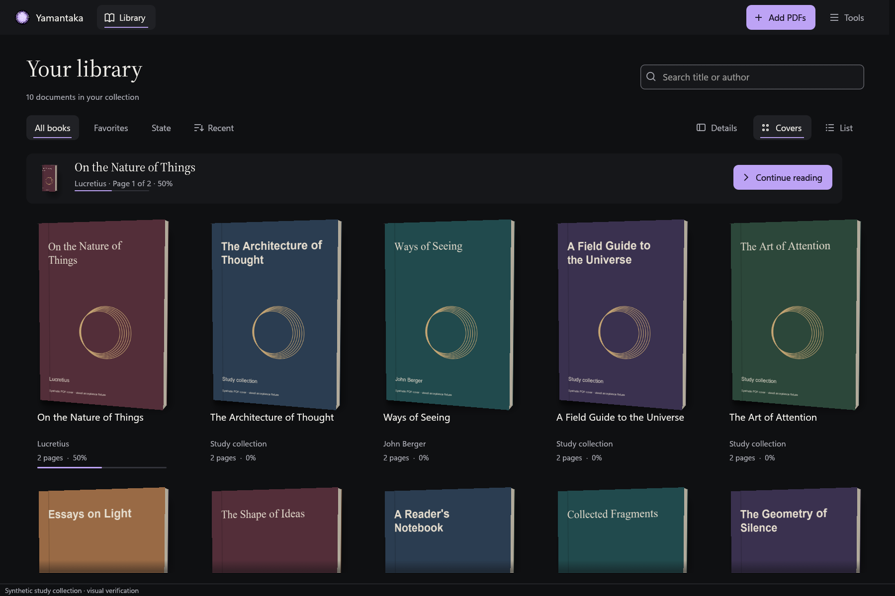

# Preserve background PDF handles and recover waiting covers

A native regression reproduced an ownership failure: with a reader open, a cover
request evicted the other PDF while metadata analysis was still using it. The
cover succeeded, but subsequent analysis no longer had its native document.
The regression failed before this correction and now passes.

## Native admission

Loaded native handles now retain their opening purpose. Cover work can reclaim
an unprotected warm reader handle, but it cannot reclaim a background analysis
or indexing handle. A third background open waits until a slot becomes available
instead of replacing an active background job. The two-handle limit still applies
before opening a temporary PDF.

Reader opening retains its higher priority and can reclaim a background handle.
This checkpoint prevents covers and other background opens from doing so. Existing
import and reanalysis fallbacks still apply if a reader preempts their handle;
fully resumable interrupted analysis remains pending.

Verified cached cover pixels can still be served while native slots are occupied.
The existing source, generation, page, and cache checks remain in place. When
native cover work needs an unavailable slot, it returns the typed
`NativeSlotsBusy` result rather than treating temporary capacity as a permanent
document failure.

## Event-driven cover retry

The application publishes a coalesced capacity revision after acknowledged reader,
import, reanalysis, and index closes, or after reader pin changes. This is a hint
that a slot may be usable, not a free-slot count.

A cover request captures that revision before submission. A capacity failure
keeps its slot eligible for retry when the revision changes. Capturing before
submission prevents a release between native failure and UI receipt from being
lost. Successful cover textures remain resident. Other document errors retain
their existing handling.

The retry does not add an idle repaint timer or a processing banner. It uses the
existing completion wakeups and retains document, source, generation, and
cancellation checks. Manual cover installation replaces the waiting request
through the existing ownership path.

Failed import opening or source capture now waits for the native close reply
before publishing its terminal failure. A held-close actor test proves that
catalogue queries still work during cleanup and that the capacity revision stays
unchanged until close succeeds. Cancellation and reanalysis share that cleanup
path.

## Verification

All 505 workspace tests passed, including 104 UI tests, with no ignored tests.
Formatting, all-target Clippy with warnings denied, and the application build
passed. Two new native tests verify cover refusal without background eviction,
successful retry after release, the original reader's text, a third background
open waiting for release, unchanged source bytes, and governed memory returning
to zero. The new actor test verifies the failed-import close barrier. Existing
native reanalysis coverage also checks that completed closure advances the
capacity revision.

Two native captures start with both slots pinned, then release those pins through
the application command path. In each capture, ten blocked covers become ten
native PDF textures without a library reload. The verifier reads an independent
synthetic SQLite store and confirms all ten automatic choices, source pages,
algorithm versions, retained progress, disabled indexing, and original PDF hashes.
The captures cover dark English and light Spanish with reduced motion.



The captures use the existing 3D book rendering, spine imagery, and interaction
code. This checkpoint changes admission and retry behavior, not the gallery's
visual composition.

```powershell
cargo test --workspace --locked --offline
cargo fmt --all --check
cargo clippy --workspace --all-targets --locked --offline -- -D warnings
cargo build -p yamantaka --locked --offline
./tool/capture_rust_ui.ps1 -OutputDirectory build/rust-visual/cover-capacity-final `
  -CaseNames cover-capacity-retry-dark,cover-capacity-retry-light-es
python tool/verify_rust_cover_capacity.py build/rust-visual/cover-capacity-final
```

The capture manifest binds images and control records to the executable and UI
source hashes. Published images include native synthetic provenance. Temporary
SQLite stores and generated PDF fixtures stay outside Git.

## Remaining acceptance

Import-time cover coordination, interrupted-analysis resumption, live source
revalidation, broader memory-pressure retry, device recovery, and cache cleanup
remain pending. The fixed ownership race does not establish complete metadata
accuracy or universal fluidity. Physical interaction and paired Flutter and Rust
Release performance traces remain outstanding.
