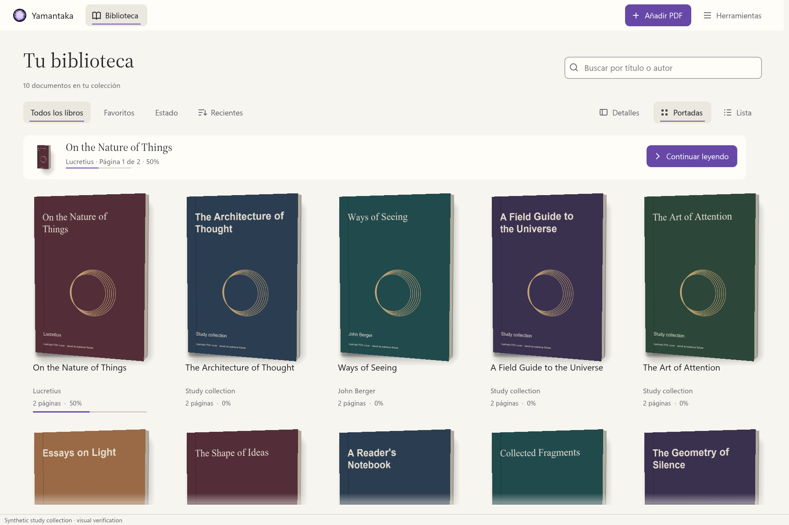

# Cover coordination during native capacity pressure

Date: 2026-10-16. Scope: pending cover work, import continuation, and cancellation
in the native Rust application. Whole-rewrite acceptance remains incomplete.

## Problem and behavior

Previously, a cover completion reporting `NativeSlotsBusy` ended its actor
request. The UI retained a capacity revision and submitted another request after
a release. A batch import could admit its next PDF before that UI round trip,
occupying the newly available native slot again.

`CoverJob` now owns the source, cancellation, generation, intent, and native work.
Library covers, picker previews, and automatic restoration share explicit start,
render, detection, and capacity-wait states. A capacity failure keeps the existing
admission reservation. It does not publish a terminal document error or schedule
a timer. Other failures remain scoped terminal results.

Waiting uses the capacity revision captured when native work was submitted. If a
release was already confirmed before a busy reply arrived, the job can retry
without waiting for another release. The actor handles up to two transitions per
job per pass, so a late busy reply can be followed by admission before the next
import starts. Each import still closes its native handle and commits the source
and metadata before the following file is admitted. Visible reader rendering
retains the native worker's existing higher priority.

After processing close replies, the actor advances ready cover jobs before
continuing successful imports. Search indexing also waits for admitted cover work.
This prevents the next background opening from taking the opportunity first.
Native detection itself still runs on the serialized PDF worker.

Library retries reread the saved choice, so a new manual selection wins while a
cover waits. Restoration retains the exact choice revision captured when it was
requested and rejects a newer decision. Previewing does not persist a choice.
The source and late-image checks from the previous checkpoint remain in use.

## Cancellation and ownership

A coalesced wake channel lets UI cancellation wake parked work without using a
command reservation or an idle poll. Native tickets retain their usual completion
barrier. At shutdown, parked and native cover jobs are cancelled and dropped
before joining the native owner. The existing 128 ordinary actor reservations
bound pending cover requests as well as their undrained terminal results.

The UI no longer keeps its own capacity-retry state. It owns visible texture slots
and request tokens. Filtering, replacing a selected cover, closing the picker,
and leaving its destination wake cancelled work. Closing an automatic restoration
also cancels its token and invalidates the resident cover so the next lookup uses
the persisted decision. An in-progress manual save retains its existing close
barrier.

The synthetic capacity capture now observes the actor's waiting count before
releasing two reader pins. Its ten requested covers then finish through their
original request tokens. The 3D books, PDF imagery, spines, physics, and visual
layout are preserved.

## Evidence

The initial regression failed before the implementation: a busy native result
was published as a terminal cover error. Its local log is
`build/verification/cover-coordination-before.log`.

New actor tests verify waiting without repeated native attempts, cancellation
without a capacity release, a release preceding a delayed busy reply, newer
manual choices during library and restore waits, preview retry without saving,
and bounded admission plus shutdown of 128 parked requests.

A separate integration test uses real PDFium with a protected reader handle and
a held front-matter reply from the first import. A real cover request encounters
both occupied slots. Releasing the analysis allows the first import to close and
commit; the test checks that the cover is submitted again before the second open
is admitted. Its native pixels complete while that second open is held, the
original reader still returns its text, cancellation closes the remaining import,
and all original PDF bytes and the zero-memory close condition are checked.

A UI ownership test verifies that restoration can be closed and drops its loading,
preview, and restoration scopes, while a manual save and unrelated token remain
uncancelled. Existing late-source, selection-race, storage rollback, and native
cover-cache tests remain enabled.

All 518 workspace tests passed, including 105 UI tests, with no ignored tests.
Formatting, all-target Clippy with warnings denied, and the native application
build passed. This checkpoint adds six cover-coordination tests, one real import
interleaving test, and one picker ownership test.

Thirteen fresh native cases passed their independent verifiers: two capacity
recovery cases, six picker cases, and five restoration cases. The set covers
dark/light, English/Spanish, reduced motion, 640×480 with 200% text, successful
saving, cancellation, and failed writes. Both capacity captures show ten parked
requests becoming ten resident native textures after release, with the expected
saved automatic decisions and original source hashes. Picker and restoration
verifiers also inspect independent synthetic SQLite stores and control bounds.



Published images retain synthetic provenance and exact native pixel chunks. The
full local capture sets are `build/rust-visual/cover-coordination-capacity-final`,
`build/rust-visual/cover-coordination-picker-final`, and
`build/rust-visual/cover-coordination-restore-final`.
The frozen development executable is
`build/verification/yamantaka-cover-coordination-final.exe`, SHA-256
`92F5A7AE73C7D49940E0B06E70E3DF5989627BBF210800FC19CE3ABB7030058F`.
It is not the final Windows Release bundle.

```powershell
cargo fmt --all --check
cargo clippy --workspace --all-targets --locked --offline -- -D warnings
cargo test --workspace --locked --offline
cargo build -p yamantaka --locked --offline
python tool/verify_rust_cover_capacity.py build/rust-visual/cover-coordination-capacity-final
python tool/verify_rust_cover_picker.py build/rust-visual/cover-coordination-picker-final build/verification/yamantaka-cover-coordination-final.exe
python tool/verify_rust_cover_restore.py build/rust-visual/cover-coordination-restore-final build/verification/yamantaka-cover-coordination-final.exe
```

Use the corresponding case names in `tool/capture_rust_ui.ps1` to regenerate the
capture sets after rebuilding. Capture manifests bind images and control records
to the executable, lockfile, and all 73 UI source files.

## Limits

This establishes admission order and ownership under the tested conditions, not a
latency improvement or universal smoothness claim. A single PDFium call can still
run until it returns. Fully resumable analysis after reader preemption, live disk
change invalidation, cache cleanup controls, physical accessibility, paired
Flutter/Rust performance runs, remaining parity, and the final Windows Release
bundle remain pending.
