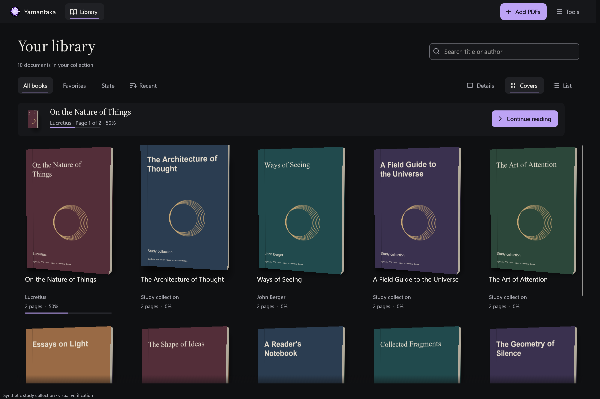

# Cover request source checks

Date: 2026-10-16. Scope: cover admission and late completion in the Rust
application. This is a development checkpoint, not whole-rewrite acceptance.

## Behavior

Previously, a visible cover request supplied a document ID and path. The actor
could read a newer fingerprint or page count from the catalogue and proceed with
that different source. A saved-page raster could also arrive after another cover
choice had been committed.

`CoverSource` now captures the displayed document's ID, path, fingerprint, page
count, and missing state. Library covers, picker previews, and automatic
restoration use this contract. The actor rejects a missing, deleted, or changed
catalogue entry before submitting native work. Detection and restoration check
the captured source again before completing their existing guarded writes.

`CoverFrame` retains the requested page and generation while native rendering is
pending. Before publishing pixels, it checks the source, cancellation, native
identity, page, generation, rotation, region, dimensions, and pixel length.
Library renders also retain the cover snapshot and reject a result if its saved
selection or source date changed. Snapshot read errors propagate as errors.
Picker previews do not freeze a saved choice because browsing pages does not
change that choice.

Resident library slots and book textures now include page count in their source
checks. A catalogue refresh invalidates mismatched textures and requests the
current source through the normal visible-cover path. The 3D mesh, spine imagery,
physics, and animation behavior are unchanged by this checkpoint.

## Verification

The initial regression reproduced native detection being admitted for an obsolete
visible fingerprint before the contract change. Its local failure log is
`build/verification/cover-frame-before.log`.

New actor tests use real PDFium pixels and held completion channels to verify:

- Obsolete visible fingerprints reject library, preview, and restore commands.
- Delayed library and preview rasters reject changed paths, fingerprints, page
  counts, and missing state without changing the saved cover.
- A newer manual choice survives a delayed raster for the old selection.
- Preview results reject a wrong native ID, page, generation, or rotation, and
  honor cancellation. A matching result succeeds without persisting a choice.
- A source marked missing during detection or restoration rejects completion
  without writing a new selection.

The new native tests assert governed memory returns to zero after owners close.
Tests that change catalogue source fields also compare the original PDF bytes.
Existing automatic-choice, manual-priority, cache-restart, restoration, rollback,
and cancellation coverage remains enabled.

All 510 workspace tests passed, including 104 UI tests, with no ignored tests.
Formatting, all-target Clippy with warnings denied, and the application build
passed. Five actor regressions were added.

Thirteen fresh native captures and their independent verifiers passed: two
capacity-recovery cases, six picker cases, and five restoration cases. These cover
both themes, Spanish and English, reduced motion, 640×480 with 200% text, saving,
cancellation, and rejected writes. Verifiers check executable/UI-source hashes,
control state and bounds, independent synthetic SQLite records, and fixture hashes.

The picker verifier had an outdated expectation that cancellation left no stored
cover. Returning to the library now runs automatic detection. The verifier now
requires automatic page 0 with algorithm 3 after cancellation, manual page 1 only
after saving, and no row after the simulated failed write. It does not accept a
manual selection created by cancelling.

The two published capacity captures retain synthetic provenance. The remaining
capture artifacts stay in the ignored verification directories.



Local capture directories are `build/rust-visual/cover-source-capacity-final`,
`build/rust-visual/cover-source-picker-final`, and
`build/rust-visual/cover-source-restore-final`. The frozen development executable
is `build/verification/yamantaka-cover-source-final.exe`, SHA-256
`F4B54490807DC3AAA9FE8EA9E4FE9AD026B50417265D7591A6D6FA7914E80AB7`.
It is not the final Release bundle.

```powershell
cargo fmt --all --check
cargo clippy --workspace --all-targets --locked --offline -- -D warnings
cargo test --workspace --locked --offline
cargo build -p yamantaka --locked --offline
python tool/verify_rust_cover_capacity.py build/rust-visual/cover-source-capacity-final
python tool/verify_rust_cover_picker.py build/rust-visual/cover-source-picker-final build/verification/yamantaka-cover-source-final.exe
python tool/verify_rust_cover_restore.py build/rust-visual/cover-source-restore-final build/verification/yamantaka-cover-source-final.exe
```

## Remaining work

These checks bind requests to catalogue state. They do not implement a filesystem
watcher or full-file identity validation for every resident texture. Live disk
change invalidation, small/large thumbnail parity, cache cleanup controls,
interrupted analysis resumption, and coordination of cover work with consecutive
imports remain pending. This checkpoint makes no new latency or throughput claim.
Physical DPI, Narrator, multiple monitors, paired Flutter/Rust performance runs,
remaining functional parity, and the final Windows release gates also remain open.
