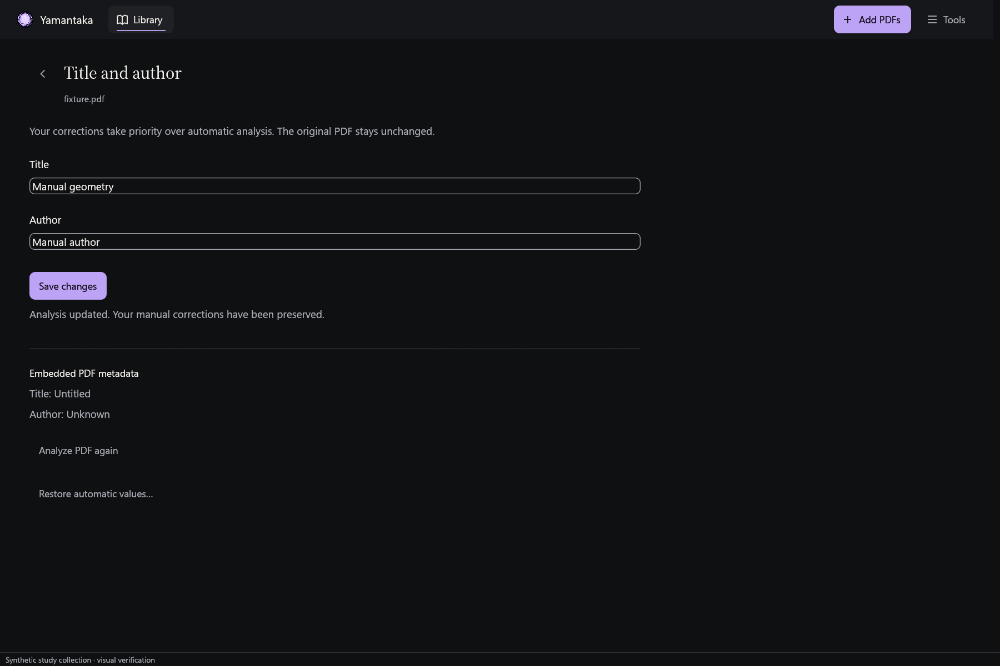

# Native metadata reanalysis

**Analyze PDF again** now runs from the title and author editor. It reuses the
background import analyzer, reads up to six opening pages, closes its temporary
native handle, and atomically replaces the stored analysis. The original PDF
remains unchanged.

The editor requires a saved draft before reanalysis. It keeps the current values
visible, offers cancellation during the operation, and accepts only the matching
terminal reply. Completion refreshes the catalogue and reports the analysis
result locally. A failed or cancelled operation retains the previous review.

## Preserve accepted values and manual decisions

Reanalysis compares the PDF text with the catalogue's accepted automatic values,
separately from manual overrides. Conflicting front matter becomes a proposal.
Missing or rejected automatic values can use native metadata and explicit
bylines under the existing conservative rules.

A native regression initially reproduced a loss of accepted automatic titles:
raw `Untitled` metadata caused a valid catalogue title to become the filename.
The analyzer now receives the prior automatic baseline. Storage also refuses an
analysis that would replace an accepted automatic value. The regression passes
and checks both retained values and conflicting title and author proposals.

Manual overrides remain untouched. Reanalysis does not copy a manual correction
into the automatic baseline, so explicitly resetting that override still works.
Fields with a manual override do not receive repeated review proposals, while
the auxiliary evidence retains the native analysis. Manual topic choices remain
intact. Old confidence columns are cleared because the new rules do not produce
calibrated probabilities.

## Source identity and atomic publication

Before work starts, the actor verifies the expected metadata revision and loads
the current catalogue document. Native opening and analysis use a temporary UUID
identity through the same background scheduling path as import. A real runtime
test reanalyzes while the original reader stays open, then reads that reader's
original text successfully.

The transaction checks the review revision again. Catalogue path, fingerprint,
page count, size, missing state, and modification time must match the captured
native source. Reanalysis requires a valid RFC 3339 catalogue timestamp and
rejects a source that needs revalidation.

Storage verifies canonical path, size, modification time, and the first 64 KiB
hash before writing and before commit. It reads back source identity, metadata,
overrides, and analysis records. Ignored writes, mutated paths or metadata,
evidence failures, and search failures roll back the replacement. Search refresh
obeys the current indexing consent and exclusions.

These checks use the existing bounded source stamp. They do not establish
full-file equality or exact-duplicate detection. Same-size edits outside the
sampled header that preserve modification time remain outside that guarantee.

If bounded analysis cannot finish, reanalysis leaves the previous evidence and
metadata unchanged. This differs from a new import, which can retain a valid
basic document with a redacted analysis failure state.

## Verification

All 502 workspace tests passed, including 104 UI tests, with no ignored tests.
Formatting, all-target Clippy with warnings denied, and the application build
passed. New native storage tests cover evidence replacement, manual metadata,
manual topics, confidence clearing, stale reviews, changed source bytes, ignored
writes, source mutation, evidence failures, and search failure rollback.

Three native actor tests cover an open reader, accepted automatic values,
bounded failure, scoped cancellation, unchanged import revisions, and durable
catalogue results. An editor state test covers unsaved drafts, cancellation
ownership, and the distinction between saving corrections and updating analysis.
Native lifecycle assertions return governed memory to zero after owners drop.

Five final native captures cover dark, light Spanish with reduced motion, manual
overrides, analysis work limits, and 640 by 480 with 200% text zoom. The verifier
checks their source hashes and horizontal control bounds, then opens their
isolated SQLite stores read-only. It confirms native evidence, retained automatic
and manual values, failure preservation, indexing consent, and unchanged hashes
for both synthetic PDFs. The compact form scrolls vertically.



```powershell
cargo test --workspace --locked --offline
cargo fmt --all --check
cargo clippy --workspace --all-targets --locked --offline -- -D warnings
cargo build -p yamantaka --locked --offline
python tool/verify_rust_metadata_reanalysis.py build/rust-visual/metadata-reanalysis-final `
  --source-hash-file build/verification/metadata-reanalysis-source-hashes.json
```

Capture generation uses the five `metadata-reanalysis-*` cases in
`tool/capture_rust_ui.ps1`. Record hashes for `front-matter-missing.pdf` and
`front-matter-work-limit.pdf` before capturing as a JSON array with `File` and
`Sha256` fields. The verifier uses the raw capture process IDs to locate the
unpublished synthetic stores. Published images retain native provenance and
their original hashes in the capture manifest.

## Remaining acceptance

Proposal source-page navigation, multi-line bibliographic analysis, OCR,
import-time cover coordination, and the wider file-revalidation flow remain
pending. Native calls still have their documented non-progressive boundaries.
Physical cancellation timing, keyboard and Narrator acceptance, complete
resource traces, paired Flutter and Rust Release performance measurements, and
the final release gates remain outstanding. These synthetic tests do not
establish universal metadata accuracy or frame-time guarantees.
