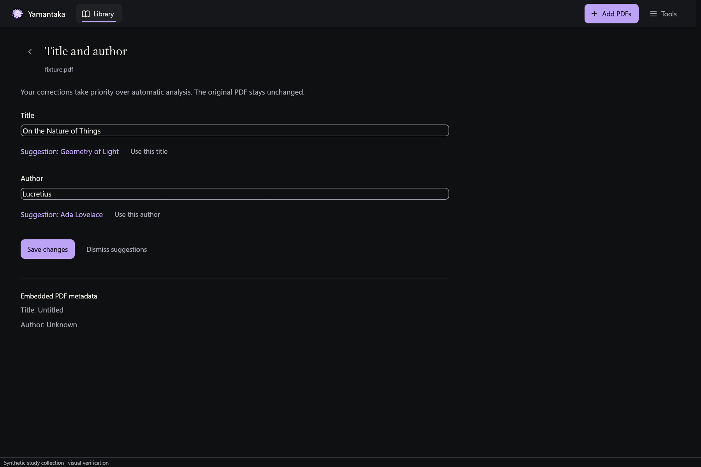

# Native title and author review

The book inspector now opens **Title and author**. The editor displays current
values, offers saved analysis proposals, and preserves embedded metadata as
read-only reference. Choosing a proposal changes the draft. **Save changes**
confirms the correction and stores manual overrides.

Manual overrides take priority over later extracted values. Saving leaves the
original source fields intact and clears reviewed proposals. **Dismiss
suggestions** clears proposals without changing the current values. **Restore
automatic values** has an inline confirmation, removes both manual overrides,
and returns to the catalogue's current automatic values. It does not rerun
PDF analysis.

## Persistence and request ownership

A bounded review query reads one metadata record, its enrichment decision, and
its saved evidence. The record is limited to 64 KiB before Rust deserialization.
A SHA-256 revision covers those stored values. A correction starts an immediate
SQLite transaction, rereads the record, and rejects an obsolete review.

New manual values support Unicode, normalize whitespace, and allow at most
512 characters per field. A title is required. An empty author is an explicit
manual choice that hides the source author. User-entered values do not pass
through the automatic placeholder rejection rules.

The same transaction writes overrides, clears reviewed suggestions, and updates
existing search titles and metadata when indexing is enabled. Excluded
documents remain excluded. Disabled indexing does not create search entries.
Complete metadata readback detects ignored or mutated writes before commit.
Source metadata, the analysis evidence, reading progress, favorite state, and
the manual cover remain intact.

Actor requests and replies retain document, cancellation, and operation identity.
The editor ignores obsolete replies and keeps its draft after a failed write.
It prevents duplicate writes while one is pending, then confirms a successful
save visibly. A scoped actor test reads and saves metadata while a native PDF
opening remains held, without submitting additional native work.

## Native presentation

The dedicated editor uses the existing graphite and ivory surfaces, editorial
heading, violet confirmation control, and labelled native text fields. It keeps
the PDF library available through the back control. Spanish and English action
labels are connected. Backend diagnostic details still use the shared English
failure messages; broader localized recovery messages remain pending.

The first capture round exposed a horizontal overflow at 640 by 480 with 200%
text zoom. The form now takes the available width, wraps its explanation, and
uses a compact heading and shorter explanation. The complete form scrolls
vertically at that size. The second round confirmed the correction and stopped
visual iteration.

Seven final captures cover dark, light Spanish with reduced motion, compact
200%, successful save, dismissal, reset, and failed save. Their custom-control
bounds stay inside the horizontal clip. Independent read-only SQLite queries
confirm each result. The failed-save capture retains the proposed draft while
the database still contains the prior values. All seven source PDF hashes match
the hash recorded before capture.



## Verification

All 495 workspace tests passed, including 103 UI tests, with no ignored tests.
The new coverage includes five SQLite regressions, one held-native-work actor
test, two editor ownership tests, and one manual-value validation test.
Formatting, all-target Clippy with warnings denied, and the application build
passed.

The capture manifest records the executable and UI source hashes. Published
images contain native synthetic provenance and preserve their original hashes
in that manifest. The independent verifier reads the temporary databases from
the raw capture process IDs; those stores are never published.

```powershell
cargo test --workspace --locked --offline
cargo fmt --all --check
cargo clippy --workspace --all-targets --locked --offline -- -D warnings
cargo build -p yamantaka --locked --offline
(Get-FileHash build/rust-fixtures/textual.pdf -Algorithm SHA256).Hash |
  Set-Content build/verification/metadata-review-source-sha.txt
./tool/capture_rust_ui.ps1 -OutputDirectory build/rust-visual/metadata-review-final `
  -CaseNames metadata-review-dark,metadata-review-light-es,metadata-review-small-200,metadata-review-saved,metadata-review-dismissed,metadata-review-reset,metadata-review-failed
python tool/verify_rust_metadata_review.py build/rust-visual/metadata-review-final `
  --source-hash-file build/verification/metadata-review-source-sha.txt
```

## Remaining acceptance

Reanalysis controls, proposal source-page navigation, multi-line bibliographic
analysis, OCR, and import-time cover coordination remain pending. Physical
keyboard, Narrator, monitor DPI, and broader interaction acceptance are not
certified by these captures. This checkpoint does not establish universal
metadata accuracy or complete the rewrite's performance and release gates.
